# Candela — a composable grammar for physically based rendering

> *Working name.* A fluent JavaScript API for describing **scenes** and the **engines** that render them. It is built on radiometry, scattering theory and Monte Carlo light transport, so the physics constrains the API: units are types, energy conservation is checked, and the parts compose because the underlying maths does.

**How to read this document**

| Part | What it covers |
| --- | --- |
| **I. From physics to grammar** | The equations, and how each term becomes a noun in the API. Short, but everything later depends on it. |
| **II. Architecture on one page** | Three *stages* (build, trace, run), two *modes* (graph, live), proxies, and fragments. |
| **III. Examples L0 → L18** | The main part: from one sphere to an agent lighting a product shot, then a full configurator. |
| **Appendices** | The grammar in compact form, the diagnostic codes, and further reading. |

All code is plain JavaScript (ES modules, top-level `await`). The library is hypothetical, so printed outputs (diagnostics, IR dumps, agent results) are illustrative. **The physics numbers are real:** every unit conversion, exposure value, refractive index and furnace-test albedo was computed, not invented.

---

## Contents

- [Part I — From physics to grammar](#part-i--from-physics-to-grammar)
- [Part II — Architecture on one page](#part-ii--architecture-on-one-page)
- [Part III — Examples](#part-iii--examples)
  - [L0 Hello, sphere](#l0--hello-sphere)
  - [L1 Builders are values; the IR comes free](#l1--builders-are-values-the-ir-comes-free)
  - [L2 Diagnostics](#l2--diagnostics-the-proxies-at-work)
  - [L3 Light in real units, the camera as an instrument](#l3--light-in-real-units-the-camera-as-an-instrument)
  - [L4 Parameters and sliders](#l4--parameters-and-sliders)
  - [L5 Patterns: traced lambdas](#l5--patterns-traced-lambdas-and-staging)
  - [L6 The scattering algebra](#l6--the-scattering-algebra)
  - [L7 Physical tests as code](#l7--physical-tests-as-code)
  - [L8 Build-time generators](#l8--build-time-generators)
  - [L9 Fragments](#l9--fragments-extending-components)
  - [L10 Participating media](#l10--participating-media)
  - [L11 Spectral rendering](#l11--spectral-rendering)
  - [L12 Engines: integrators and render graphs](#l12--engines-integrators-and-render-graphs)
  - [L13 Write your own integrator](#l13--write-your-own-integrator)
  - [L14 The IR: inspect, rewrite, diff, cache](#l14--the-ir-inspect-rewrite-diff-cache)
  - [L15 Live mode: mutations, transactions, behaviours](#l15--live-mode-mutations-transactions-behaviours)
  - [L16 Agents in the loop](#l16--agents-in-the-loop)
  - [L17 Inverse rendering](#l17--inverse-rendering)
  - [L18 Capstone: a product configurator](#l18--capstone-a-product-configurator)
- [Appendix A — The grammar](#appendix-a--the-grammar)
- [Appendix B — Diagnostic codes](#appendix-b--diagnostic-codes)
- [Appendix C — Further reading](#appendix-c--further-reading)

---

## Part I — From physics to grammar

### 1. One equation, seven nouns

A physically based renderer exists to estimate one quantity: what a sensor pixel `j` records. That is the **measurement equation**, and inside it sits the **rendering equation**:

```text
                     sensor response           radiance arriving at the lens
  I_j  =  ∫_A ∫_Ω ∫_T ∫_Λ   W_j(x,ω,t,λ)   ·   L_i(x,ω,t,λ)   |cos θ|  dλ dt dω dA         (measurement)

  L_o(x,ωo)  =  L_e(x,ωo)  +  ∫_{S²}  f_s(x,ωi,ωo)  ·  L_i(x,ωi)  ·  |n·ωi|  dωi              (rendering)
                └emission┘            └scattering┘     └transport┘   └geometry┘
```

In participating media (fog, skin, smoke) the surface integral is joined by the **radiative transfer equation**:

```text
  (ω·∇) L(x,ω)  =  −σt(x) L(x,ω)  +  σs(x) ∫_{S²} p(ω,ω') L(x,ω') dω'  +  σa(x) L_e(x,ω)
                   └ extinction ┘    └──────── in-scattering ────────┘    └ emission ┘
```

Each term becomes one noun in the grammar. Nothing else is primitive.

```text
 term in the equations          noun            the question it answers
 ─────────────────────────────  ──────────────  ─────────────────────────────────────────────
 x, n, dA                       Shape           where is matter? (surfaces, instances)
 f_s(x, ωi, ωo)                 Surface (BSDF)  how does a boundary redirect light?
 σa, σs, p(ω,ω')                Medium          how does light travel *through* matter?
 L_e                            Light           where does energy enter the system?
 W_j(x, ω, t, λ)                Camera          how is radiance turned into pixel values?
 ∫ … ≈ Monte Carlo estimate     Integrator      how do we approximate the integrals?
 any value varying over x,λ,t   Field           how does a quantity vary in space/spectrum/time?
```

Two more nouns organise the work without being physics: **Param**, a named knob that becomes a slider, and **Engine**, which is integrator + passes + backend. One meta-noun, **Fragment**, extends any of the others.

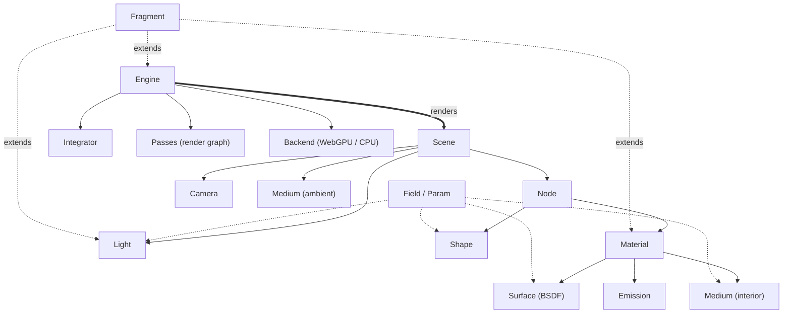

### 2. Units are types

Light is energy, and the API treats its units as types. Radiometric quantities are measured in watts. Photometric quantities are the same quantities weighted by the eye's luminous efficiency `V(λ)` and scaled by `K_m = 683 lm/W`.

| Quantity | Definition | Radiometric | Photometric | Constructor |
| --- | --- | --- | --- | --- |
| Flux (power) | `Φ` | W | lumen, `lm` | `u.lm(800)` |
| Intensity | `I = dΦ/dω` | W/sr | candela, `cd = lm/sr` | `u.cd(64)` |
| Irradiance | `E = dΦ/dA` | W/m² | lux, `lx = lm/m²` | `u.lux(500)` |
| Radiance | `L = d²Φ / (dA cosθ dω)` | W/(m²·sr) | nit, `cd/m²` | `u.nit(1000)` |
| Reflectance | `ρ = dΦ_out / dΦ_in` | dimensionless, **bounded [0, 1]** | same | `0.18`, `'#c8553d'` |

The geometry of an emitter decides how one quantity converts into another, and the API does these conversions for you:

```text
  isotropic point light       I = Φ / 4π                 800 lm   →    63.66 cd
  spot, cone half-angle θ     I = Φ / 2π(1 − cos θ)      1200 lm @ 20° → 3167 cd   (power focused into the cone)
  one-sided Lambertian area   L = Φ / (π A)              3000 lm, 1 × 0.5 m → 1909.9 nit
  directional (sun)           specify E⊥ (lux) directly  power is meaningless for an infinitely distant source
```

Colours also carry a **role**: `reflectance` (bounded), `transmittance` (bounded) or `illuminant` (unbounded). The role decides how an RGB triple becomes a spectrum (bounded versus unbounded upsampling) and which checks apply. An "emission colour" of `(4, 4, 4)` is fine. An albedo of `(4, 4, 4)` creates energy.

### 3. Scattering has an algebra

A BSDF `f_s` is physically valid when it satisfies three invariants:

```text
  positivity      f_s(ωi, ωo) ≥ 0
  reciprocity     f_s(ωi, ωo) = f_s(ωo, ωi)                         (Helmholtz; refraction picks up an η² factor)
  conservation    ρ(ωo) = ∫ f_s(ωi, ωo) |cos θi| dωi ≤ 1   ∀ ωo        (directional albedo)
```

The API is designed so that **the combinators preserve these invariants by construction**, or check them where construction cannot guarantee it:

| Combinator | Meaning | Energy conserving? |
| --- | --- | --- |
| `bsdf.mix(a, b, t)` | `(1−t)·a + t·b`, `t ∈ [0,1]` | ✅ always: a convex combination of valid BSDFs is valid |
| `a.scale(k)` | `k·a`, `k ∈ [0,1]` | ✅ always |
| `bsdf.layer(top, bottom, …)` | top reflects `F(θ)`; bottom is seen through `(1−F(θi))(1−F(θo))·T` | ✅ by construction (Fresnel-coupled) |
| `bsdf.add(a, b)` | `a + b` | ⚠️ only if `ρa + ρb ≤ 1`, so it is **checked** (W420) |

The leaves of the algebra are a handful of physical models:

```text
  lambert(ρ)                  f = ρ / π

  microfacet (Cook–Torrance)  f = D(h) · G₂(ωi,ωo) · F(ωo·h) / (4 |n·ωi| |n·ωo|)
     GGX distribution         D(h) = α² / (π ((n·h)²(α²−1) + 1)²)          α = roughness²  (perceptual remap)
     Smith, height-correlated G₂ = 1 / (1 + Λ(ωi) + Λ(ωo)),   Λ(ω) = (−1 + √(1 + α² tan²θ)) / 2
     dielectric Fresnel       F0 = ((η−1)/(η+1))²   →  0.04 at η = 1.5;   Schlick: F ≈ F0 + (1−F0)(1−cos θ)⁵
     conductor Fresnel        complex IOR η + ik:    F0 = ((η−1)² + k²) / ((η+1)² + k²)
```

The popular "metallic/roughness" uber-material is **not a primitive**. It is sugar over the algebra: `mix(layer(dielectric, lambert(base)), conductor(F0 = base), metallic)`. L6 shows its full definition in eight lines.

### 4. Media in two numbers

```text
  σt = σa + σs                          extinction = absorption + scattering        [m⁻¹]
  T(t) = exp(−∫₀ᵗ σt(s) ds)              transmittance (Beer–Lambert)
  α_ss = σs / σt,   ℓ = 1 / σt          single-scattering albedo, mean free path     ← what artists set
  p_HG(cos θ) = (1/4π) · (1 − g²) / (1 + g² − 2g cos θ)^{3/2}                         Henyey–Greenstein phase, g ∈ (−1, 1)
```

### 5. Monte Carlo is the engine

Every integrator is an **estimator** of an integral:

```text
  ⟨I⟩_N = (1/N) Σ_k f(X_k) / p(X_k)          unbiased if p > 0 wherever f ≠ 0;  RMS error ∝ σ / √N

  importance sampling      choose p ∝ f (BSDF sampling, light sampling, environment sampling)
  MIS (power heuristic)    w_a = p_a² / (p_a² + p_b²)     combine strategies; each wins where the other is weak
  Russian roulette         continue with probability q, divide the weight by q  →  still unbiased
```

Two consequences shape the API:

- **Integrators are just kernels.** If the grammar exposes `intersect`, `bsdf.sample`, `lights.sample` and `mis`, users can write their own path tracer (L13).
- **Light transport is linear in emission.** The radiance at a pixel is `Σ_j Φ_j · (response to light j at 1 unit)`. This lets an agent relight a scene by superposition without re-rendering (L16).

### 6. The sensor closes the loop

```text
  thin lens         1/f = 1/z_o + 1/z_i,   aperture diameter A = f / N
  exposure          EV100 = log₂(N² / t) − log₂(S / 100)          f/16, 1/125 s, ISO 100  →  EV100 = 14.97  ("sunny 16")
  saturation        L_max = 1.2 · 2^EV100   (scene luminance that clips the sensor; exposure scale = 1 / L_max)
  reflected meter   EV100 = log₂(L · S / K),  K = 12.5
  time, aperture    motion blur and depth of field are not effects; they are the ∫_T and ∫_A in the measurement equation
  display           scene-referred radiance → tone map (AgX, ACES, PBR Neutral) → display encoding (sRGB, P3, PQ)
```

### 7. Invariants the API enforces

| Invariant | Where it is checked | Code |
| --- | --- | --- |
| Units and dimensions match (`lm` is not `cd`) | build: proxy argument check | E120 |
| Reflectance within `[0, 1]`; plausible within `[0.03, 0.90]` | build for constants, debug runtime for fields | E121, W330 |
| Composed BSDFs conserve energy | compile: albedo tables or Monte Carlo | W420 |
| Lens f-number ≥ 0.5 (the limit in air) | build | E123 |
| No JS arithmetic or branching on symbolic values | trace: `Symbol.toPrimitive` trap | E201, E202 |
| Build lambdas are deterministic | build: `Math.random` interception | W501 |
| Spectral data rendered by an RGB engine | compile | W610 |
| Every component has a lowering for the chosen backend | compile | E710 |

---

## Part II — Architecture on one page

### Three stages

Every lambda you pass runs in exactly **one** of three stages. The *component that receives it* decides which, not you.

| Stage | When it runs | What the lambda receives | What it produces | Components that take one |
| --- | --- | --- | --- | --- |
| **① build** | once, eagerly, while the scene is described | plain JS values and a seeded `rng` | structure (builders) | `scene.group(fn)`, `scatter({ place })`, `engine.graph(fn)`, `param.build(fn)`, fragment `methods` |
| **② trace** | once per compile, **symbolically** | Proxy-wrapped symbols (`p.uv`, `p.N`, `ray`) | a typed expression DAG, compiled to WGSL or JS | `fx.pattern`, `fx.field`, attribute lambdas, `integrator.define`, fragment `lower` |
| **③ run** | on the host, per frame, event or param change | live handles and real numbers | mutations (patches) | `.behavior`, `world.on`, `param.map`, agents, `optimize({ onStep })` |

> **The staging rule: JavaScript is the macro language of the shader.** Inside a traced lambda, *JS values are compile-time constants* and *proxies are run-time values*. A `for` loop over a JS number unrolls. An `if` on a JS boolean specialises the code. Only `fx.select`, `fx.when` and `fx.loop` branch at run time. Static params arrive as JS values; dynamic params arrive as symbols.

Traced expressions are **stage-polymorphic**. The same `fx.pattern` can run in a GPU shader (shading), on the CPU at build time (driving scatter density), be baked into a texture (an optimiser decision), or be evaluated with interval arithmetic (to bound a volume's majorant).

### Two modes

- **Graph mode (declarative).** Builders produce an **immutable, hash-consed, typed DAG**, the IR. It is then validated, lowered, optimised and compiled. Use it for scenes, engines, offline renders, caching and diffing.
- **Live mode (direct).** `engine.run(scene)` returns a `World` whose handles are mutable proxies. Each assignment becomes a **patch**, classified by cost: value (a uniform write), transform (a BVH refit), specialisation (a cached kernel variant) or structure (an incremental recompile). Use it for apps, games and agents.

Both modes share one IR. A world is a graph plus state, a patch is a graph diff, and `fork()` costs O(1) through copy-on-write.

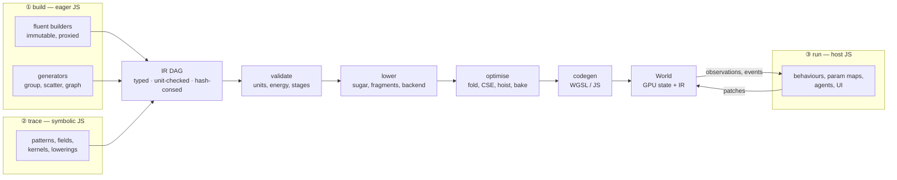

### Proxies: four kinds, one purpose

Each kind of proxy turns misuse into a diagnostic at the point of misuse, carrying the caller's source location.

| Proxy | Traps used | What it catches or enables |
| --- | --- | --- |
| **Builder** | `get`, `apply` | unknown methods with *did-you-mean*; argument types, units and ranges; call-site capture for later compile errors |
| **Symbolic** (trace stage) | `get`, `Symbol.toPrimitive` | swizzles (`p.P.xz`, `c.rgb`); JS arithmetic or comparison on a symbol (E201, E202) |
| **Live handle** (run stage) | `get`, `set` | reads return current values; writes become validated patches; `$('#id')`, `$$('.tag')` |
| **Agent facade** | same as live | identical checks, but errors are **returned as data** with suggestions instead of thrown |

One honest limit: **truthiness cannot be trapped.** `if (P.coat)` is always true because `P.coat` is an object. The API therefore offers `P.coat.select(a, b)`, and the bundled lint rule flags the pattern.

### Fragments

A fragment is a named, reusable extension aimed at one or more component kinds. It can contribute any of:

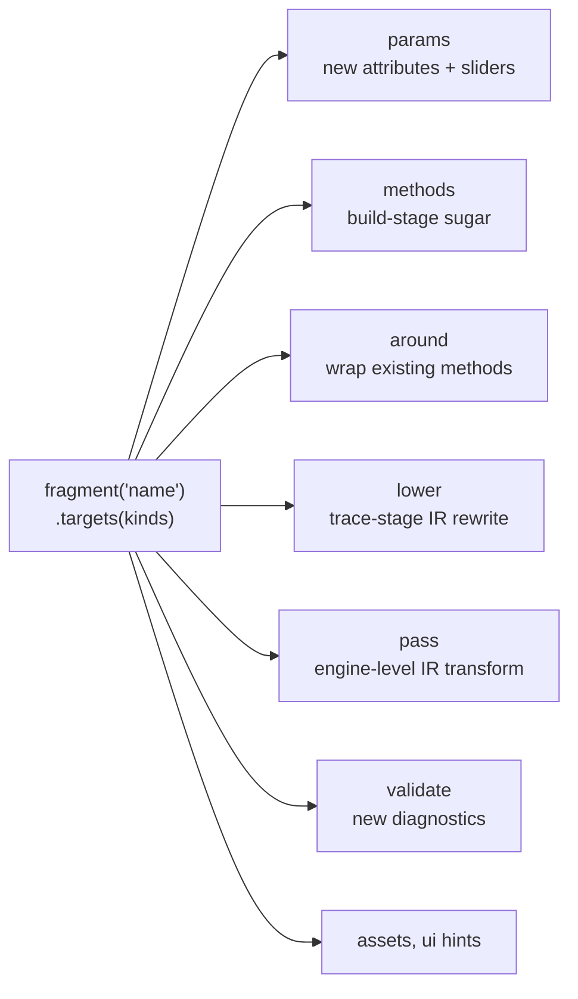

Apply a fragment locally with `.with(fragment)`, which affects that builder and everything derived from it, or globally with `candela.use(fragment)`. Fragments are part of a node's hash, so the same component with and without a fragment caches separately.

---
## Part III — Examples

Each level adds one idea. From L1 on, assume:

```js
import candela, {
  scene, shape, material, bsdf, ior, light, medium, phase, camera, engine, integrator, pass,
  fx, param, params, fragment, lift, ui, units as u,
} from 'candela';
```

---

### L0 — Hello, sphere

```js
import { scene, shape, material, light, camera, units as u } from 'candela';

const s = scene()
  .add(shape.sphere(1)
    .material(material.pbr().baseColor('#c8553d').roughness(0.4)))
  .add(shape.plane(20).at(0, -1, 0)
    .material(material.pbr().baseColor(0.18)))                 // an 18 % grey card
  .light(light.daylight({ elevation: u.deg(40), turbidity: 3 }))  // sun + physical sky
  .camera(camera.thinLens().at(0, 0.6, 5).lookAt(0, 0, 0));

await s.render('#view');   // compile and run with a device-appropriate default engine
```

**Points to notice**

- Every call returns a **new immutable builder**, so `s` is a value you can pass around.
- `'#c8553d'` is an sRGB-*encoded* hex value and is decoded to linear. A bare `0.18` is a linear reflectance.
- Anything you did not specify gets a physically plausible default, and **defaults are announced** rather than silent:

```js
console.log(s.explain());
```

```text
scene#7f3a · 5 nodes · 0 params · units: SI, photometric
├─ camera   thinLens 50 mm · f/8 · 1/125 s · ISO 100            ⓘ default lens, sensor 36×24 mm
│           exposure: auto → metered from scene                  ⓘ set .exposure(ev) to lock it
├─ light    daylight  sun 40° · turbidity 3 → sun + sky
├─ node     sphere r=1     material.pbr  (base #c8553d, roughness 0.4)
├─ node     plane 20×20    material.pbr  (base 0.18)
└─ engine   auto → realtime (WebGPU available) · tone map AgX · display sRGB
```

---

### L1 — Builders are values; the IR comes free

```js
const plastic = material.pbr().roughness(0.35);
const red  = plastic.baseColor('#b3261e');
const blue = plastic.baseColor('#1e4bb3');
// `plastic` is unchanged. `red` and `blue` share every IR node except the colour constant.

const ball = shape.sphere(0.5);
const s = scene()
  .add(ball.material(red).at(-0.6, 0, 0))
  .add(ball.material(blue).at(0.6, 0, 0));   // same geometry node → instanced automatically

console.log(red.ir().print());
console.log(red.ir({ optimize: true }).print());
```

```text
material.pbr#a91c   (sugar → lowered)
mix  t = metallic = 0
├─ layer  coupling = fresnel
│  ├─ dielectric        f0 = 0.08 · specular = 0.04    α = 0.35² = 0.1225
│  └─ lambert           ρ = srgb(#b3261e) → linear(0.451, 0.019, 0.013)
└─ conductor.schlick    F0 = ρ (shared node)           α = 0.1225 (shared node)

after optimise: mix(t = 0) folded → layer(dielectric, lambert)        nodes 7 → 4
```

The IR is a **DAG, not a tree**. Equal sub-expressions are hash-consed into one node, which gives structural sharing between builders, automatic instancing and cache keys at no extra cost:

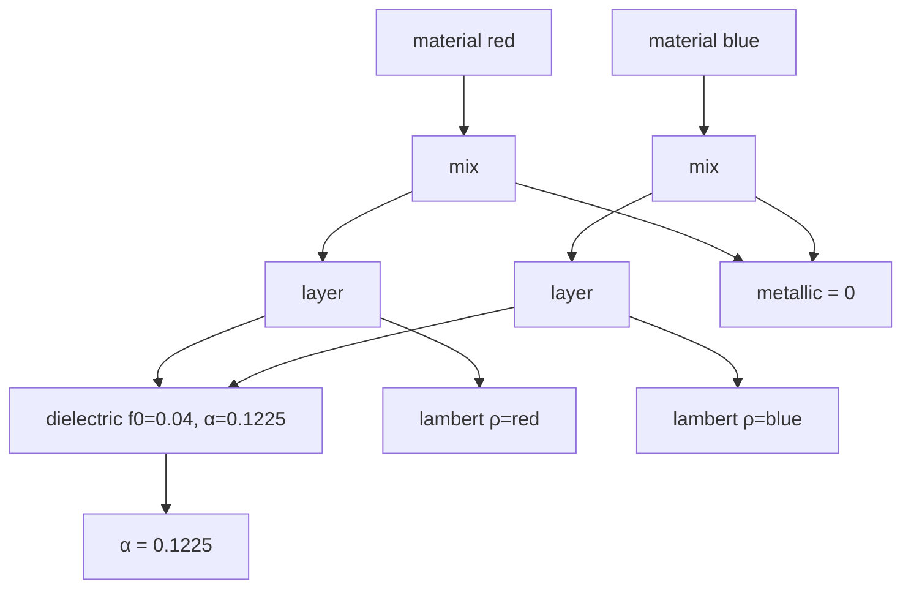

---

### L2 — Diagnostics: the proxies at work

Each line below is a separate mistake:

```js
material.pbr().roughnes(0.4);                 // typo
material.pbr().roughness(1.4);                // out of range
material.pbr().baseColor(1.0);                // a perfect white reflector does not exist
light.point().intensity(u.lm(800));           // wrong unit for the quantity
material.glass({ ior: 0.67 });                // relative IOR < 1 with no interface declared
camera.thinLens().fstop(0.4);                 // impossible lens in air
```

```text
✖ E104  material.pbr().roughnes(…)                                    scene.js:1:16
        'roughnes' is not an attribute of Material<pbr>. Did you mean 'roughness'?
        attributes: baseColor metallic roughness specular coat coatRoughness normal emission …

✖ E121  material.pbr().roughness(1.4)                                 scene.js:2:16
        roughness ∈ [0, 1] (perceptual; α = roughness²). Got 1.4.

⚠ W330  material.pbr().baseColor(1.0)                                 scene.js:3:16
        albedo 1.00 is outside the measured range of real materials [0.03 charcoal … 0.90 fresh snow].
        A perfect reflector makes indirect light converge slowly and look flat. Use ≤ 0.9, or .unchecked().

✖ E120  light.point().intensity(800 lm)                               scene.js:4:15
        intensity expects luminous intensity [cd = lm/sr]; got luminous flux [lm].
        → .power(u.lm(800))           (isotropic: I = Φ/4π = 63.66 cd)
        → .intensity(u.cd(63.66))

⚠ W340  material.glass({ ior: 0.67 })                                 scene.js:5:10
        ior < 1 describes a *relative* index (e.g. glass→water). Declare the outside medium:
        → material.glass({ ior: 1.5 }).exterior(medium.water())       (relative 1.5/1.33 = 1.13)

✖ E123  camera.thinLens().fstop(0.4)                                  scene.js:6:19
        N ≥ 0.5 for any lens in air (Abbe sine condition: N = 1 / (2 n sin θ_max)).
```

Errors surface **as early as possible**. Argument errors throw immediately, with a stack pointing at your code. Problems that span several nodes, such as energy conservation or a missing backend lowering, are collected at compile time and still point back to the builder call that created the node, because every node records its `loc`.

```js
const report = s.check();              // never throws: { errors, warnings, infos }
report.warnings.map(w => w.code);      // → ['W330']

candela.config({ diagnostics: 'strict' });   // warnings become errors (CI)
material.pbr().baseColor(1.0).unchecked();   // explicit opt-out, recorded in the IR
```

---

### L3 — Light in real units, the camera as an instrument

**Outdoors.** Photometric units with real-world magnitudes:

```js
const outdoor = scene({ units: 'photometric' })
  .add(shape.mesh('statue.glb').material(material.pbr().baseColor(0.55).roughness(0.6)))
  .light(light.sun().elevation(u.deg(55)).azimuth(u.deg(140)).illuminance(u.lux(100_000)))
  .light(light.sky.physical().fromSun())      // sky radiance consistent with the sun above
  .camera(camera.thinLens().focal(u.mm(35)).fstop(16).shutter(1 / 125).iso(100));   // "sunny 16"

outdoor.camera().ev100;    // → 14.97     log₂(16² · 125) − log₂(100/100)
outdoor.camera().lMax;     // → 38 400 nit  (1.2 · 2^14.97 = 1.2 · 32 000): scene luminance that just clips
```

**Indoors.** Each emitter is specified in the quantity that is natural for it, and the API converts using the emitter's geometry:

```js
const bulb = light.point().power(u.lm(800)).temperature(u.K(2700));   // ≈ 60 W incandescent equivalent
bulb.intensity();        // → 63.66 cd        Φ / 4π

const spot = light.spot().power(u.lm(1200)).cone(u.deg(20)).softEdge(u.deg(4));
spot.intensity();        // → 3167 cd         Φ / 2π(1 − cos 20°): the reflector focuses the flux
spot.powerMode('masked').intensity();   // → 95.5 cd   a point light with a mask: flux outside the cone is lost

const panel = shape.rect(1, 0.5).emit(light.area().power(u.lm(3000)).temperature(u.K(4000)));
panel.emission().luminance();   // → 1909.9 nit   Φ / πA, one-sided Lambertian

const interior = scene()
  .add(shape.mesh('room.glb'), panel.at(0, 2.6, 0).rotateX(u.deg(90)), bulb.at(1, 2.2, 0))
  .camera(camera.thinLens().focal(u.mm(24)).fstop(2.8).shutter(1 / 60).iso(800));   // EV100 = 5.88
```

**The camera as an instrument.** Once a scene is running you can take readings like a gaffer with a light meter:

```js
const world = await engine.preview().run(interior);

world.meter.incident({ at: [0, 0.75, 0], normal: [0, 1, 0] });   // → lux on the desk
world.meter.reflected('#painting');                              // → nit, plus EV100 = log₂(L · S / K), K = 12.5
interior.camera().exposure('meter:#painting');                   // lock exposure to the reading
```

```text
✖ E120  light.sun().power(100000 lm)
        a directional emitter has no finite power (it is infinitely distant).
        Specify illuminance at normal incidence: .illuminance(u.lux(100_000)).
```

---

### L4 — Parameters and sliders

Params are **typed, unit-aware DAG leaves**. Use them anywhere a value is accepted. Changing one does not change the graph's topology, so dragging a slider costs a uniform write rather than a recompile.

```js
import { param, params, ui } from 'candela';

const P = params({
  sun:   param.angle(u.deg(35)).range(u.deg(-6), u.deg(90)).label('Sun elevation'),
  paint: param.color('#b01818').role('reflectance'),
  gloss: param.float(0.65).range(0, 1).step(0.01),
  bulb:  param.lumen(800).range(0, 3000).scale('log'),
  cct:   param.kelvin(2700).range(1800, 6500),          // the UI draws a blackbody gradient
  ev:    param.ev(14).range(-2, 18),
  coat:  param.bool(true).static(),                     // specialisation constant
  look:  param.choice(['studio', 'dusk', 'night']).static(),
});

// Stage ③ host map: runs on the CPU only when `sun` changes, and feeds a uniform.
// Kasten–Young air mass + Meinel attenuation: a decent first-order model of direct sunlight.
function directNormalLux(elevation) {
  const e = elevation.deg;
  if (e <= 0) return 0;
  const z = 90 - e;
  const airMass = 1 / (Math.cos(z * Math.PI / 180) + 0.50572 * (96.07995 - z) ** -1.6364);
  return 128_000 * 0.7 ** (airMass ** 0.678);   // ≈ 89.6 klx at zenith, 72.4 at 30°, 52.9 at 15°, 22.6 at 5°
}

const s = scene().params(P)
  .add(shape.mesh('car.glb').material(material.pbr()
    .baseColor(P.paint)
    .roughness(P.gloss.map(g => 1 - g))                // host map: cheap
    .coat(P.coat.select(1, 0))))                       // static: false ⇒ no coat code is emitted at all
  .add(light.point().id('lamp').power(P.bulb).temperature(P.cct).at(0, 2.5, 0))
  .light(light.sun().elevation(P.sun).illuminance(P.sun.map(directNormalLux)))
  .light(light.sky.physical().fromSun())
  .camera(camera.thinLens().exposure(P.ev));

ui.panel(P, {
  groups: { Sun: ['sun'], Car: ['paint', 'gloss', 'coat'], Interior: ['bulb', 'cct'], Camera: ['ev', 'look'] },
}).mount('#controls');

P.bindURL();                      // ?sun=35deg&paint=%23b01818&…  shareable state
const preset = P.snapshot();      // JSON with units
P.load(preset);
```

**Dynamic versus static params.** This is the same distinction as uniforms versus specialisation constants:

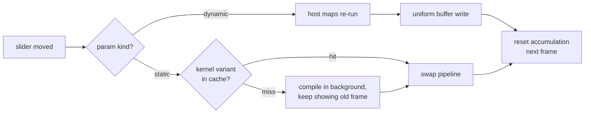

> **Truthiness trap.** `.coat(P.coat ? 1 : 0)` would *always* pick `1`, because a param handle is an object and proxies cannot intercept truthiness. Use `P.coat.select(1, 0)`. The lint rule `candela/no-param-truthiness` catches this.

---

### L5 — Patterns: traced lambdas and staging

A **pattern** is a field over the shading context. Its lambda is called **once**, with symbolic proxies. Every operation records a node, and the result is type-checked and compiled into the shader.

```js
import { fx } from 'candela';

const tiles = fx.pattern(p => {
  const cell = p.uv.mul(8).floor();
  const odd  = cell.x.add(cell.y).mod(2);                       // 0 or 1, symbolic
  return fx.mix(fx.color('#e8e4da'), fx.color('#2b2b2b'), odd);
});

const grime = fx.pattern(p =>
  fx.noise.fbm(p.P.mul(3), { octaves: 5 }).smoothstep(0.45, 0.75));

const floor = material.pbr()
  .baseColor(tiles.mul(grime.oneMinus().mul(0.35).add(0.65)))  // grime darkens by up to 35 %
  .roughness(fx.mix(0.12, 0.7, grime));                         // fields compose like values
```

**Inline lambdas** work wherever a field is accepted. The context exposes `P, N, Ng, uv, wo, lambda, time, instance, curvature`, and swizzles come from the proxy (`p.P.xz`, `c.rgb`, `v.zyx`):

```js
const snow = fx.color(0.85), rock = fx.color('#5a5550');

const alpine = material.pbr()
  .baseColor(p => fx.mix(rock, snow, p.N.y.smoothstep(0.6, 0.8).mul(p.P.y.gt(1200).select(1, 0))))
  .roughness(p => fx.noise.perlin(p.P.xz.mul(0.05)).remap(-1, 1, 0.5, 0.9));
```

**Staging: JS is the macro language.** Below, `octaves`, `gain` and `ridged` are compile-time constants. The `for` loop unrolls and the `if` specialises; no branch reaches the shader:

```js
const terrainNoise = ({ octaves = 6, lacunarity = 2, gain = 0.5, ridged = false } = {}) =>
  fx.pattern(p => {
    let sum = fx.float(0), amp = 0.5, freq = 1;
    for (let i = 0; i < octaves; i++) {               // unrolled at trace time
      let n = fx.noise.perlin(p.P.mul(freq));
      if (ridged) n = n.abs().oneMinus().pow(2);      // compile-time branch
      sum = sum.add(n.mul(amp));                      // `let` rebinding = SSA for free
      amp *= gain;                                    // plain JS arithmetic on plain JS numbers
      freq *= lacunarity;
    }
    return sum;
  });

const mountains = terrainNoise({ octaves: 8, ridged: true });   // a different kernel from terrainNoise()
```

**Stage errors.** The symbolic proxy traps `Symbol.toPrimitive`, so any attempt to treat a symbol as a JS number fails loudly and explains why:

```js
fx.pattern(p => Math.sin(p.uv.x * 10));
fx.pattern(p => (p.N.y > 0.7 ? snow : rock));
```

```text
✖ E201  symbolic Float used as a JS number (operator `*`)              terrain.js:1:33
        `p.uv.x` exists only when the shader runs; JS arithmetic happens now, at trace time.
        → p.uv.x.mul(10).sin()

✖ E202  cannot branch on a symbolic Bool with `?:` / `if` / `>`         terrain.js:2:20
        → fx.select(p.N.y.gt(0.7), snow, rock)                          (hard edge)
        → fx.mix(rock, snow, p.N.y.smoothstep(0.65, 0.75))              (anti-aliased)
```

**Textures carry colour spaces and roles.** Getting these wrong is the most common PBR bug, so they are part of the type:

```js
const bricks = {
  albedo: fx.texture('bricks/albedo.jpg', { colorSpace: 'srgb', role: 'reflectance' }),
  rough:  fx.texture('bricks/rough.png',  { colorSpace: 'linear' }).r,
  normal: fx.normalMap('bricks/normal.png', { convention: 'opengl' }),   // +Y green; 'directx' flips it
  height: fx.texture('bricks/height.exr').r,
};

const wall = material.pbr()
  .baseColor(bricks.albedo).roughness(bricks.rough).normal(bricks.normal)
  .displace(bricks.height.mul(u.mm(8)));
```

```text
⚠ W310  roughness fed from a texture decoded as 'srgb'                  wall.js:3:11
        roughness is a linear quantity; sRGB decoding skews it toward smooth (0.5 → 0.21).
```

**Host lambdas inside shading** (stage ③ per sample) exist for debugging on the CPU reference backend only:

```js
const debug = material.pbr().baseColor(fx.host(ctx => (ctx.uv[0] < 0.5 ? [1, 0, 0] : [0, 0, 1])));
// engine.cpu()      → runs: real JS per shading point (~1000× slower; fine for a 64×64 probe)
// engine.realtime() → ✖ E710 fx.host has no WebGPU lowering; use fx.pattern
```

---

### L6 — The scattering algebra

**Leaves** are physical models; **combinators** preserve validity (see Part I §3).

```js
import { bsdf, ior } from 'candela';

const clay    = bsdf.lambert(0.45);
const glass   = bsdf.dielectric({ ior: 1.5, roughness: 0 });
const gold    = bsdf.conductor({ ior: ior.metal('Au') });                   // spectral η + ik, measured
const brushed = bsdf.conductor({ ior: ior.metal('Al'), roughness: [0.35, 0.08] });   // anisotropic αx, αy
const velvet  = bsdf.sheen({ color: '#5b1a3a', roughness: 0.4 });

const lacquered = bsdf.layer(bsdf.dielectric({ ior: 1.5, roughness: 0.05 }), bsdf.lambert('#204080'));
const dustyGold = bsdf.mix(gold, clay, 0.2);
const sofa      = material(bsdf.layer(velvet, bsdf.lambert('#3a0f24')));
```

**A deep example: car paint.** A clear coat over a mix of pigment and randomly oriented metallic flakes:

```js
const flakeNormal = fx.pattern(p => {
  const cell = fx.noise.voronoi(p.P.mul(4000));                  // ≈ 0.25 mm cells
  return p.N.add(cell.randomVec3.sub(0.5).mul(0.5)).normalize(); // per-flake tilt
});

export const carPaint = (pigment, { flakes = 0.3, coatRoughness = 0.02 } = {}) =>
  bsdf.layer(
    bsdf.dielectric({ ior: 1.5, roughness: coatRoughness }),     // clear coat
    bsdf.mix(
      bsdf.lambert(pigment),
      bsdf.conductor({ ior: ior.metal('Al'), roughness: 0.3 }).normal(flakeNormal),
      flakes),
    { thickness: u.um(40), tint: '#fffaf0' });                    // σa = −ln(tint) / thickness

const body = material(carPaint('#7a0c12', { flakes: 0.25 }));
```

```text
              ωo               ωi
               ↖              ↗                 top: dielectric (η = 1.5, α = 0.02² = 0.0004)
  ─────────────●──────────────●──────────────   reflects F(θ); transmits (1 − F(θ))
   clear coat  │  T = exp(−σa d (1/μo′ + 1/μi′))       ← μ′: cosines after refraction; tint sets σa
  ─────────────●──────────────●──────────────
   base        mix( lambert(pigment), Al flakes with tilted normals, 0.25 )
```

**Materials are definitions, not primitives.** The standard `material.pbr` is eight lines of the algebra. `material.define` turns each param into a fluent method, a slider and an attribute that fragments can `map`:

```js
export const pbr = material.define('pbr', {
  baseColor:     param.color(0.8).role('reflectance'),
  metallic:      param.float(0).range(0, 1),
  roughness:     param.float(0.5).range(0, 1),
  specular:      param.float(0.5).range(0, 1),            // dielectric F0 = 0.08 · specular → 0.04 by default
  coat:          param.float(0).range(0, 1),
  coatRoughness: param.float(0.03).range(0, 1),
}, (m) => {
  const base = bsdf.mix(
    bsdf.layer(bsdf.dielectric({ f0: m.specular.mul(0.08), roughness: m.roughness }), bsdf.lambert(m.baseColor)),
    bsdf.conductor.schlick({ f0: m.baseColor, roughness: m.roughness }),
    m.metallic);
  const coated = bsdf.layer(bsdf.dielectric({ ior: 1.5, roughness: m.coatRoughness }), base);
  return bsdf.mix(base, coated, m.coat);                  // `base` appears twice → one shared DAG node
});

pbr().baseColor('#888').metallic(1).roughness(0.2).coat(1);
```

**Energy is checked where construction cannot guarantee it:**

```js
const tooBright = bsdf.add(bsdf.lambert(0.8), bsdf.conductor.schlick({ f0: 0.9, roughness: 0.2 }));
```

```text
⚠ W420  bsdf.add(…) is not energy-conserving: directional albedo ρ(0°) ≈ 1.70 > 1
        → bsdf.mix(a, b, t)           convex: always valid
        → bsdf.layer(b, a)            Fresnel-coupled: physically motivated
        → bsdf.add(…).normalize()     rescale by 1/max ρ(θ)
```

---

### L7 — Physical tests as code

The furnace test comes from renderer engineering: put an object inside a uniform white environment. A lossless material should then be **invisible**, because every direction returns radiance 1. Any visible darkening is energy the model loses.

```js
import { test } from 'candela/test';

const r = await test.furnace.sweep(
  rough => bsdf.conductor.schlick({ f0: 1, roughness: rough }),
  { roughness: [0.25, 0.5, 0.75, 1], angles: u.deg([0, 45, 75, 85]), spp: 1 << 20 });

console.table(r.albedo);
```

```text
white furnace · conductor F0 = 1 · GGX + height-correlated Smith · single scattering
roughness   θo = 0°    45°      75°      85°
0.25        0.996      0.993    0.964    0.892
0.50        0.916      0.887    0.840    0.902
0.75        0.627      0.636    0.741    0.862
1.00        0.307      0.377    0.592    0.781     ← exact value at 0°, α = 1:  1 − ln 2 = 0.3069

⚠ W421  up to 69 % of energy lost: light that bounces between microfacets more than once is
        missing. Rough metals will render too dark.  → .multiscatter('kulla-conty')
```

These numbers are real. They were computed by Monte Carlo and cross-checked against the closed form at `α = 1`, where `D = 1/π` and `E(μ=1) = ∫₀¹ c/(1+c) dc = 1 − ln 2`.

```js
const fixed = rough => bsdf.conductor.schlick({ f0: 1, roughness: rough }).multiscatter('kulla-conty');
await test.furnace.sweep(fixed, { roughness: [0.25, 0.5, 0.75, 1] });   // ✓ 1.000 within table precision

await test.reciprocity(carPaint('#a00'), { pairs: 10_000 });   // max |f(ωi,ωo) − f(ωo,ωi)| / f
await test.positivity(sofa.surface());
await test.colorChecker({ illuminant: 'D65', engine: 'reference', tolerance: { deltaE2000: 1.0 } });
await test.furnace.scene(s, { expect: 'lossless-invisible' });  // whole-scene variant: replaces lights with a white env
```

> **Why the scene-level test matters.** Normal maps and shading normals break reciprocity and energy conservation, as Veach showed. The scene test catches assets that "glow" in the furnace.

Run them in CI: `npx candela test 'scenes/**/*.scene.js'`.

---

### L8 — Build-time generators

Generator lambdas run **once, eagerly**, and produce structure. The classic PBR validation chart has metallic in the rows and roughness in the columns:

```js
const chart = scene.group(g => {
  for (let row = 0; row < 7; row++)          // metallic 0 → 1
    for (let col = 0; col < 7; col++)        // roughness 0 → 1
      g.add(shape.sphere(0.4)
        .at((col - 3) * 1.0, (3 - row) * 1.0, 0)
        .material(material.pbr().baseColor('#d4a017').metallic(row / 6).roughness(col / 6))
        .tag('swatch'));
});
```

```text
ⓘ I205  chart: 49 instances → 1 geometry (sphere r=0.4, hash-shared)
        49 materials → 1 kernel + 49 rows of (metallic, roughness) constants   [structural hash ignores literals]
⚠ W335  metallic ∈ {0.17 … 0.83}: partially metallic surfaces are non-physical outside texel
        boundaries. Fine for a chart; silence with .tag('chart') or .unchecked('W335').
```

The compiler hashes structure *without literal values*. Forty-nine materials that differ only in constants therefore become **one shader plus a constant table**. Generators can be naive and still produce efficient output.

**Scattering.** The `density` pattern is a *traced* lambda, evaluated **on the CPU at build time** to drive sampling (stage polymorphism). `place` is a build lambda that receives a seeded `rng`:

```js
const [grassA, grassB, clover] = await shape.meshes('flora.glb', ['grassA', 'grassB', 'clover']);
const terrain = shape.heightfield(mountains, { size: u.m(4000), resolution: 2048 });

const meadow = scene.scatter({
  on: terrain,
  count: 200_000,
  seed: 7,
  density: fx.pattern(p => p.N.y.smoothstep(0.85, 0.95).mul(p.P.y.lt(1800).select(1, 0))),
  place: (i, { rng, P, N }) =>
    rng.pick([grassA, grassB, clover], [0.6, 0.3, 0.1])
      .at(P).alignTo(N, { blend: 0.6 })
      .rotateY(rng.angle()).scale(rng.range(0.7, 1.3)),
});
```

**Determinism is enforced**, because a content-addressed IR is only useful if the same code produces the same hash:

```js
const rock = shape.mesh('rock.glb');
scene.group(g => g.add(rock.at(Math.random() * 10, 0, 0)));
```

```text
⚠ W501  Math.random() called inside a build lambda                      rocks.js:2:32
        The scene hash will change on every run (no caching, no reproducible renders).
        → scene.group((g, { rng }) => g.add(rock.at(rng.range(0, 10), 0, 0)))
```

---

### L9 — Fragments: extending components

**Using fragments.** `.with()` adds methods and attributes to a single builder and everything derived from it:

```js
import { ies, weathering, bokeh } from 'candela/fragments';

const downlight = light.spot().power(u.lm(900)).with(ies('fixtures/downlight-36deg.ies'));
const bench     = shape.mesh('bench.glb').material(material.pbr().with(weathering).wear(0.4).dust(0.2));
const portrait  = camera.thinLens().with(bokeh).blades(7).bladeCurvature(0.3).fstop(1.8);
```

**Writing a fragment.** This one adds attributes and sliders (`params`), build-time sugar (`methods`), a trace-stage IR rewrite (`lower`) and a new diagnostic (`validate`):

```js
import { fragment, lift } from 'candela';

export const weathering = fragment('weathering')
  .targets('material')
  .requires('baseColor', 'roughness', 'metallic')        // attribute contract → E130 if missing
  .params({
    wear:      param.float(0).range(0, 1).label('Edge wear'),
    dust:      param.float(0).range(0, 1).label('Dust'),
    dustColor: param.color('#9a8f7f').role('reflectance'),
  })
  .methods({
    // stage ①: `years` may be a number or a param, so lift() it and map on the host
    aged(self, years) {
      const y = lift(years);
      return self.wear(y.map(v => Math.min(1, v / 25))).dust(y.map(v => Math.min(1, v / 8)));
    },
  })
  .lower((m, f) => {                                     // stage ②: rewrite the material's attributes
    const edges  = fx.curvature().smoothstep(0.2, 0.6).mul(f.wear);
    const upness = fx.pattern(p => p.N.dot(fx.vec3(0, 1, 0)).smoothstep(0.3, 0.9)).mul(f.dust);
    return m
      .map('baseColor', c => fx.mix(c, f.dustColor, upness))
      .map('roughness', r => fx.mix(r, 0.85, fx.max(edges, upness)))
      .map('metallic',  k => k.mul(upness.oneMinus()));
  })
  .validate((m, f, report) => {
    if (m.attr('emission').nonZero() && f.dust.nonZero())
      report.warn('W351', 'dust does not attenuate emission; add .map("emission", e => e.mul(upness.oneMinus()))');
  });
```

**Extending an existing method** with around-advice. This makes every material in the project enforce plausible albedo:

```js
import candela from 'candela';

export const plausibleAlbedo = fragment('plausible-albedo')
  .targets('material', 'bsdf.lambert')
  .around('baseColor', (next, self, color) => {
    const c = fx.color(color);                             // a constant or a field
    self.check(fx.luminance(c).between(0.03, 0.9), {       // constant → checked now; field → debug AOV
      code: 'W330',
      message: v => `albedo luminance ${v.toFixed(2)} is outside [0.03 charcoal … 0.90 fresh snow]`,
    });
    return next(c);
  });

candela.use(plausibleAlbedo);                              // global: every material from now on
```

`self.check` is stage-polymorphic as well. A constant is checked at compile time. A field becomes a **runtime assertion** in debug builds: violating pixels show up in a `diagnostics` AOV, highlighted in magenta.

**Composition rules**

```js
const rust = fragment('rust').targets('material').params({ wear: param.float(0) });   // also defines `wear`
material.pbr().with(weathering).with(rust);
```

```text
✖ E140  fragment 'rust' redefines attribute 'wear' from 'weathering'
        → rust.as({ wear: 'rustAmount' })       rename on import
        → fragment('rust', { override: true })  replace explicitly
ⓘ       lowerings run in application order: weathering → rust
```

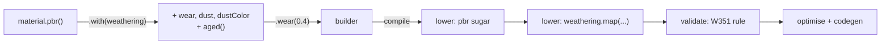

---
### L10 — Participating media

**Atmospheric haze and god rays.** Artists set two intuitive numbers, and the API derives `σs` and `σa` from them (Part I §4):

```js
const haze = medium.homogeneous({
  albedo: 0.98,                   // single-scattering albedo σs / σt
  meanFreePath: u.m(60),          // σt = 1/60 m⁻¹ → meteorological visibility ≈ 3.912 · ℓ ≈ 235 m (Koschmieder)
  phase: phase.hg(0.75),          // strongly forward-scattering: a bright halo around the sun
});

const cathedral = scene()
  .medium(haze)                   // the ambient medium fills the scene
  .add(shape.mesh('nave.glb'))
  .add(shape.mesh('windows.glb').material(material(bsdf.thinDielectric({ ior: 1.52 }))))
  .light(light.sun().elevation(u.deg(30)).illuminance(u.lux(72_000)));
```

**Subsurface scattering is a volume behind an interface,** not a special shading model. Marble is a rough dielectric boundary with a scattering interior:

```js
const marble = material(bsdf.dielectric({ ior: 1.49, roughness: 0.15 }))   // the interface
  .interior(medium.homogeneous({
    albedo: fx.color(0.998, 0.996, 0.990),     // bounded role → bounded spectrum
    meanFreePath: u.mm(5),
    phase: phase.hg(0),
  }));
```

The **same description gets a different lowering per engine**:

| Engine | Lowering of `material(dielectric).interior(medium)` |
| --- | --- |
| `offline` | volumetric random walk inside the boundary (exact for the model) |
| `realtime` | Christensen–Burley diffusion profile fitted from `(albedo, meanFreePath)` |

```text
ⓘ I455  realtime lowering of 'marble' uses a diffusion profile: features thinner than ≈ 3ℓ (15 mm)
        will look too opaque. The offline engine is exact for this medium.
```

**Smoke from a traced density field.** Delta tracking needs a *majorant*, an upper bound on `σt`. Because the field is an IR expression, `majorant: 'auto'` derives one by **interval arithmetic over the DAG**:

```js
const smoke = medium.heterogeneous({
  density: fx.field(p => fx.noise.fbm(p.P.mul(0.8).add(fx.vec3(0, p.time.mul(-0.4), 0)), { octaves: 6 })
    .sub(0.45).max(0).mul(30)),                // σt in m⁻¹
  albedo: 0.92,
  phase: phase.hg(0.3),
  majorant: 'auto',
  bounds: shape.box(4, 6, 4).at(0, 3, 0),
});

const explosion = medium.vdb('fx/explosion.vdb', {
  density: 'density',
  emission: { grid: 'temperature', as: 'blackbody' },   // Planck spectrum per voxel
});
```

```text
✖ E450  majorant: 'auto' failed for '#plume'                            smoke.js:14:13
        density contains p.P.x.reciprocal(), which is unbounded at x = 0 inside bounds.
        → pass majorant: 120 (m⁻¹), or clamp: .min(120)
```

---

### L11 — Spectral rendering

RGB is a property of displays, not of light. Dispersion, interference and metamerism only appear in a spectral engine.

**A dispersive prism.** The Sellmeier equation for Schott N-BK7:

```js
import { spectrum } from 'candela';

const bk7 = ior.sellmeier({                      // n²(λ) = 1 + Σ Bᵢ λ² / (λ² − Cᵢ),  λ in µm
  B: [1.03961212, 0.231792344, 1.01046945],
  C: [0.00600069867, 0.0200179144, 103.560653],
});
bk7.at(u.nm(587.6));     // → 1.5168   n_d
bk7.at(u.nm(400));       // → 1.5308
bk7.at(u.nm(700));       // → 1.5131
bk7.abbe();              // → 64.17    (n_d − 1) / (n_F − n_C)

const prism = scene()
  .add(shape.prism({ apex: u.deg(60), size: u.cm(5) }).material(material(bsdf.dielectric({ ior: bk7 }))))
  .add(shape.plane(1).at(0, -0.03, 0).material(material.pbr().baseColor(0.8)))
  .add(light.spot().power(u.lm(400)).cone(u.deg(0.5)).spectrum(spectrum.blackbody(u.K(5800))).at(-0.5, 0, 0))
  .camera(camera.thinLens().focal(u.mm(50)).at(0, 0.3, 0.6).lookAt(0, 0, 0));

const spectral = engine.offline().spectral({ mode: 'hero', wavelengths: 4, range: [u.nm(360), u.nm(830)] });
await prism.render('#view', { engine: spectral });
```

*Hero wavelength sampling* traces each path with one random "hero" λ and three wavelengths rotated evenly across the range. That costs about the same as RGB. At a dispersive interface the secondary wavelengths are terminated and the hero continues.

```text
⚠ W610  '#prism' has a wavelength-dependent IOR but the engine renders RGB.
        Dispersion will be approximated with 3 wavelengths (visible banding).  → engine.spectral()
```

**Thin-film interference.** Fields carry units, so `Length + Float` would be E120:

```js
const bubble = material(bsdf.thinDielectric({ ior: 1.33 }).thinFilm({
  // gravity drains the film: thinner at the top (→ "black film"), plus swirling turbulence
  thickness: fx.pattern(p => fx.mix(u.nm(900), u.nm(150), p.uv.y)
    .add(fx.noise.perlin(p.P.mul(6).add(p.time.mul(0.3))).mul(u.nm(120)))),
  ior: 1.33,
}));
// reflected phase difference δ = (4π/λ) · n_f · d · cos θ_t + π   (one reflection is off a denser medium)
```

**Illuminants and reflectances are different kinds of spectra:**

```js
const tungsten = spectrum.blackbody(u.K(2700));                    // unbounded: illuminant
const daylight = spectrum.cie('D65');
const triband  = spectrum.cie('F11');                              // narrow-band (triphosphor) fluorescent
const orange   = spectrum.fromRGB('#ff7f00', { role: 'reflectance' });   // smooth, bounded upsampling
const sage     = spectrum.measured('paints/sage.csv', { role: 'reflectance' });

await test.metamerism(sage, spectrum.measured('paints/sage-alt.csv'), { illuminants: ['D65', 'F11', 'A'] });
// reports ΔE2000 per illuminant: a metameric pair matches under D65 and splits apart under F11
```

---

### L12 — Engines: integrators and render graphs

An **engine** is a composition too: an integrator (or a render graph), a sampler, a film, post-processing and a backend.

**An offline reference engine:**

```js
import { sampler, film, filter, post } from 'candela';

const reference = engine.offline()
  .integrator(integrator.path({ maxDepth: 24, nee: true, mis: 'power', rr: { after: 4 } }))
  .sampler(sampler.sobol({ scramble: 'owen', seed: 1 }))
  .spectral({ mode: 'hero', wavelengths: 4 })
  .film(film.hdr({ size: [1920, 1080], filter: filter.blackmanHarris(1.5) })
    .aovs('albedo', 'normal', 'depth', 'variance'))
  .post(post.denoise({ guides: ['albedo', 'normal'] }), post.tonemap('agx'), post.encode('srgb'))
  .backend('webgpu');
```

**A real-time engine as a render graph.** The graph lambda is **stage ①**: it runs once and builds a DAG of passes. The engine then derives resource lifetimes, aliases transient textures and inserts barriers, in the style of a frame graph.

```js
const realtime = engine.realtime().graph(g => {
  const shadows = g.pass(pass.shadowMaps({ cascades: 4, size: 2048 }));
  const gbuf    = g.pass(pass.gbuffer({ targets: ['albedo', 'normal', 'orm', 'motion', 'depth'] }));
  const ibl     = g.pass(pass.ibl.splitSum({ samples: 256 }), { when: 'env-changed' });
  const lit     = g.pass(pass.deferredLighting({ areaLights: 'ltc' }), { gbuf, shadows, ibl });
  const ssr     = g.pass(pass.ssr({ maxSteps: 64 }), { gbuf, color: lit });
  const fog     = g.pass(pass.froxelFog({ slices: 64 }), { gbuf, shadows });
  const comp    = g.pass(pass.composite(), { lit, ssr, fog });
  const taa     = g.pass(pass.taa(), { color: comp, motion: gbuf.motion });
  const bloom   = g.pass(pass.bloom({ threshold: 'physical' }), { color: taa });
  return g.pass(pass.tonemap('agx'), { color: taa, bloom, exposure: 'camera' });
});
```

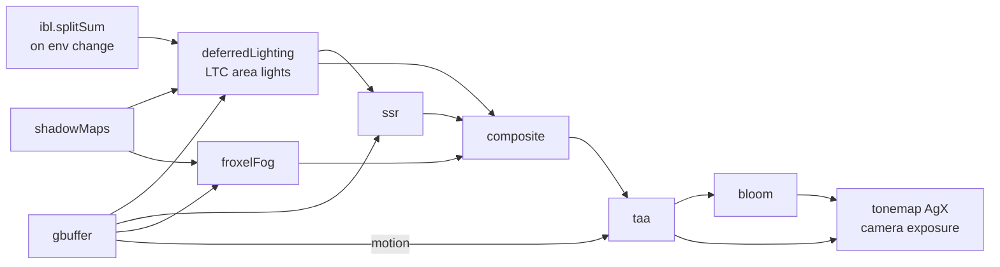

**Passes are components.** You define them the same way as materials: params, typed inputs and a traced kernel. This false-colour exposure pass is a tool cinematographers use; agents use it too (L16):

```js
const falseColor = pass.define('falseColor', {
  inputs: { color: 'hdr' },
  kernel: ({ color }, params, { camera }) => {
    const stops = fx.log2(fx.luminance(color).div(camera.middleGrey()));   // 0 = 18 % grey
    return fx.ramp(stops, [[-4, '#2b0a3d'], [-2, '#1f5fbf'], [0, '#7f7f7f'], [2, '#f2c12e'], [3.5, '#e8361c']]);
  },
});
```

**Each component is lowered per engine.** A missing lowering is a compile error, never a silent fallback:

| Component | `offline` (path tracing) | `realtime` (raster) |
| --- | --- | --- |
| `bsdf.layer` | stochastic layer evaluation | analytic coat approximation |
| `material.interior(medium)` | volumetric random walk | diffusion profile |
| `medium.heterogeneous` | delta / ratio tracking | froxel fog (requires `pass.froxelFog`) |
| `light.area` | MIS area sampling | linearly transformed cosines (LTC) |
| `light.env` | importance-sampled environment | split-sum prefiltered IBL |
| wavelength-dependent IOR | hero wavelength | 3-wavelength approximation (W610) |

```text
✖ E710  '#plume' (medium.heterogeneous) has no lowering in engine 'realtime'
        → add g.pass(pass.froxelFog()) to the graph, or smoke.fallback(medium.homogeneous({ … }))
```

**Mix and compare engines:**

```js
const app = engine.adaptive({ interactive: realtime, idle: reference, idleAfter: 600 /* ms */ });
await app.run(s, { canvas: '#view' });

const report = await engine.compare(s, { reference, candidate: realtime, metric: 'flip', spp: 4096 });
report.mean;                       // mean FLIP error
report.heatmap.show('#diff');      // where the real-time approximations diverge
```

---

### L13 — Write your own integrator

The grammar exposes the primitives of transport: `intersect`, `bsdf.eval/sample/pdf`, `lights.sample/pdf`, `visible` and `mis`. An integrator is a **traced kernel**. Static params arrive as JS numbers, which is what lets loops unroll.

**Warm-up: ambient occlusion.**

```js
const ao = integrator.define('ao', {
  params: { radius: param.length(u.m(0.5)), samples: param.int(4).static() },
  kernel: ({ ray, scene, sampler }, { radius, samples }) => {
    const hit = scene.intersect(ray);
    let open = fx.float(0);
    for (let k = 0; k < samples; k++) {                    // `samples` is static → plain JS number → unrolled
      const d = sampler.cosineHemisphere(hit.N);           // pdf = cos θ / π, which cancels the cosine
      open = open.add(scene.occluded(hit.spawn(d), radius).select(0, 1));
    }
    return fx.select(hit.missed, fx.color(1), fx.color(open.div(samples)));
  },
});
```

**The real thing: a unidirectional path tracer with next-event estimation, MIS and Russian roulette,** in about forty lines. It is the estimator from Part I §5, written in the grammar:

```js
import { mis } from 'candela';

export const pathMIS = integrator.define('path-mis', {
  params: {
    maxDepth: param.int(12).range(1, 64).static(),
    rrAfter:  param.int(4).static(),
  },
  kernel: ({ ray, scene, sampler }, { maxDepth, rrAfter }) => {
    const init = { L: fx.spectrum(0), beta: fx.spectrum(1), ray, pdfPrev: fx.float(1), delta: fx.bool(true) };

    return fx.loop(init, { maxIter: maxDepth }, (s, { depth, exit }) => {
      const hit = scene.intersect(s.ray);

      // 1 ─ escaped: environment, MIS-weighted against environment sampling at the previous vertex
      fx.when(hit.missed, () => {
        const Le = scene.env.eval(s.ray.d);
        const w  = fx.select(s.delta, 1, mis.power(s.pdfPrev, scene.env.pdf(s.ray.d)));
        exit({ L: s.L.add(s.beta.mul(Le).mul(w)) });
      });

      // 2 ─ emitter hit by BSDF sampling
      const Le = hit.emitted(s.ray.d.neg());
      const wE = fx.select(s.delta, 1, mis.power(s.pdfPrev, scene.lights.pdf(s.ray, hit)));
      let L = s.L.add(s.beta.mul(Le).mul(wE));

      // 3 ─ next-event estimation: sample a light, weight against the BSDF strategy
      const bsdf = hit.bsdf();
      const ls   = scene.lights.sample(hit, sampler.next2D(), sampler.next1D());
      const fL   = bsdf.eval(hit.wo, ls.wi).mul(hit.N.dot(ls.wi).abs());
      const wL   = fx.select(ls.delta, 1, mis.power(ls.pdf, bsdf.pdf(hit.wo, ls.wi)));
      L = L.add(s.beta.mul(fL).mul(ls.Li).mul(wL).div(ls.pdf).mul(scene.visible(hit, ls)));

      // 4 ─ continue the path by BSDF sampling
      const bs = bsdf.sample(hit.wo, sampler.next1D(), sampler.next2D());
      fx.when(bs.failed, () => exit({ L }));
      let beta = s.beta.mul(bs.weight);                    // f · |cos θ| / pdf, computed stably by the BSDF

      // 5 ─ Russian roulette: unbiased because survivors are divided by the survival probability
      const pSurvive = fx.min(1, beta.max()).max(0.05);
      const rr = depth.gte(rrAfter);
      fx.when(rr.and(sampler.next1D().gte(pSurvive)), () => exit({ L }));
      beta = fx.select(rr, beta.div(pSurvive), beta);

      return { L, beta, ray: hit.spawn(bs.wi), pdfPrev: bs.pdf, delta: bs.delta };
    }).L;
  },
});
```

Notes on the trace:

- `fx.when` records **both** sides. `exit` becomes a structured early-out in WGSL.
- `let` rebinding produces SSA nodes, and `mis.power(a, b)` is `a² / (a² + b²)`.
- `maxDepth` bounds the loop at compile time, which matters on GPUs.

**Use it, and check the maths empirically:**

```js
const mine = engine.offline().integrator(pathMIS.maxDepth(8));

const conv = await engine.compare(s, {
  reference: engine.offline().integrator(integrator.path()).spp(1 << 16),
  candidate: mine, metric: 'relMSE', spp: [1, 4, 16, 64, 256, 1024],
});
conv.plot('#convergence', { logLog: true });   // an unbiased estimator gives slope −1: MSE ∝ 1/N
```

Integrators compose with fragments too. A biased firefly clamp announces itself:

```text
ⓘ I460  pathMIS.with(clampIndirect(10)) is biased (energy above the clamp is discarded).
        It is ignored when this engine is used as `reference` in engine.compare().
```

---

### L14 — The IR: inspect, rewrite, diff, cache

```js
const ir = s.ir();
ir.hash;                                   // 'b3f19c…' content address of the whole scene
ir.stats();                                // { nodes, shared, byType: { BSDF, Field, Light, … } }
console.log(ir.print({ focus: '#car', depth: 3 }));
console.log(ir.toMermaid({ focus: '#car.material' }));   // a diagram of any subgraph, for docs
const json = ir.toJSON();                  // stable and diffable; scene.fromJSON(json) round-trips
```

**Stop the pipeline anywhere:**

```js
const stages = await engine.realtime().compile(s, {
  keep: ['traced', 'validated', 'lowered', 'optimized', 'wgsl'],
});
stages.lowered.print({ focus: '#car.material' });
stages.wgsl.get('material:#car').source;
stages.optimized.report();      // what was folded, deduplicated, hoisted or baked, and why
```

**Automatic stage assignment.** Each node knows its **dependency set**: which context variables it reads (`uv`, `P`, `N`, `ωo`, `λ`, `time`, `param:*`, `instance`). The optimiser hoists every node to the cheapest stage its dependencies allow. This is loop-invariant code motion, generalised across stages:

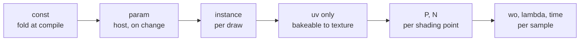

This is why `P.gloss.map(g => 1 - g)` runs once on the CPU when you write it inside a pattern, and why a pattern that depends only on `uv` can be baked.

**A custom IR pass,** shipped as an engine fragment:

```js
export const bakeStaticPatterns = fragment('bake-static-patterns')
  .targets('engine')
  .pass('optimize', (ir, { cost }) => ir.rewrite(
    n => n.kind === 'field' && n.deps.subsetOf(['uv']) && cost(n) > 64,   // uv-only and expensive
    n => fx.texture.baked(n, { size: 2048, mips: true }),                  // evaluated once on the GPU
  ));

const fast = engine.realtime().with(bakeStaticPatterns);
```

**Functional edits and diffs.** Graph mode is persistent: `edit` returns a new scene and shares everything it did not touch.

```js
const a = s;
const b = s.edit('#car', car => car.material(car.material().roughness(0.2)));
console.log(a.ir().diff(b.ir()).print());
```

```text
diff b3f19c → 0e7a21
  value      #car.material.roughness   0.35 → 0.2    literal: kernel unchanged, constant row rewritten
  structure  —
  cost       uniform
```

**Caching.** Kernels are keyed by *structural* hash, which excludes literals, so caches survive edits and reloads:

```js
engine.realtime().cache({ store: 'indexeddb', key: 'structural' });
```

---

### L15 — Live mode: mutations, transactions, behaviours

`run()` returns a **World**: the IR plus GPU state, exposed through proxied live handles. Reads return current values, and writes become validated **patches**.

```js
const world = await engine.realtime().run(s, { canvas: '#view' });

const lamp = world.$('#lamp');
lamp.power = u.lm(1500);                         // value patch → uniform write
lamp.temperature = 3000;                         // a bare number means the canonical unit (K)
world.$('#car').position.y += 0.1;               // transform patch → BVH refit
world.$$('.bulb').forEach(b => { b.temperature = u.K(2200); });   // selectors: #id, .tag, kind, a > b

world.add(shape.box(0.5).id('crate').at(2, 0.25, 0).material(material.pbr()));   // structure patch
world.remove('#crate');

await world.tx(w => {                            // atomic: applied at the next frame boundary, one undo step
  w.$('#key').power = u.lm(1200);
  w.$('#fill').power = u.lm(400);
});
world.history.undo();
```

```text
✖ E104  world.$('#lamp').powr = …      'powr' is not an attribute of light.point. Did you mean 'power'?
✖ E120  world.$('#lamp').power = 500 lx    power expects luminous flux [lm]; got illuminance [lx]
```

**Patch classes, cheapest first.** The cost class is reported for every patch, and agents see it too:

| Class | Example | What happens |
| --- | --- | --- |
| value | `lamp.power = …`, a literal changes, a dynamic param moves | constant-buffer write |
| transform | `car.position.y += 0.1` | instance transform write and top-level BVH refit |
| specialisation | a static param flips | cached kernel variant swapped in, or compiled in the background |
| structure | `world.add(…)`, the BSDF topology changes | incremental compile of the affected subgraph, BVH rebuild of the subtree |

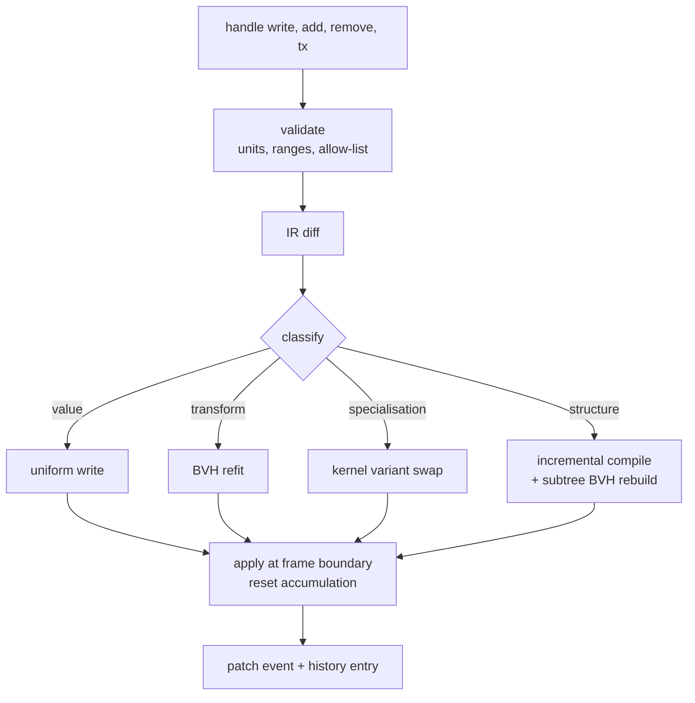

**Behaviours are run-stage lambdas declared at build time.** Compare them with *traced* animation:

```js
// stage ③: JS on the host, once per frame
const fanHost = shape.mesh('fan.glb').id('fan')
  .behavior((self, { dt }) => { self.rotation.y += dt * 2 * Math.PI * 3; });   // 3 rev/s

// stage ②: traced; evaluated at each path's *sampled time* inside the shutter interval
const fanTraced = shape.mesh('fan.glb').rotateY(fx.time().mul(2 * Math.PI * 3));
```

Motion blur is the `∫_T` in the measurement equation. A traced transform is evaluated at the time each sample is taken, so the blur is exact: an arc. A host behaviour provides one key per frame, and the engine interpolates between keys, which blurs along a chord:

```text
ⓘ I520  '#fan' rotates 18° per frame from a host behaviour; motion blur interpolates linearly between
        frame keys. For exact blur use a traced transform: .rotateY(fx.time().mul(…))
```

**Events:**

```js
world.on('pick', ({ hit }) => { hit.node.material.baseColor = '#ffcc00'; });
world.on('converged', ({ spp }) => console.log(`converged at ${spp} spp`));
world.on('patch', p => socket.send(JSON.stringify(p)));   // patches serialise → multi-user, remote agents
```

---

### L16 — Agents in the loop

An agent sees the world the way a lighting technician does: an image, **meter readings** and a scene summary with stable IDs. It acts through the same proxied grammar, so every action is validated, typed and unit-checked. **Errors come back as data** rather than exceptions, so an LLM can read them and correct itself.

```js
const session = world.agent({
  allow: ['light.*', 'camera.exposure', 'camera.fstop', 'add:light.area', 'add:light.spot', 'remove:light.*'],
  deny:  ['material.*', 'shape.*'],                // it may light the bust, never repaint or move it
  budget: { actions: 60, renderMs: 20_000 },
  probes: {
    litCheek:    { at: '#bust/cheek.L', measure: 'illuminance' },   // anchor points authored in the asset
    shadowCheek: { at: '#bust/cheek.R', measure: 'illuminance' },
    backdrop:    { at: '#backdrop', measure: 'luminance' },
  },
});

session.tools();   // JSON schemas derived from the grammar, the allow-list and param ranges
```

```json
[
  { "name": "set",
    "description": "Set an attribute. Values accept units: '1200 lm', '35 deg', '5600 K', 'f/4'.",
    "input_schema": { "type": "object", "required": ["target", "value"], "properties": {
      "target": { "type": "string", "pattern": "^#[\\w-]+\\.(power|temperature|position|rotation|cone|size)$" },
      "value":  { "type": ["string", "number", "array"] } } } },
  { "name": "add_light", "input_schema": { "type": "object", "required": ["kind", "id"], "properties": {
      "kind": { "enum": ["area", "spot"] }, "id": { "type": "string" }, "at": { "type": "array" } } } },
  { "name": "meter",   "input_schema": { "type": "object", "properties": { "probes": { "type": "array" } } } },
  { "name": "observe", "input_schema": { "type": "object", "properties": { "falseColor": { "type": "boolean" } } } },
  { "name": "fork" }, { "name": "commit" }, { "name": "rollback" }
]
```

**A scripted agent that uses the physics directly.** Light transport is linear in emission (Part I §5). Measure, once, how many lux each light delivers to each probe per lumen. Hitting a target is then a 2 × 2 linear solve, with no trial and error:

```js
const solve2x2 = ([[a, b], [c, d]], [e, f]) => {
  const det = a * d - b * c;
  return [(e * d - b * f) / det, (a * f - e * c) / det];
};

// A[i][j] = lux at probe i per lumen emitted by light j   (two renders, one per light)
const A = await session.measure.transport({ lights: ['#key', '#fill'], probes: ['litCheek', 'shadowCheek'] });

const target = [500, 500 / 3];                     // 500 lx on the lit cheek, 3:1 lighting ratio (≈ 1.58 stops)
const [key, fill] = solve2x2(A, target).map(x => Math.max(0, x));

const result = await session.act([
  { op: 'set', target: '#key.power',  value: `${key.toFixed(0)} lm` },
  { op: 'set', target: '#fill.power', value: `${fill.toFixed(0)} lm` },
]);
```

**An LLM agent for open-ended goals** ("make it feel like a 1940s film noir still"). The loop is generic because the grammar provides the tools:

```js
const SYSTEM = `You are a lighting assistant. Work in physical units. Meter before and after each change.
Prefer few, decisive changes. Stop when the goal is met and explain the result in one paragraph.`;

export async function runAgent(session, goal, llm) {
  const history = [{ role: 'user', content: goal }];
  for (let turn = 0; turn < 20; turn++) {
    const obs = await session.observe({ image: { size: 512, spp: 32 }, falseColor: true, meters: true, scene: 'summary' });
    history.push({ role: 'user', content: obs.asContent() });          // image + meters + ids as content blocks
    const reply = await llm.chat({ system: SYSTEM, tools: session.tools(), messages: history });
    history.push(reply.message);
    if (reply.toolCalls.length === 0) { await session.commit(); return reply.text; }
    for (const call of reply.toolCalls) {
      const result = await session.act(call);                          // never throws
      history.push({ role: 'tool', id: call.id, content: result.asContent() });
    }
  }
  await session.rollback('budget exhausted');
  return 'Stopped: budget exhausted, changes rolled back.';
}
```

**Results are data.** These are what the model reads back:

```json
[
  { "ok": false, "code": "E104", "message": "light '#key' has no attribute 'brightness'",
    "suggest": ["power", "intensity", "temperature"], "hint": "power accepts '1200 lm' or a number in lm" },

  { "ok": false, "code": "E901", "message": "'#bust.material.baseColor' is outside this session's allow-list (material.* is denied)" },

  { "ok": true, "cost": "value", "diff": [{ "path": "#key.power", "from": "800 lm", "to": "1240 lm" }],
    "meters": { "litCheek": "498 lx", "shadowCheek": "171 lx", "ratio": "2.91:1" } }
]
```

**Counterfactuals are cheap.** `fork()` is O(1) because the IR is persistent, so an agent can try alternatives side by side:

```js
const variants = await Promise.all(['softbox', 'umbrella', 'bare'].map(async modifier => {
  const f = session.fork();
  await f.act({ op: 'set', target: '#key.modifier', value: modifier });
  return { modifier, fork: f, obs: await f.observe({ image: { size: 256, spp: 16 } }) };
}));
// the agent (or a person) picks one; that fork is committed and the others are dropped
```

**Relighting by superposition.** One basis image per light lets an agent or a UI preview *any* combination of powers instantly. The result is exact for power changes; moving a light needs a new render.

```js
const basis = await session.observe({ basis: 'lights', spp: 256 });
const preview = basis.combine({ '#key': 1240, '#fill': 410, '#rim': 900 });   // lumens → image, no render
```

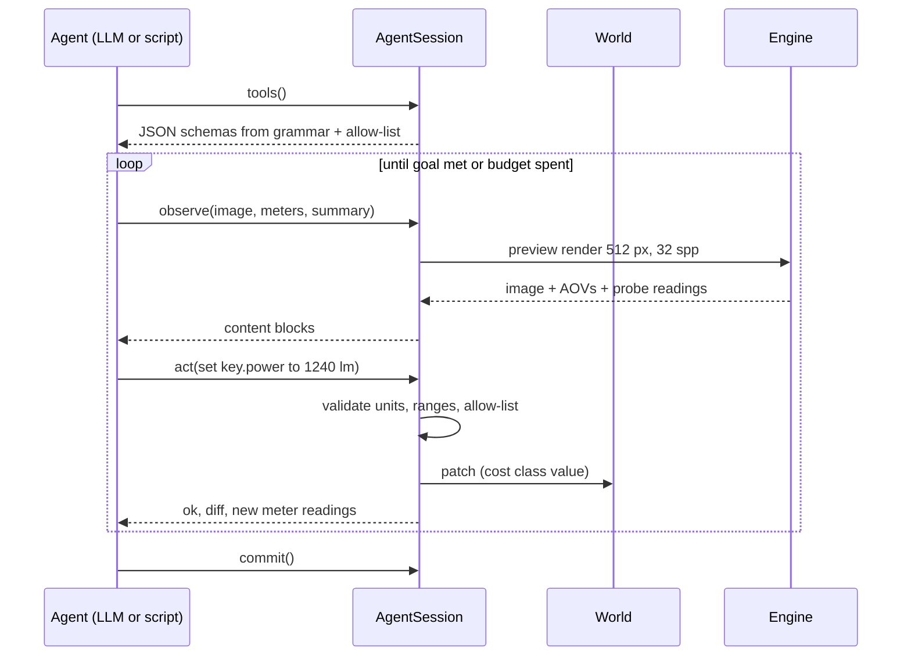

---

### L17 — Inverse rendering

Run the pipeline backwards: given a photograph, find the parameters that reproduce it. Because the scene *and* the loss are traced IR, a differentiable backend can propagate gradients through the render.

```js
import { optimize, loss, image } from 'candela/optimize';

const P = params({
  sunElev:   param.angle(u.deg(40)).range(u.deg(5), u.deg(85)),
  sunAz:     param.angle(u.deg(180)).range(u.deg(0), u.deg(360)),
  turbidity: param.float(3).range(1, 10),
  wall:      param.color(0.5).role('reflectance'),
});

const courtyard = scene().params(P)
  .add(shape.mesh('courtyard.glb').part('walls', m => m.material(material.pbr().baseColor(P.wall).roughness(0.8))))
  .light(light.sun().elevation(P.sunElev).azimuth(P.sunAz).illuminance(P.sunElev.map(directNormalLux)))  // L4
  .light(light.sky.physical({ turbidity: P.turbidity }).fromSun())
  .camera(camera.fromPhoto('courtyard.exr'));      // intrinsics and exposure from metadata / calibration

const photo = await image.load('courtyard.exr', { colorSpace: 'linear-rec709' });

const fit = await optimize(courtyard, {
  engine: engine.offline().differentiable({ method: 'prb' }),   // path replay backpropagation
  params: [P.sunElev, P.sunAz, P.turbidity, P.wall],
  loss: img => loss.mse(img.log1p(), photo.log1p()),            // log space: HDR highlights must not dominate
  optimizer: { kind: 'adam', lr: 0.02 },
  steps: 400,
  spp: 8,
  decorrelate: true,                                            // independent samples for primal and adjoint
  onStep: ({ step, value }) => ui.plot('#loss', step, value),   // stage ③
});

P.load(fit.params);
```

The stages show up here as well:

```text
ⓘ I471  P.sunElev → illuminance passes through a host map (directNormalLux); its derivative is taken
        by central finite differences (2 extra host evaluations per step). Everything traced is exact AD.
⚠ W470  '#statue.position' changes visibility (shadow edges move). Gradients of discontinuous
        integrands are biased without edge handling. → differentiable({ visibility: 'reparam' })
```

- **Smooth parameters** (albedo, roughness, light power, sun direction in open sky) differentiate cleanly.
- **Visibility-changing parameters** (geometry, occluder positions) need reparameterisation or edge sampling.
- **Without a differentiable backend**, `optimize({ gradient: 'spsa' })` falls back to simultaneous-perturbation estimates.

---

### L18 — Capstone: a product configurator

Everything together: params and sliders, the scattering algebra, local and global fragments, build-time structure, traced appearance, host behaviours, two engines, live mode, an agent with a narrow physical toolset, and physical tests in CI.

```js
// configurator.js
import candela, {
  scene, shape, material, bsdf, ior, light, camera, engine, integrator,
  param, params, ui, units as u,
} from 'candela';
import { weathering, plausibleAlbedo, bokeh } from 'candela/fragments';
import { test } from 'candela/test';
import { carPaint } from './materials/car-paint.js';      // L6
import { standardDeferred } from './engines/deferred.js';  // L12's graph, packaged as a function
import { studioRig, streetRig } from './rigs.js';
import { runAgent, llm } from './agent.js';               // L16

candela.use(plausibleAlbedo);                              // project-wide physical guard rails

// 1 ─ knobs ─────────────────────────────────────────────────────────────────
const P = params({
  paint:  param.color('#7a0c12').role('reflectance').label('Paint'),
  flakes: param.float(0.25).range(0, 0.6).label('Metallic flakes'),
  finish: param.choice(['gloss', 'satin', 'matte']).static(),
  age:    param.float(0).range(0, 30).unit('years'),
  rig:    param.choice(['studio', 'golden-hour', 'night-street']).static(),
  ev:     param.ev(12).range(4, 16),
  fstop:  param.float(4).range(1.4, 22).scale('log'),
});

// 2 ─ appearance: algebra, traced ──────────────────────────────────────────
const body = material(carPaint(P.paint, {
  flakes: P.flakes,
  coatRoughness: P.finish.pick({ gloss: 0.02, satin: 0.15, matte: 0.45 }),   // static → specialised kernel
}));

const tyres = material.pbr().baseColor(0.04).roughness(0.8)
  .with(weathering).aged(P.age);                 // the fragment's method accepts a param (lift + host map)

// 3 ─ structure: build-time JS ─────────────────────────────────────────────
const car = shape.mesh('models/coupe.glb').id('car')
  .part('body',   m => m.material(body))
  .part('chrome', m => m.material(material(bsdf.conductor({ ior: ior.metal('Cr'), roughness: 0.05 }))))
  .part('glass',  m => m.material(material(bsdf.thinDielectric({ ior: 1.52 }))))
  .part('tyres',  m => m.material(tyres));

const turntable = shape.cylinder(3, 0.05).id('turntable')
  .material(material.pbr().baseColor(0.05).roughness(0.3))
  .behavior((self, { dt, state }) => { if (state.spin) self.rotation.y += dt * 0.2; })   // stage ③
  .child(car);

const rigs = {
  'studio':       () => studioRig({ key: u.lm(2400), fill: u.lm(800), rim: u.lm(1600) }),
  'golden-hour':  () => light.daylight({ elevation: u.deg(6), turbidity: 4 }),
  'night-street': () => streetRig(),
};

const s = scene().params(P)
  .add(turntable)
  .add(P.rig.build(name => rigs[name]()))       // a static param drives a build lambda, re-run on change
  .camera(camera.thinLens().with(bokeh).blades(9)
    .focal(u.mm(85)).fstop(P.fstop).focusOn('#car').exposure(P.ev));

// 4 ─ engines: fast while interacting, converged when idle ─────────────────
const realtime  = engine.realtime().graph(standardDeferred({ ssr: true, fog: false }));
const reference = engine.offline().integrator(integrator.path({ maxDepth: 16 })).spectral({ mode: 'hero' });
const app = engine.adaptive({ interactive: realtime, idle: reference, idleAfter: 600 });

const world = await app.run(s, { canvas: '#view', state: { spin: true } });
ui.panel(P).mount('#controls');
P.bindURL();

// 5 ─ assistant: an agent with a narrow, physical toolset ──────────────────
const assistant = world.agent({
  allow: ['params.ev', 'params.fstop', 'params.rig', 'light.*', 'camera.*'],
  deny: ['#car.*'],                                // it may light the car, never repaint it
  budget: { actions: 40, renderMs: 15_000 },
});
ui.chat('#assistant').onMessage(text => runAgent(assistant, text, llm));

// 6 ─ guard rails in CI ────────────────────────────────────────────────────
export const tests = [
  () => test.furnace(body.surface(), { expect: 'no-gain' }),
  () => test.reciprocity(body.surface()),
  () => test.render(s, { engine: reference, golden: 'golden/coupe.exr', metric: 'flip', max: 0.05 }),
  () => engine.compare(s, { reference, candidate: realtime, metric: 'flip', max: 0.12 }),
];
```

**Design decisions visible in the capstone**

- `weathering` goes on the tyres, which are a `material.pbr`. It declares `.requires('baseColor', 'roughness', 'metallic')`, and the car body is built directly from the BSDF algebra and exposes none of those, so `.with(weathering)` there raises **E130**. The fragment contract is checked, not assumed.
- Writing `.aged(Math.min(1, P.age / 25))` would raise **E203** (a param used in build-time JS arithmetic). The fragment's `aged()` lifts its argument and maps on the host instead.
- `P.finish.pick(…)` and `P.rig.build(…)` are the two ways a *static* param affects the result: by selecting values (specialisation) or by regenerating structure (a build-lambda re-run followed by an IR diff).

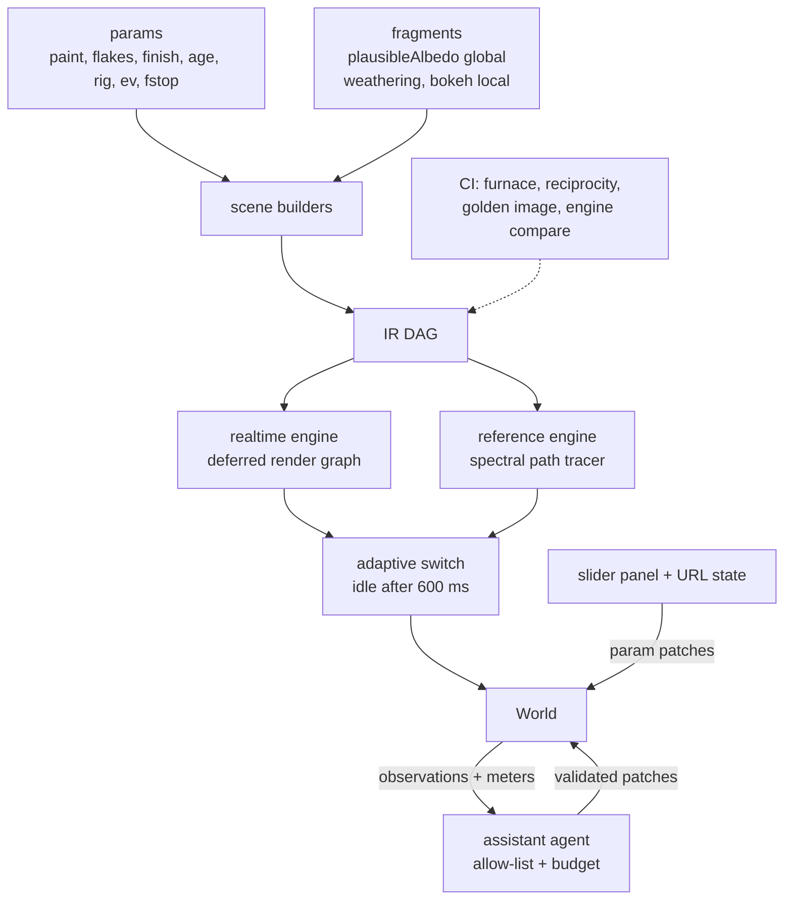

---

## Appendix A — The grammar

```text
Scene       := scene(opts?) { .add(Node…) | .light(Light) | .camera(Camera) | .medium(Medium)
                             | .params(Params) | .with(Fragment) | .edit(sel, fn) }

Node        := Shape [Placement] [.material(Material)] [.emit(Light)] [.behavior(fn③)]
                     [.id(s)] [.tag(s)] [.part(name, fn①)] [.child(Node)]
             | scene.group(fn①) | scene.scatter({ on, count, seed, density: Field, place: fn① })
             | Param.build(fn①) | Light
Placement   := .at(x,y,z) | .rotateX|Y|Z(Angle | Field) | .scale(s) | .lookAt(p) | .alignTo(N)

Shape       := shape.sphere | plane | rect | box | cylinder | prism | mesh(url) | heightfield(Field) | …

Material    := material(Surface) [.interior(Medium)] [.exterior(Medium)] [.emission(Field<Radiance>)]
                                 [.normal(Field<Normal>)] [.displace(Field<Length>)]
             | material.define(name, ParamSpec, m ⇒ Surface)        -- e.g. material.pbr, user materials
             | Material.with(Fragment)

Surface     := bsdf.lambert(Field<Refl>) | bsdf.dielectric({ ior | f0, roughness })
             | bsdf.conductor({ ior: η+ik | f0, roughness }) | bsdf.sheen(…) | bsdf.thinDielectric(…)
             | bsdf.mix(Surface, Surface, Field<[0,1]>)             -- always valid
             | bsdf.layer(Surface, Surface, { thickness, tint })    -- valid by construction
             | bsdf.add(Surface, Surface)                           -- checked (W420)
             | Surface.scale(Field<[0,1]>) | .normal(Field) | .thinFilm(…) | .multiscatter(…)

Medium      := medium.homogeneous({ albedo, meanFreePath | σa, σs, phase })
             | medium.heterogeneous({ density: Field, albedo, phase, majorant, bounds }) | medium.vdb(url, …)

Light       := light.point | spot | area | sun | sky.physical | env(url) | daylight
               [.power(lm) | .intensity(cd) | .illuminance(lx) | .luminance(nit)]
               [.temperature(K) | .spectrum(Spectrum)] [.cone(Angle)] [.with(Fragment)]

Camera      := camera.thinLens | pinhole | ortho | spherical | fromPhoto(url)
               [.focal .fstop .shutter .iso .exposure(EV | 'auto' | 'meter:sel') .focusOn(sel)]

Field<T>    := literal | Quantity | Param<T> | fx.pattern(p ⇒ Expr②) | fx.field(p ⇒ Expr②)
             | fx.texture(url, { colorSpace, role }) | fx.noise.* | fx.host(fn③)  -- CPU backend only
Expr        := Field.op(…) | fx.mix | select | when | loop | ramp | …   (typed, unit-checked)

Param<T>    := param.float | int | bool | color | angle | length | lumen | kelvin | ev | choice
               .range .step .scale .label .unit .role [.static()]  [.map(fn③)] [.select | .pick | .build(fn①)]

Engine      := engine.offline | realtime | cpu | preview | adaptive({ interactive, idle })
               [.integrator(Integrator)] [.graph(g ⇒ Pass DAG①)] [.sampler] [.spectral] [.film] [.post…]
               [.backend] [.differentiable] [.cache] [.with(Fragment)]
Integrator  := integrator.path(…) | integrator.define(name, { params, kernel: ctx ⇒ Expr② })
Pass        := pass.* | pass.define(name, { inputs, params, kernel: ctx ⇒ Expr② })

Fragment    := fragment(name).targets(kinds…) [.requires(attrs…)] [.params] [.methods(fn①)]
               [.around(method, fn①)] [.lower(fn②)] [.pass(stage, fn)] [.validate(fn)] [.assets]

World       := Engine.run(Scene) → { $(sel), $$(sel), add, remove, tx, on, meter, history, agent(…) }

①  build stage  · ②  trace stage  · ③  run stage
```

## Appendix B — Diagnostic codes

| Code | Severity | Meaning | Raised at |
| --- | --- | --- | --- |
| E104 | error | unknown method or attribute (with did-you-mean) | build, live, agent |
| E120 | error | unit or dimension mismatch | build, trace, live |
| E121 | error | value outside its physical domain (roughness ∉ [0,1], …) | build |
| E123 | error | impossible optics (f-number < 0.5 in air) | build |
| E130 | error | a fragment's attribute contract is not met | compile |
| E140 | error | two fragments define the same method or attribute | build |
| E201 | error | symbolic value used as a JS number | trace |
| E202 | error | JS branch or comparison on a symbolic value | trace |
| E203 | error | param used in build-time JS arithmetic (use `.map`) | build |
| W310 | warning | colour space wrong for the role (linear quantity decoded as sRGB) | build |
| W330 | warning | albedo outside the plausible range [0.03, 0.90] | build / debug runtime |
| W335 | warning | partially metallic surface | compile |
| W340 | warning | IOR < 1 without an exterior medium | build |
| W351 | warning | fragment-defined rule (example: dust on emitter) | compile |
| W420 | warning | composed BSDF can exceed unit albedo | compile |
| W421 | warning | significant energy loss (missing multiple scattering) | test |
| I205 | info | instancing and constant-hoisting summary | compile |
| E450 | error | cannot bound a heterogeneous medium (majorant) | compile |
| I455 | info | approximation used by this engine's lowering | compile |
| I460 | info | biased estimator component | compile |
| W470 | warning | differentiating a visibility discontinuity without edge handling | optimise |
| I471 | info | host map differentiated by finite differences | optimise |
| W501 | warning | non-deterministic build lambda | build |
| I520 | info | host-animated motion blur is linear between frame keys | compile |
| W610 | warning | spectral data rendered by an RGB engine | compile |
| E710 | error | component has no lowering for this engine | compile |
| E901 | error | agent action outside the session's allow-list | agent |

## Appendix C — Further reading

The physics and algorithms this design builds on:

- Pharr, Jakob, Humphreys — *Physically Based Rendering: From Theory to Implementation*, 4th ed. (2023): radiometry, the measurement equation, integrators, spectral rendering.
- Veach — *Robust Monte Carlo Methods for Light Transport Simulation*, PhD thesis (1997): MIS, the power heuristic, shading-normal asymmetry.
- Walter, Marschner, Li, Torrance — *Microfacet Models for Refraction through Rough Surfaces* (EGSR 2007): GGX.
- Heitz — *Understanding the Masking-Shadowing Function in Microfacet-Based BRDFs* (JCGT 2014): height-correlated Smith.
- Burley — *Physically-Based Shading at Disney* (SIGGRAPH 2012 course): the perceptual roughness remap, `specular · 0.08`.
- Karis — *Real Shading in Unreal Engine 4* (SIGGRAPH 2013 course): split-sum IBL.
- Lagarde, de Rousiers — *Moving Frostbite to Physically Based Rendering* (SIGGRAPH 2014 course): photometric lights, EV100, `L_max = 1.2 · 2^EV100`.
- Kulla, Conty — *Revisiting Physically Based Shading at Imageworks* (SIGGRAPH 2017 course): multiple-scattering energy compensation.
- Heitz, Dupuy, Hill, Neubelt — *Real-Time Polygonal-Light Shading with Linearly Transformed Cosines* (SIGGRAPH 2016).
- Wilkie, Nawaz, Droske, Weidlich, Hanika — *Hero Wavelength Spectral Sampling* (EGSR 2014).
- Jakob, Hanika — *A Low-Dimensional Function Space for Efficient Spectral Upsampling* (Eurographics 2019).
- Belcour, Barla — *A Practical Extension to Microfacet Theory for the Modeling of Varying Iridescence* (SIGGRAPH 2017).
- Novák, Georgiev, Hanika, Jarosz — *Monte Carlo Methods for Volumetric Light Transport Simulation* (Eurographics STAR 2018): delta and ratio tracking, majorants.
- Christensen, Burley — *Approximate Reflectance Profiles for Efficient Subsurface Scattering* (Pixar, 2015).
- Hosek, Wilkie — *An Analytic Model for Full Spectral Sky-Dome Radiance* (SIGGRAPH 2012).
- O'Donnell — *FrameGraph: Extensible Rendering Architecture in Frostbite* (GDC 2017).
- Andersson et al. — *FLIP: A Difference Evaluator for Alternating Images* (HPG 2020).
- Loubet, Holzschuch, Jakob — *Reparameterizing Discontinuous Integrands for Differentiable Rendering* (SIGGRAPH Asia 2019).
- Vicini, Speierer, Jakob — *Path Replay Backpropagation* (SIGGRAPH 2021).
- Kasten, Young — *Revised Optical Air Mass Tables and Approximation Formula* (Applied Optics, 1989).
