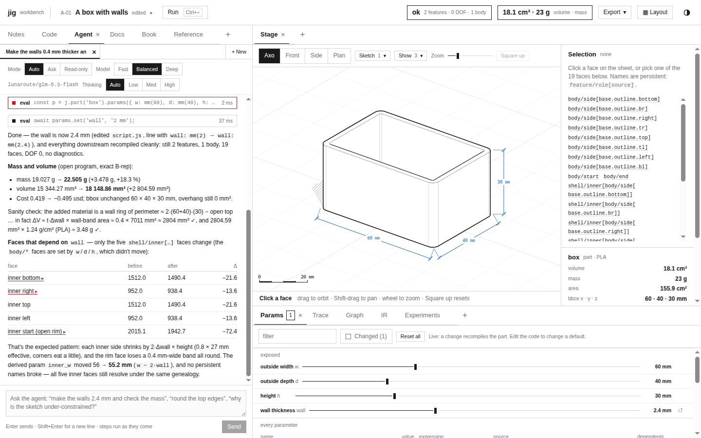

# jigcad serve: Go model backend on geppetto and Pi, and the browser sample adapter

## 1. Executive summary

jigcad's coding agent was written for one host capability: `window.claude.use('sample')`, which claude.ai provides
to artifacts. Opened anywhere else, the agent reports "The agent is off here." This ticket gives the agent its own
backend.

`jigcad serve` is a single Go binary. It serves the built workbench (`dist/`) and exposes a small HTTP API for
model calls. Calls go to models configured in the Pi coding agent's directory (`~/.pi/agent`), through geppetto's
`providers/pi`. The default tiers use lunaroute's `glm-5.3-flash`, with `deepseek-4.1-flash` for the complex tier.
The agent's one tool, `eval`, runs JavaScript against the live workbench, so it must execute in the browser. The
server streams a `tool` event to the page and waits for the page to post the result back.

The backend code is the one slop-computer wrote for the same contract (SLOP-010): `pkg/piworker` and
`pkg/piworker/gepp`. It is adapted into this repository rather than imported, because slop-computer's module needs
Go 1.26.6 and pulls in a database layer jigcad does not need. Only geppetto is a shared dependency.

## 2. System orientation

### 2.1 Terms

| Term | Meaning |
|---|---|
| **sample** | The capability contract: `sample(turns, opts) → Promise<{ text, truncated }>`. `opts = { tools, signal, modelTier, effort, onText }`. One call is one agent turn, which may span many model rounds. |
| **round** | One model inference. When the model asks for tools, the server runs them (here: asks the page to) and starts another round with the results appended. |
| **tool** | `{ name, description, inputSchema, execute(input, { signal }) }`. Name, description and schema go to the model; `execute` stays in the page. |
| **Pi** | The Pi coding agent. Its directory holds the model catalog (`models-store.json`, `models.json`), credentials (`auth.json`) and defaults (`settings.json`). |
| **geppetto** | go-go-golems' Go inference library: turns (conversations as blocks), engines (one per provider API), events (streaming), tool registries. |
| **providers/pi** | geppetto's loader for Pi's directory. `Resolve("lunaroute/glm-5.3-flash")` returns an engine with the right base URL, API style and credential. |
| **tier** | `quick`, `default` or `complex`; the agent panel's Model setting (fast, balanced, deep) picks one. |

### 2.2 Architecture

```
 browser (dist/app.js)                                   jigcad serve (Go)
 ─────────────────────                                   ─────────────────────────────────────────────
 AgentPanel ─ runTurn ─ sample(turns, opts) ──POST /api/sample───►  server: validate, new call id, SSE stream
   (src/agent/*)           (src/host/sample-http.js)                  │
                                     ◄── event: call {call}            ▼
                                     ◄── event: text {text, delta}   gepp.Backend.Sample(ctx, req, emit, execute)
                                     ◄── event: tool {use,name,input}  │  pick tier → pi.Resolve → engine
   eval tool runs in the page                                        │  round: engine.RunInference(turn)
   POST /api/sample/{call}/tools/{use} {value, isError} ──────────►  │  tool calls → execute() waits on a channel
                                     ◄── event: result {text, …}     │  next round with tool results
                                                                     ▼
                                                           lunaroute (OpenAI-compatible) via Pi credentials
```

### 2.3 One turn over time

1. The person types a request. `runTurn` builds the turns (instructions plus reference on the first user turn) and
   calls `sample(turns, { tools: [eval], onText, signal, modelTier })`.
2. The adapter POSTs `{ input: turns, modelTier, effort, tools: [{ name, description, inputSchema }] }` to
   `/api/sample` and reads the SSE stream from the response body with `fetch` + `getReader`. `EventSource` cannot
   be used because it only issues GET requests.
3. The server answers with `event: call` (the call id), then streams `text` events while the model writes.
4. When the model calls `eval`, the server registers a channel for that tool-use id, sends `event: tool`, and
   blocks until the page posts `{ value, isError }` to `/api/sample/{call}/tools/{use}`, or until 150 s pass.
5. The page's `execute` runs the code in the workbench (the agent's step UI shows it), then posts the result. The
   server appends a tool-result block to the turn and starts the next round.
6. A round without tool calls ends the call with `event: result`. Stop in the panel aborts the fetch and POSTs
   `/api/sample/{call}/cancel`, which cancels the server context.

## 3. Proposed API

### 3.1 HTTP

| Request | Body | Response |
|---|---|---|
| `GET /api/sample/models` | — | `{ available, models: [{ provider, id, name, tier, reasoning }], tiers: { quick, default, complex }, maxRounds }` |
| `POST /api/sample` | `{ input: string \| [{ role, content }], modelTier, model?, effort?, tools? }` | `text/event-stream`: `call`, `text`, `thinking`, `tool`, `result`, `error` |
| `POST /api/sample/{call}/tools/{use}` | `{ value, isError }` (≤ 32 KB) | `{ ok: true }`, or 404 if nothing is waiting |
| `POST /api/sample/{call}/cancel` | — | `{ ok: true }` |
| `GET /*` | — | the workbench (`dist/`) from `--dist` or the embedded copy |

Errors before streaming use `{ error: { code, message } }` with HTTP 400, 401 or 503. Errors during the stream are
`event: error { code, message, text? }` with the contract codes `authentication_error`, `rate_limited`,
`prompt_too_large`, `upstream_error`, `empty_completion`, `invalid_request` and `cancelled`.

### 3.2 Security

The server spends the operator's Pi credentials. It binds `127.0.0.1:8787` by default. With `--token T` (or
`JIGCAD_TOKEN`), every `/api/` request must present `Authorization: Bearer T` or the `jigcad_token` cookie. Opening
`/?token=T` once sets that cookie. Provider error text never reaches the page; errors are classified into the fixed
codes above (slop's `classify`).

### 3.3 Go packages

```
cmd/jigcad/main.go           cobra root; `serve` flags: --listen --dist --pi-agent-dir --model-quick/default/complex
                             --max-rounds --token
pkg/sample/types.go          Request, Tool, Event, Result, Failure, ToolResult, Backend (from slop pkg/piworker)
pkg/sample/validate.go       ValidateRequest (limits: 256 KiB prompt, 16 tools, 4 KiB schema)
pkg/sample/gepp/backend.go   New(Config): Pi directory, tier models, lunaroute headers (agent "jigcad")
pkg/sample/gepp/sample.go    Sample: rounds, tools via execute, sink → events, budget, classify
pkg/server/server.go         handlers, call registry, SSE writer, token check, static files
import/jigcad/embed.go       //go:embed all:dist behind the `embed` build tag (single binary)
```

### 3.4 Browser

`src/host/sample-http.js` exports `httpSample(base)`. It probes `GET api/sample/models`, and if the backend answers
it returns a function with the `sample` contract (a port of slop's `web/runtime/src/sample.ts`, minus consent and
caching). `src/agent/panel.jsx`'s `getSample()` uses `window.claude` when present, else `httpSample()`. claude.ai
hosting keeps working unchanged.

## 4. Decision records

### D1: Adapt slop-computer's backend instead of importing the module

- **Context:** slop-computer's `go.mod` requires Go 1.26.6 plus pgx, glazed and a sandbox runtime. The local
  checkout is 82 commits behind origin, and the geppetto code lives in a separate worktree.
- **Options:** import `github.com/go-go-golems/slop-computer/pkg/piworker/gepp`; copy and adapt about 700 lines;
  write a backend from scratch on geppetto.
- **Decision:** copy and adapt, with attribution in the package docs.
- **Consequences:** a small duplication; jigcad controls its limits (max rounds, the agent header). If slop moves
  the backend to geppetto or to a shared module, this copy can be replaced.
- **Status:** accepted.

### D2: Tools execute in the browser

- **Context:** `eval` reads and edits the workbench's live state (files, compile, selection) and asks the person
  in Ask mode.
- **Decision:** the server holds each tool call on a channel and the page answers over HTTP, as in slop.
- **Consequences:** each tool round costs one extra HTTP request; the server waits up to 150 s per tool, which is
  far above `eval`'s 25 s timeout.
- **Status:** accepted.

### D3: Tier defaults

- **Decision:** `quick` and `default` → `lunaroute/glm-5.3-flash`; `complex` → `lunaroute/deepseek-4.1-flash`,
  all overridable by flags. Both ids exist in Pi's catalog with a lunaroute OAuth login.
- **Status:** accepted (user decision).

### D4: Max rounds

- **Context:** slop caps a call at 10 rounds. A jigcad turn often reads the reference, edits, compiles and checks:
  6 to 12 eval steps.
- **Decision:** `--max-rounds` with default 16, capped at 32. The last round offers no tools, so the model must
  answer.
- **Status:** accepted.

## 5. Pseudocode

```go
// server: POST /api/sample
req := sample.Request{CallID: newID(), Input, Options{ModelTier, Model, Effort}, Tools, MaxRounds: cfg.MaxRounds}
if err := sample.ValidateRequest(req); err != nil { fail(400, "invalid_request", err) }
startSSE(w); send("call", {call: id})
emit := func(e sample.Event) { switch e.Type { case "text", "thinking": send(e.Type, {text, delta}); case "result": send("result", e.Result); case "error": send("error", e.Error) } }
execute := func(ctx, e) (sample.ToolResult, error) {
    ch := calls.wait(id, e.ToolCallID); send("tool", {use: e.ToolCallID, name: e.Name, input: e.Input})
    select { case r := <-ch: return r, nil; case <-time.After(150 * time.Second): return timeoutResult, nil; case <-ctx.Done(): return {}, ctx.Err() }
}
backend.Sample(ctx, req, emit, execute)
```

```js
// browser adapter
async function sample(turns, opts) {
  const r = await fetch('api/sample', { method: 'POST', body: JSON.stringify({ input: turns, modelTier, effort, tools: descriptors }), signal });
  for await (const { type, data } of sse(r.body)) switch (type) {
    case 'call': callId = data.call; break;
    case 'text': opts.onText({ text: data.text, delta: data.delta }); break;
    case 'tool': runTool(callId, data); break;      // execute in the page, POST the result back
    case 'result': return { text: data.text, truncated: data.truncated };
    case 'error': throw Object.assign(new Error(data.message), { code: data.code });
  }
}
```

## 6. Implementation phases

1. The Go module and `pkg/sample` (types, validate, gepp backend) with unit tests against a stub provider
   (httptest + `pi.WithLocalProviders`, as slop's tests do).
2. `pkg/server` and `cmd/jigcad serve`, plus a curl/Node smoke test of the SSE protocol with a fake backend.
3. The browser adapter and the panel wiring; rebuild `dist/`.
4. End to end through lunaroute: a real agent turn with eval steps in the browser, on both models.
5. A vault report.

## 7. Test strategy

- Go unit tests: validation limits; a full call against a stub OpenAI-compatible server that first asks for a tool
  and then answers, where the tool result is checked in the second request body; cancellation; error
  classification.
- Protocol smoke test (Node): POST `/api/sample` with a fake backend, parse SSE, answer the tool, check `result`.
- Browser: Playwright drives the Agent view, sends a request, checks steps and answer, and takes screenshots.
- Live: one turn per model (`glm-5.3-flash`, `deepseek-4.1-flash`) through lunaroute.

## 8. Results (implemented)

The design was implemented as written, with one addition to the round loop (D5 below). Commits: `4c6ba07` (Go
backend, server, command) and `a7cb8e2` (browser adapter, last-round note, screenshots).

| Check | Result |
|---|---|
| `go test ./pkg/...` | `pkg/sample/gepp` (slop's scripted-provider suite plus the last-round check) and `pkg/server` (tool round trip, cancel while a tool waits, rejections, no backend, token and static files) pass |
| `node --test test/agent/*.test.mjs` | 34/34, including 5 adapter tests against a Node server speaking the protocol |
| Live, no tools | "jigcad ok" from `lunaroute/glm-5.3-flash` (1.1 s) and `lunaroute/deepseek-4.1-flash` (0.3 s) |
| Live agent turn, Balanced | walls +0.4 mm: 9 eval steps, 194 K input / 2.4 K output tokens, 24 s; file edited, mass and face table correct |
| Live agent turn, Deep | 3 mm fillet request: 12 eval steps, 277 K / 3.6 K tokens, 26 s; found the radius already in the sketch, verified with `check()` |
| Ask mode and Stop | step waits for the person; Stop → page "Stopped.", server `outcome=cancelled` |
| `go build -tags embed` | one 41.6 MB binary serving the workbench and the API |



### D5: Ask for an answer before the last round

- **Context:** the first Deep turn spent 15 rounds on exploration; the 16th round, which offers no tools, returned
  an empty completion (`outcome=empty_completion`).
- **Decision:** before the last round of a call that used tools, append a user turn: "No tool calls are left in this
  turn. Answer now in plain text from what you have found so far. Say plainly what is done, what you checked, and
  what is unfinished."
- **Consequences:** the same request then completed in 12 rounds with a full answer; the final round always has an
  explicit instruction. This is a jigcad addition to slop's loop.
- **Status:** accepted.

### Running it

```sh
cd import/jigcad && node build.mjs && cd ../..
GOTOOLCHAIN=auto go run ./cmd/jigcad serve           # http://127.0.0.1:8787/
GOTOOLCHAIN=auto go build -tags embed -o jigcad ./cmd/jigcad   # single binary
```

## 9. Risks and open questions

- lunaroute OAuth tokens expire; Pi refreshes only Codex tokens. If lunaroute rejects the token, the call fails
  with `authentication_error` and the operator logs in again through Pi.
- Flash models may follow the agent's long reference less reliably than larger models. That is a model-quality
  question, not a protocol one; measure it in the live phase.
- No prompt caching: each round resends the whole conversation, including the roughly 14 KB agent reference.

## 10. References

- `reference/01-how-slop-computer-calls-llms-with-geppetto-and-the-pi-provider-and-how-jigcad-can-reuse-it.md` (this ticket)
- slop worktree `/home/manuel/workspaces/2026-10-28/slop-computer/slop-computer`: `pkg/piworker/{backend,validate}.go`,
  `pkg/piworker/gepp/{backend,sample,gepp_test}.go`, `pkg/server/rt_sample.go`, `web/runtime/src/sample.ts`
- geppetto v0.13.13: `pkg/steps/ai/providers/pi`
- jigcad: `src/agent/panel.jsx` (`getSample`), `src/agent/turn.js` (`runTurn`, error codes), `src/agent/evaltool.js`
