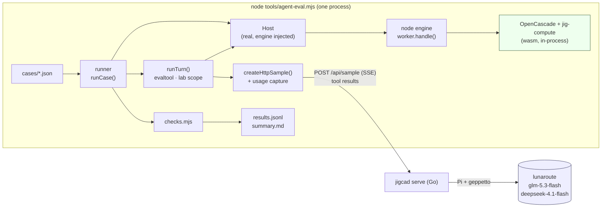

# Agent evaluation harness: analysis, design and implementation guide

## 1. Executive summary

The jigcad workbench has a coding agent. A person types a request, and a language model works on the open part through one tool, `eval`, which runs JavaScript against the workbench's API. Since JIG-002 the agent can run on a local Go server (`jigcad serve`) that reaches lunaroute's `glm-5.3-flash` and `deepseek-4.1-flash` through Pi's credentials. Live tests have shown that it works: a handful of turns, each run once. They do not show how *often* it works, how much a turn costs, or whether a change to the instructions, the reference, the round limit or the model makes things better or only different.

This ticket builds an **evaluation harness** that answers those questions with numbers. It has four parts:

1. **Cases as data.** Each case is a JSON file: a preset, a request, a mode, optional setup edits, and a list of machine-checkable expectations.
2. **A headless runner in Node.** It drives the real agent turn (`runTurn`), the real eval tool and lab scope, and the real workbench `Host` on top of the real engine (OpenCascade and jig-compute), running in-process. It sends model calls through the real browser adapter to `jigcad serve`, which forwards them to lunaroute.
3. **Checks.** A small vocabulary (file contents, compile state, parameter and metric values, sketch DOF, answer text, step counts, untouched files) evaluated against the host's final state and the turn record.
4. **Results.** One JSON line per run, with per-check outcomes, tool calls, rounds, tokens (input, cached, output) and time. A Markdown summary gives pass rates per model with 95 % Wilson intervals.

The design changes only three things in existing code. `Host` accepts an injected engine and stops touching `document` when there is none. The Go server adds a `usage` object to its `result` and `error` events. The adapter passes that usage through.

## 2. Why the harness is needed

### 2.1 What is known today

| Evidence | Source | Limit |
|---|---|---|
| Balanced turn, walls +0.4 mm: 9 tool calls, correct answer | JIG-002 diary step 4 | one run |
| Deep turn, fillet request: empty answer after 15 rounds, then ok in 12 rounds after the last-round note | JIG-002 diary step 4 | one run before, one after; the model also behaved differently |
| 88 % of input tokens served from lunaroute's prefix cache on an 8-tool turn | JIG-002 diary step 6 | one turn |

Every open question about the agent is statistical:

- Is the default of 16 rounds right?
- Should the Deep tier use deepseek or glm?
- Does the last-round note help in general?
- Does shortening the reference hurt accuracy?

The models are not deterministic, and cases differ in difficulty. A single run per configuration cannot separate an improvement from noise.

### 2.2 What the harness must measure

- **Correctness** of the final state: the file was edited as asked, it compiles, the numbers are right, nothing else changed.
- **Correctness** of the answer: it states the facts a correct answer must state.
- **Mode discipline**: Read-only mode must not edit files.
- **Cost and latency**: tool calls, model rounds, input tokens, cached input tokens, output tokens, wall time.
- **Failure kind**: `ok`, a turn note (stopped, rate limited, empty answer, length limit), or a harness error.

## 3. System orientation for a new reader

This section explains every part of the system that the harness touches, in the order a request flows through it.

### 3.1 Terms

- **Preset.** A named example part shipped with the workbench (`import/jigcad/content/presets/<ID>-<slug>/`): `script.js`, optional `notes.md` and data files, and `meta.json` (title, group, agent brief, suggested requests). There are 72, in nine groups. `A-01` is a 60 × 40 × 30 mm box with 2 mm walls; `A-03` is a constrained plate sketch; `S-01` is a cable clip print job.
- **Program.** The plain-data result of compiling a preset: summary, metrics (volume, mass, bounding box…), diagnostics, parameters with provenance, solved sketches, bodies with named faces, and IR text. See `import/jigcad/BUILD.md §3`.
- **Host.** The main-thread object that owns the open files, the current Program, the selection, the view and the parameter overrides (`src/host/host.js`). The UI and the agent act only through it.
- **Engine.** The jig compiler and OpenCascade, normally in a Web Worker (`src/engine/worker.js`), driven by six request types: `init`, `compile`, `call`, `solveSketch`, `export`, `run`.
- **Turn.** One agent exchange: the person's message, the steps (eval calls) the model makes, and its final answer.
- **Sample.** The capability `sample(turns, { tools, signal, modelTier, effort, onText })` that runs one whole turn's model rounds and returns the final text. On claude.ai the page gets it from `window.claude`. Elsewhere it comes from `src/host/sample-http.js`, which talks to `jigcad serve`.
- **Tier.** The panel's model choice: Fast (`quick`), Balanced (`default`), Deep (`complex`). `jigcad serve` maps quick and default to `lunaroute/glm-5.3-flash` and complex to `lunaroute/deepseek-4.1-flash`.

### 3.2 The agent turn

`runTurn` in `src/agent/turn.js` is the unit the harness drives:

```js
export async function runTurn({ host, sample, thread, text, settings, reference = '', signal, onUpdate, timeoutMs })
// → { ok, off? }; thread.turns gains { role: 'user', text } and
//   { role: 'agent', text, steps: [...], note?, pending: false }
```

It appends the user's message and an agent turn to `thread.turns`. It creates the eval tool, converts the thread into a list of `{ role, content }` messages (`toTurns` in `prompt.js`), calls `sample` **once**, and stores the final text. A rejection becomes a one-sentence `turn.note` through `explainError`, using the codes and sentences in `NOTES` and `OFF_CODES`.

`toTurns` builds the model's view of the thread:

- The **first user message** starts with `instructions(reference)`. That is a fixed text describing the workbench and the working method, followed by the reference: the **language reference** (`content/docs/reference.md`, 38.9 KB) and the **lab API** (`src/agent/reference.md`, 13.6 KB), joined by `host.reference()`. The total is about 52 KB, roughly 13 K tokens.
- The **newest user message** starts with a **context block** (`context(host)`): the preset, its brief, edited files, the open file, the selection, the compile state and key metrics.
- **Earlier agent turns** become one line per step, `[eval] <first line of code> → <result>`, then the answer.

### 3.3 The eval tool and the lab scope

`createEvalTool(host, { getMode, onStep, onUpdate, signal, timeoutMs })` in `src/agent/evaltool.js` returns `{ name: 'eval', description, inputSchema, execute(input, { signal }) }`. Each call:

1. Creates a **step** record `{ code, result, running, asking, error, ms, snapshot, changed, reverted }` and reports it through `onStep`.
2. In **Ask** mode, waits until the person approves (`step.resolve(true)`) or declines.
3. Takes a **snapshot** of the files.
4. Runs `runEval(host, code, { readOnly, signal, timeoutMs })`. That compiles the code as an async function whose parameters are the **lab scope** names. It races the code against a 25 s timeout and the abort signal, renders the value as YAML (with `console.log` output above it), and cuts the text at 9,000 characters.
5. Marks `step.changed` if the files differ from the snapshot.

The lab scope (`labScope(host, { readOnly, console })` in `src/agent/scope.js`) is the agent's whole API:

| Name | Purpose |
|---|---|
| `files.read/grep/write/edit/rename/remove` | the open preset's files; `edit(path, find, replace)` needs an exact, unique match |
| `run()` | recompile → `{ ok, errors, warnings, summary }` |
| `check(variant, options)` | compile a variant without touching the editor |
| `program.summary() .metrics(...) .graph() .params() .ir(level) .bodies()` | the compiled Program |
| `why(target)`, `faces(sel)`, `feature(id)`, `sketch(id)` | kernel questions answered by the engine |
| `params.set/clear`, `measure.*`, `select`, `view`, `presets.*`, `exportFile`, `lab` | the workbench's controls |

In **Read-only** mode, the names in `READONLY` (`files.write`, `files.edit`, `files.rename`, `files.remove`, `run`, `params.set`, `params.clear`, `presets.load/create/rename`) throw. The scope uses about forty members of the Host, which is why the harness must run the real `Host` rather than a mock (§6, D1).

### 3.4 The Host and its engine client

`new Host({ forceMock, forceJsCompute })` creates its engine client with `createEngine` (`src/host/engine.js`). In a browser that starts `dist/worker.js` as a module worker. Without `Worker`, as in Node, it falls back to an in-thread **mock engine** that only imitates a box. The Host uses four members of the engine client:

```js
engine.ready      // a promise, resolved when init has answered
engine.request(op, args) // → reply without { id, ok }; rejects with the engine's error
engine.compute    // { kind: 'rust' | 'js', … } from init
engine.initMs     // load time
```

The Host methods the harness relies on:

```js
await host.loadPreset(id)        // files from the bundled content (no localStorage in Node → published files)
await host.compile()             // compile files + overrides → host.program (and host.lastGood if ok)
await host.check(files, opts)    // what-if compile; keep: false
host.files                       // Map path → text
host.program                     // last ProgramData
host.reference()                 // the Reference text sent to the agent
host.setFile(path, text)         // used by case setup
```

The Host imports `../generated/content.json` (written by `node build.mjs`) and `../agent/reference.md`. Node cannot import either file as written, so the runner registers loader hooks that serve JSON and Markdown as modules (§5.6). `applyTheme()` writes `document.documentElement.dataset.theme`. That line must be guarded for Node.

### 3.5 The engine in Node

`src/engine/worker.js` exports `handle(msg)`, which accepts the same messages a worker receives and returns the reply. `tools/preset-check.mjs` uses it to compile all presets in Node:

```js
register(new URL('../test/engine/loader.mjs', import.meta.url).href);   // module hook for core.js
const W = await import('../src/engine/worker.js');
await W.handle({ id: 0, op: 'init' });                                  // loads OpenCascade + jig-compute
const r = await W.handle({ id: 1, op: 'compile', files, entry: 'script.js', options: {} });
```

OpenCascade loads from `vendor/occt/replicad_single.wasm` (unpacked from the `.gz` once), and jig-compute from `dist/jig_compute.wasm`. Init takes about 0.3 s. The worker keeps one current Program, so one process can hold only one Host's state at a time, and the harness runs cases sequentially.

### 3.6 The sample capability and the Go backend

`createHttpSample(base, fetch)` in `src/host/sample-http.js` returns the `sample` function. It POSTs `{ input, modelTier, model, effort, tools }` to `api/sample` and reads a server-sent-event stream:

| Event | Data | Adapter action |
|---|---|---|
| `call` | `{ call }` | remember the call id |
| `text` / `thinking` | `{ text, delta }` | `onText` |
| `tool` | `{ use, name, input }` | run the tool, POST `{ value, isError }` to `api/sample/{call}/tools/{use}` |
| `result` | `{ text, truncated, modelTierApplied, modelUsed }` | resolve |
| `error` | `{ code, message }` | reject with `.code` |

`jigcad serve` (`cmd/jigcad`, `pkg/server`, `pkg/sample/gepp`) runs up to 16 model rounds per call. The last round offers no tools and carries a note asking for a final answer. The server waits up to 150 s for each tool result. Per call it logs one line with tokens, including cache reads:

```
sample jcdc79ff… tier=default model=lunaroute/glm-5.3-flash tools=8 in=170359 cacheRead=149248 cacheWrite=0 out=1650 ms=16668 outcome=ok
```

Today the page never sees token counts; the harness needs them (§5.5).

### 3.7 The whole path in the harness



Everything inside the runner box is production code except the runner, the checks and the node engine adapter. The model calls go through the same server and adapter a browser uses. The only browser parts not exercised are the panel's rendering and the stage.

## 4. Requirements

| # | Requirement |
|---|---|
| R1 | A case is a JSON file; adding a case needs no code |
| R2 | The runner uses the production agent turn, eval tool, lab scope, Host, engine, adapter and Go server |
| R3 | Each run records per-check results, the answer, step summaries, tool calls, rounds, input/cached/output tokens, wall time and outcome |
| R4 | Runs repeat (`--repeat n`) and the summary reports pass rates with confidence intervals per tier |
| R5 | A run never hangs: each turn has a deadline, after which it is aborted and recorded as such |
| R6 | The harness tests itself without network access, using a scripted model |
| R7 | Results are files a later run can be compared with |

## 5. Design

### 5.1 Files

```
import/jigcad/tools/agent-eval.mjs           CLI: parse flags, register loader, run cases, write results
import/jigcad/tools/agent-eval/
  loader.mjs                                  module hooks: .json and .md as modules; core.js shim
  node-engine.mjs                             createNodeEngine(): the engine client over worker.handle()
  runner.mjs                                  loadCases(), runCase(), runAll()
  checks.mjs                                  CHECKS vocabulary, evaluate(case, state)
  report.mjs                                  summarise(records), wilson(k, n), markdown(summary)
import/jigcad/test/agent-eval/cases/*.json   the cases
import/jigcad/test/agent-eval/harness.test.mjs  self-test with a scripted sample (no network)
import/jigcad/src/host/host.js               + constructor option { engine }; applyTheme guarded
import/jigcad/src/host/sample-http.js        + result.usage / error.usage passthrough
pkg/server/server.go                          + usage in result and error events
```

### 5.2 Case format

```json
{
  "id": "a01-wall-edit",
  "preset": "A-01",
  "mode": "auto",
  "request": "Set the wall thickness to 2.4 mm in the script, recompile, and tell me the new mass.",
  "setup": [{ "edit": { "path": "script.js", "find": "…", "replace": "…" } }],
  "checks": [
    { "kind": "compiles" },
    { "kind": "file", "path": "script.js", "matches": "wall:\\s*mm\\(2\\.4\\)" },
    { "kind": "metric", "name": "mass", "approx": 22.505, "tol": 0.05 },
    { "kind": "answer", "matches": ["22[.,]5"] },
    { "kind": "steps", "max": 12 }
  ],
  "tags": ["edit", "params"]
}
```

- `mode` is `auto`, `read` or `ask`. In `ask`, the runner approves every step, which exercises the approval path without a person.
- `setup` is a list of edits applied to the preset's files before the turn, for example to plant a bug.
- `checks` must all pass for the run to pass.
- `tags` group cases in the summary.

### 5.3 Check vocabulary

Each check is evaluated against `state = { host, initialFiles, files, program, turn, steps }` after the turn:

| `kind` | Fields | Passes when |
|---|---|---|
| `compiles` | — | `program.ok !== false` and no diagnostic has level `error` |
| `fails` | `diagnostic?` | the program has an error diagnostic (of that kind, if given) |
| `file` | `path`, `matches?`, `notMatches?`, `contains?` | the final file satisfies each given pattern |
| `unchanged` | `paths?` | the files (or the listed ones) equal their initial text |
| `metric` | `name`, `approx`, `tol` or `equals` (arrays compared element-wise) or `min`/`max` | `program.metrics[name].value` matches |
| `param` | `name`, `approx`, `tol` | the parameter row's `value` matches |
| `sketchDof` | `id`, `dof` | the solved sketch has that DOF |
| `answer` | `matches?` (all), `any?`, `notMatches?` | the final answer satisfies the regexes (case-insensitive) |
| `steps` | `min?`, `max?` | the number of eval steps is in range |
| `stepCode` | `matches` | some step's code matches (for example, used `check(`) |
| `noNote` | — | the turn ended without a note other than `truncated` |

Checks are data, so they can be listed and counted, and a wrong expectation is fixed by editing JSON.

### 5.4 The runner

```js
async function runCase(c, { sample, tier, host, deadlineMs }) {
  await host.loadPreset(c.preset);
  host.resetOverrides();
  for (const s of c.setup ?? []) applySetup(host, s);           // planted bugs, prior edits
  await host.compile();
  const initialFiles = Object.fromEntries(host.files);
  const thread = newThread();
  const capture = captureUsage(sample);                          // wraps sample: keeps result/error usage
  const ctl = new AbortController();
  const timer = setTimeout(() => ctl.abort(), deadlineMs);
  const settings = { mode: c.mode === 'read' ? 'read' : c.mode === 'ask' ? 'ask' : 'auto', tier, effort: '' };
  const t0 = performance.now();
  const autoApprove = setInterval(() => approvePending(thread), 50);   // ask mode
  const r = await runTurn({ host, sample: capture.fn, thread, text: c.request, settings,
                            reference: host.reference(), signal: ctl.signal });
  clearTimeout(timer); clearInterval(autoApprove);
  const turn = thread.turns.at(-1);
  if (host.program == null || filesChangedSince(host.program)) await host.compile();  // judge the final files
  const checks = evaluate(c, { host, initialFiles, files: Object.fromEntries(host.files), program: host.program, turn, steps: turn.steps });
  return { case: c.id, tier, pass: checks.every(x => x.pass), checks, ms: performance.now() - t0,
           outcome: turn.note ? noteCode(turn.note) : 'ok', toolCalls: turn.steps.length,
           usage: capture.usage, answer: turn.text, steps: turn.steps.map(stepSummary) };
}
```

Two details matter:

- **The judged state is the final files, compiled.** The agent may have edited without recompiling, or compiled a variant last with `check()`. Recompiling the final files makes `compiles` and `metric` checks judge what the person would see after the turn.
- **One Host per process, reloaded per case.** `loadPreset` resets files, overrides, selection and Program. In Node there is no `localStorage`, so no saved edits leak between cases.

### 5.5 Token usage

The harness needs per-turn token counts. They exist only on the server today: the `usage` events are summed into the log line. The change is additive:

- `pkg/server` adds `usage: { input, cacheRead, cacheWrite, output, rounds, model }` to the data of the `result` and `error` events. `rounds` is the number of usage events, one per model round.
- `sample-http.js` copies `ev.usage` onto the returned result (`res.usage`) and onto rejection errors (`err.usage`).
- The runner wraps the sample function to keep the last usage it saw, because `runTurn` returns only `{ ok, off }`.

slop-computer withholds usage from pages, because its pages are untrusted apps run by many users. `jigcad serve` serves a single operator on loopback (or behind a token), so exposing token counts to its own page reveals nothing new.

### 5.6 Loader hooks

`tools/agent-eval/loader.mjs` extends the engine tests' loader (`test/engine/loader.mjs`, which shims `core.js`). Its `load` hook returns `export default <JSON>` for `.json` URLs and `export default <JSON string>` for `.md` URLs. The Host's imports then resolve unchanged. The runner registers it with `module.register()` before importing any `src/` module.

### 5.7 The node engine

```js
export async function createNodeEngine({ compute } = {}) {
  const W = await import('../../src/engine/worker.js');
  let seq = 0;
  const engine = { kind: 'node', version: null, compute: null, initMs: null };
  engine.ready = W.handle({ id: ++seq, op: 'init', options: compute === 'js' ? { compute: 'js' } : {} })
    .then(r => { if (!r.ok) throw new Error(r.error?.message); Object.assign(engine, { version: r.version, compute: r.compute, initMs: r.ms }); });
  engine.request = async (op, args = {}) => {
    await engine.ready;
    const r = await W.handle({ id: ++seq, op, ...args });
    if (!r.ok) throw Object.assign(new Error(r.error?.message || `${op} failed`), r.error || {});
    const { id, ok, ...rest } = r; return rest;
  };
  engine.terminate = () => {};
  return engine;
}
```

This mirrors `createEngine`'s contract. The only difference is that requests are function calls instead of `postMessage`.

### 5.8 Results and summary

Each run appends one line to `results.jsonl`:

```json
{"case":"a01-wall-edit","tier":"default","repeat":1,"pass":true,"outcome":"ok","ms":16668,
 "toolCalls":8,"usage":{"input":170359,"cacheRead":149248,"cacheWrite":0,"output":1650,"rounds":9,"model":"lunaroute/glm-5.3-flash"},
 "checks":[{"kind":"compiles","pass":true},{"kind":"metric","pass":true,"detail":"mass 22.505 ≈ 22.505"}],
 "answer":"…","steps":[{"code":"const src = files.read('script.js');","ms":2,"error":false,"changed":false}]}
```

`summary.md` has one table per tier. The columns are passed / runs, pass rate with a 95 % Wilson interval, mean tool calls, mean rounds, mean input tokens, mean cached share, mean output tokens and mean seconds. A second table lists each case per tier with its pass count and the checks that failed most often.

The **Wilson score interval** is used because pass rates near 0 or 1 with small *n* make the normal approximation produce impossible bounds. For *k* passes in *n* runs, with *z* = 1.96:

$$\hat p = k/n,\quad \text{centre} = \frac{\hat p + z^2/2n}{1 + z^2/n},\quad \text{half-width} = \frac{z}{1+z^2/n}\sqrt{\frac{\hat p(1-\hat p)}{n} + \frac{z^2}{4n^2}}$$

With 13 cases × 3 repeats = 39 runs and 30 passes, the interval is about 0.62–0.87. That width shows how many runs it takes to distinguish two configurations.

### 5.9 Command line

```
node tools/agent-eval.mjs [--base http://127.0.0.1:8787/] [--tiers default,complex] [--repeat 1]
                          [--cases a01-] [--out ../../ttmp/…/various/runs/<stamp>] [--deadline 300]
                          [--compute rust|js] [--scripted]
```

`--scripted` replaces the model with a scripted sample for the self-test cases. The default output directory is `test/agent-eval/out/<timestamp>/` (gitignored); runs worth keeping are copied into the ticket's `various/`.

## 6. Decision records

### D1: Run the real Host in Node

- **Context:** the lab scope uses about forty Host members, including `check`, overrides, presets, selection and links. `test/agent/mock-host.js` imitates a subset with a box-only compiler.
- **Options:** (a) the mock host; (b) the real Host in Node with an injected engine; (c) drive the real page in a headless browser.
- **Decision:** (b). The mock would test the mock, not the agent. A browser adds rendering, timing and selector fragility, while the agent's behaviour lives entirely in Host, scope, turn and adapter, all of which run in Node.
- **Consequences:** two small Host changes (engine injection, a `document` guard) and loader hooks for `.json` and `.md`.

### D2: Model calls go through `jigcad serve`

- **Options:** call `gepp.Backend` directly from a Go test binary, or go through the HTTP server and the browser adapter.
- **Decision:** through the server and adapter. That tests the path users run: the SSE protocol, tool round trips, the last-round note and the server's round limit.
- **Consequences:** a running server is a prerequisite; the runner checks `GET api/sample/models` first and stops with a clear message if it is absent.

### D3: Checks are data

- **Decision:** a fixed vocabulary of check kinds in JSON. A case cannot run arbitrary code.
- **Consequences:** cases are easy to review and count. A new kind of expectation needs a new check kind in `checks.mjs`, with a unit test.

### D4: Usage travels with the result

- **Decision:** add `usage` to the server's `result` and `error` events (§5.5).
- **Alternative rejected:** parse the server log. That ties the harness to log formatting and to a local file.

### D5: Sequential runs

- **Context:** the engine keeps one current Program per process, and lunaroute applies rate limits.
- **Decision:** one case at a time. Parallelism would need one process per worker and could trigger rate limiting, which would make the measurements noisier.

### D6: Repeats and Wilson intervals

- **Decision:** `--repeat` (default 1 for smoke runs, 3 for baselines), with Wilson intervals in the summary.

### D7: A scripted model for self-tests

- **Decision:** `harness.test.mjs` runs `runCase` with a scripted `sample` that issues known eval calls (the pattern of `test/agent/scripted.js`) on the real engine. It checks that edits, compiles, checks, usage capture and records behave as specified, without network access.

## 7. Implementation phases

1. **Plumbing.** Add Host engine injection and the `document` guard, the loader hooks, the node engine, and a smoke script that loads A-01 through the real Host in Node and compiles it.
2. **Usage.** Add usage to the server's `result` and `error` events, the adapter passthrough, and Go and adapter tests.
3. **Checks and runner.** Write `checks.mjs` with unit tests, `runner.mjs`, and the self-test with a scripted sample.
4. **Cases.** Write 12–15 cases over A-01, A-03 and S-01, with ground truth computed by the engine (wall 2.4 mm → mass 22.505 g; height 35 mm → volume 17,229.93 mm³; 80 × 50 mm → bbox [80, 50, 30]; wall 3 mm → the shell fails; A-03 DOF 1 with `h2.center.x` free; S-01 orients −Y).
5. **CLI and report.** Add `agent-eval.mjs`, `report.mjs` and the Wilson interval.
6. **Baseline.** Run all cases on both tiers with three repeats each, store the results in the ticket, and write up the findings.

## 8. Test strategy

- **Unit tests:** every check kind on synthetic states (pass and fail); `wilson()` against known values; `summarise()` on fixed records.
- **Self-test:** a scripted sample on the real engine produces a passing record for an edit case and a failing record for a deliberately wrong expectation.
- **Go:** the server test asserts `usage` in the `result` event of the fake backend.
- **Adapter:** the Node adapter test asserts `res.usage` and `err.usage`.
- **Live:** the baseline run itself; its results are evidence, not a pass/fail gate.

## 9. Risks and open questions

- **Answer checks are approximate.** A regex can reject a correct answer phrased differently, or accept a wrong one. Keep answer checks to facts with a fixed form (numbers, names, identifiers) and prefer state checks where possible.
- **Cost and rate limits.** A baseline of 39 runs on two tiers is about 80 turns. With the prefix cache, most input tokens are cache reads, but lunaroute may throttle. The runner records `rate_limited` as an outcome rather than retrying silently.
- **Build prerequisites.** `src/generated/content.json` and `dist/jig_compute.wasm` come from `node build.mjs`, and the OpenCascade wasm must be unpacked. The runner checks for these and names the missing step.
- **Ask-mode approval** is automated, so the harness does not measure how people decide. It measures only that the approval path works.

## 10. References

- `import/jigcad/src/agent/turn.js` (`runTurn`, `explainError`, `NOTES`), `prompt.js` (`instructions`, `context`, `toTurns`), `evaltool.js` (`createEvalTool`, `runEval`), `scope.js` (`labScope`, `READONLY`)
- `import/jigcad/src/host/host.js` (`Host`), `engine.js` (`createEngine`), `sample-http.js` (`createHttpSample`, `httpSample`)
- `import/jigcad/src/engine/worker.js` (`handle`), `tools/preset-check.mjs` (Node usage), `test/engine/loader.mjs`
- `import/jigcad/test/agent/mock-host.js`, `scripted.js`, `sample-http.test.mjs`
- `pkg/server/server.go` (`start`, `emit`), `pkg/sample/types.go` (`Usage`)
- JIG-002 design doc and diary (the backend, the last-round note, prompt-cache measurements)
