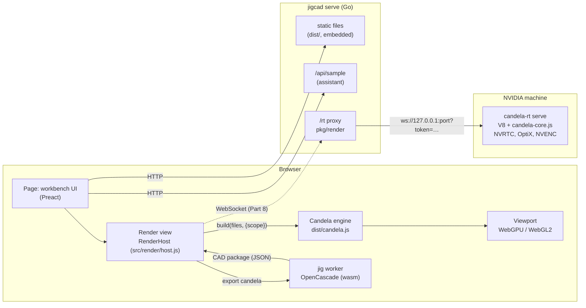
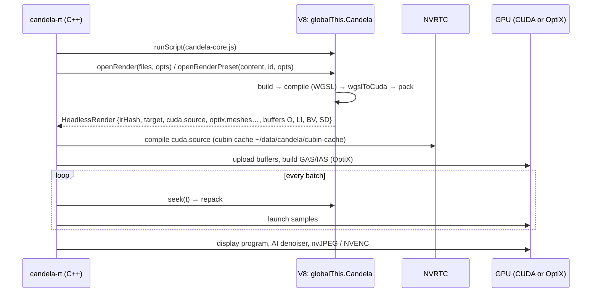
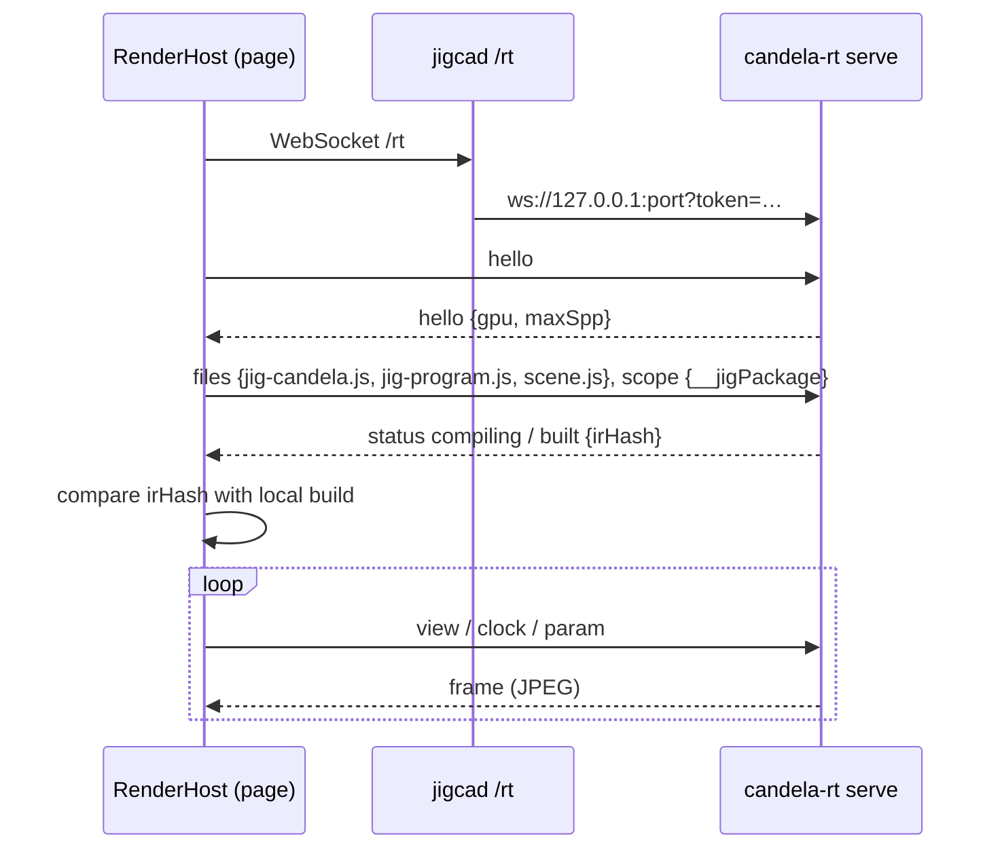

# Candela inside jig: an intern guide to the renderer, its native worker, and the integration

## 0. Status

This section is the as-built summary; the rest of the document explains the system and the reasons behind it. It is
updated at the end of JIG-017 (see the ticket's diary for the evidence of each step).

- **Done in JIG-017:** Candela's repository (pbr-spark) moved into jig at `import/candela` with its history, and
  pbr-spark is archived with a notice pointing here; jig
  builds both Candela bundles from that tree and the vendored copy is gone; Candela's core is written where Candela's
  tools and candela-rt look for it and copied into jig's `dist/`; Candela's engine tests run in jig's `make test-js`
  and CI without npm, in about 13 s, against a golden baseline per CPU architecture; Candela's tickets joined jig's `ttmp`; `make candela-rt` builds the native renderer; `jigcad serve`
  also finds candela-rt next to its own binary; a GPU CI workflow is ready for a self-hosted `nvidia` runner.
- **Designed here, not built yet (Part 8):** candela-rt rendering a jig CAD package (scope, poses, jobs), the Render
  view's OptiX mode through `/rt`, rendering on a remote GPU, and a release artifact for candela-rt.
- **Verified:** see §7.9 for every check and its result.

## 1. What this document is for

jig is a CAD workbench whose models are JavaScript programs. Candela is a physically based path tracer whose scenes
are also JavaScript programs. Since JIG-016, jig renders its models with Candela: a Render tab path-traces the open
model in the browser, and `jigcad serve` can start `candela-rt`, Candela's native renderer for NVIDIA GPUs, as a
child process. Until JIG-017 the two lived in two repositories, and jig carried a vendored copy of Candela's engine.
JIG-017 moved Candela into jig.

This guide is written for an engineer who will work on any of these parts and has not seen them before. It explains,
in order:

1. the whole system on one page (Part 2);
2. the parts of jig you need (Part 3);
3. Candela's engine: how a scene program becomes pixels (Part 4);
4. candela-rt, the native worker (Part 5);
5. how jig uses Candela, which JIG-016 built (Part 6);
6. the integration JIG-017 did, step by step, with the reasons (Part 7);
7. what comes next, designed in enough detail to implement (Part 8);
8. API and file references (Parts 9 and 10), decisions (Part 11) and a glossary (Part 12).

Read Parts 2–6 once before you change anything. Parts 9 and 10 are for looking things up.

## 2. The system on one page

Three processes take part when jig renders, and a fourth runs the model's geometry:

- **The page** (the workbench UI, Preact) owns the Render view. Candela's engine runs here: it builds the scene,
  compiles it to a GPU program and draws into a canvas with WebGPU or WebGL2.
- **jig's worker** (a Web Worker) runs the CAD kernel, OpenCascade compiled to WebAssembly. It evaluates the model
  script and, on request, exports the model as a **CAD package**: triangle meshes whose faces keep jig's names and
  carry exact geometric metadata.
- **`jigcad serve`** (Go) serves the workbench's files, runs the assistant's model calls, and supervises candela-rt.
- **`candela-rt`** (C++, CUDA, OptiX; only on an NVIDIA machine) runs the same Candela engine inside V8, translates
  the scene's GPU program to CUDA and renders it on the GPU, either for a live view over a WebSocket or for files.



The dotted edge is the part Part 8 designs: the Render view does not talk to candela-rt yet. Today `/rt` is proxied
and candela-rt is supervised, and Candela's own workbench (in `import/candela/src/app`) can use it, but jig's Render
view renders only in the browser.

Two facts explain most of the design:

- **The same engine code runs in the browser and in candela-rt.** `candela-core.js` is one JavaScript file built from
  `import/candela/src/engine/core.ts`. The page loads the engine (plus its browser layer) and candela-rt loads the
  core into V8. A scene therefore builds and compiles identically in both, and the two can prove it by comparing a
  hash of the generated GPU program (`irHash`).
- **The GPU program is generated per scene.** Candela compiles each scene into WGSL (WebGPU's shading language). The
  browser runs that WGSL; candela-rt translates the same WGSL to CUDA and compiles it with NVRTC at run time. A change
  to a material is a change to the program.

## 3. The parts of jig you need

### 3.1 The workbench and its processes

jig's JavaScript lives in `import/jigcad`. The page and the worker are bundled by `import/jigcad/build.mjs` with
esbuild into `import/jigcad/dist/`:

| Output | Built from | What it is |
|---|---|---|
| `dist/app.js` | `src/main.jsx` | the page: UI (`src/ui`), host (`src/host/host.js`), stage renderer (`src/stage`), Render view |
| `dist/worker.js` | `src/engine/worker-main.js` | the CAD worker: OpenCascade, script evaluation, exports |
| `dist/agent-worker.js` | `src/agent/sandbox/worker-main.js` | the assistant's sandboxed evaluation worker |
| `dist/candela.js` | `src/render/candela.js` | Candela's engine and browser layer as one ES module, loaded by the Render view on first use |
| `dist/candela-core.js` | `import/candela/src/engine/core.ts` | Candela's non-DOM core as an IIFE (`globalThis.Candela`), the file candela-rt loads |

jig's build needs no npm packages: esbuild is installed into `.bin/` by `make esbuild`, and everything else is in the
tree. `make build-bin` embeds `dist/` into the `jigcad` binary (`-tags embed`), so a release is one file.

**The host** (`src/host/host.js`) is the page's model of the open project: its files (`script.js`, notes, data
files, and since JIG-016 the look files), parameter overrides, the last compiled program, the selection, and an event
bus (`host.on('program' | 'files' | 'overrides' | 'pose' …)`). It sends compile requests to the worker:
`engine.request('compile', { files, entry: 'script.js', options: { override } })`.

**The worker** answers `handle({ op })` messages (`src/engine/worker.js`): `compile` returns `{ ok, program }`,
`export` returns `{ data, filename, mime }`, `call` runs methods on the compiled program (for example the stage's
`dragPose`).

### 3.2 What jig knows about a model

- **Persistent face names.** Each feature (`extrude`, `revolve`, `hole`, `add`, `pattern` …) has an id, and every
  face it makes is named after it and the sketch entity it came from, e.g. `body/side[s.big]`. In an assembly the
  component comes first: `rod#body/side[s.big]`. Names survive recompiles.
- **Exact surface data.** Each face's kind (plane, cylinder, cone, torus, B-spline), normal, axis and radius come from
  the B-rep, not from triangles.
- **Assemblies and studies.** Components are placed by joints; a study sweeps a drive (a joint value) and records,
  per row, every component's world transform.

### 3.3 `jigcad serve`

`cmd/jigcad/main.go` defines `jigcad serve`; `pkg/server/server.go` the HTTP routes:

| Route | What it does |
|---|---|
| `GET /…` | the workbench's files (embedded, or `--dist <dir>`) |
| `POST /api/sample`, `GET /api/sample/models` | the assistant's model calls, through Pi's agent directory (`~/.pi/agent`) |
| `GET /rt` | WebSocket proxy to candela-rt (with its token added), when the sidecar is up |
| `GET /api/render/capabilities` | `{ rt, state, reason, restarts }`; `state` is `off`, `starting`, `up` or `down` |

`pkg/render` is the candela-rt supervisor (§5.6 and §7.7).

## 4. Candela's engine

Candela's engine is about 7,400 lines of TypeScript in `import/candela/src/engine`, with no runtime npm dependencies.
This part follows one scene from its source files to pixels.

### 4.1 Scenes are programs

A Candela scene is a set of JavaScript files. The main one, `scene.js`, imports builders from the library `candela`
and exports a scene. This is the first preset, `content/presets/B-01-….js`, in full:

```js
import { scene, shape, material, light, camera, units as u } from 'candela';

export default scene()
  .add(shape.sphere(1).at(0, 1, 0)
    .material(material.pbr().baseColor('#c8553d').roughness(0.4)))
  .add(shape.plane(30)
    .material(material.pbr().baseColor(0.18)))            // an 18 % grey card
  .light(light.daylight({ elevation: u.deg(40), turbidity: 3 }))
  .camera(camera.thinLens().at(0, 1.6, 6).lookAt(0, 0.9, 0));
```

Three things in it recur everywhere. `material.pbr()` is not a primitive of the renderer: `stdlib.ts` defines it in
the grammar itself as a mix of simpler BSDFs, which is why a material can be composed and inspected. Quantities
carry units (`u.deg(40)`; `units.ts` types radiometric and photometric values). And nothing here draws anything: each
call returns a new immutable builder, and the exported value is a description that the compiler lowers.

`build(files, options)` (`candela.ts:116`) runs these files through a small module system, `runFiles`
(`candela.ts:70`):

- Imports of the libraries `candela`, `candela/fragments`, `candela/test` and `candela/units` resolve to the engine
  (the `LIB` table in `runFiles`); any other import resolves to another file of the map, with `.js` added and `./`
  taken relative to the importing file. A missing file is error `E150`, with a did-you-mean suggestion.
- The transform is line-based: `import … from` and `export …` lines become assignments, and each module runs inside an
  `async` function created with `new Function`. The files other than `scene.js` are evaluated first, in an order
  found by retrying until each one's imports are loaded; `scene.js` runs last.
- Every module sees a `Math` whose `random()` is seeded per build, so a scene that scatters objects randomly builds
  the same way twice, and in the browser and in candela-rt alike.
- `options.scope` injects named values into every module's function scope (they become extra parameters of the
  function). jig uses this to hand the CAD package to the scene without turning megabytes of mesh data into source
  text (§6.2).

Builders are immutable: every method returns a new builder. `build` returns `{ ok, compiled, diags, error }`;
diagnostics carry codes (`E104`, `W170` …, `diag.ts`) and point at the line of the scene that caused them.

### 4.2 Compiling: from builders to a GPU program

`compile.ts` lowers the scene graph:

- **Generated WGSL.** Materials, signed distance functions and media become WGSL functions, appended to the path
  tracer itself (`kernel.ts`, 1,513 lines, written in a strict WGSL subset so it can be translated). The whole program
  is `compiled.shared`. A material is code: changing a material changes the program and costs a shader compile.
- **Objects and lights** (`compiled.objects`, `lightsMeta`), the material table (`compiled.materials`), the camera's
  motion blur (`compiled.motionBlur`), the environment (`hdri`), the ids that can be posed (`poseIds`).
- **`irHash`.** `digestString(compiled.shared)` (`digest.ts`) is the program's identity. The browser and candela-rt
  compare it to know they compiled the same scene.

### 4.3 Packing: the per-frame data

`compiled.pack(env)` (`compile.ts:560`, `pack` at 641) writes the buffers the GPU reads every frame: objects with
their transforms (`O`, 24 floats per object, with the world-to-object matrix at offset 4), lights (`LI`), BVH nodes
(`BV`), shape data (`SD`) and uniforms. `env` carries the time, the poses at that time and, with motion blur, poses at
several instants. Moving a part is a repack, not a recompile.

**Poses** are world matrices by node id. They come from the scene's `export const animation` (a function of time) and
from outside through `setPoses` (a map or a function); outside poses win (`viewport.ts:104–107`).

### 4.4 The browser layer

- **`Viewport`** (`viewport.ts`) drives a backend: `init(prefer)`, `load(compiled, { time })` (compiles the shaders,
  packs, uploads), `frame()` (one batch of samples into the accumulation buffer), `repack(t)`, `setPoses(p)`,
  `setView(v)`, `reset()`. It meters exposure at 2, 8 and 32 samples. Note: `load` sets `compiled` before `packed`
  exists, so a host must not draw frames while loading (jig's `RenderHost` guards this).
- **Renderers** (`render.ts`): WebGPU compute when available, else WebGL2 fragment shaders, using `wgsl2glsl.ts` to
  translate the kernel's WGSL subset to GLSL ES 3.00.
- **Render jobs** (`output.ts`): `runRender(opts, { vp, signal, seek, onProgress })` renders a still or a sequence at
  a fixed size and sample count, meters once and holds exposure, and writes PNG, EXR or video (`video.ts`, WebCodecs).
- **Picking support** (`mesh.ts`): `rayMesh` intersects a ray with a packed mesh; jig uses it for clicks.

### 4.5 The core and the browser bundle

`core.ts` is the non-DOM entry: `build`, `SceneSession` (`session.ts`, the clock, behaviours and poses without a GPU),
digests, `openRender` (`headless.ts`, a scene held for a native renderer), `wgslToCuda`, `cudaProgram`. esbuild
bundles it as an IIFE that defines `globalThis.Candela`, targeting ES2020 because candela-rt's V8 is version 10.2.
jig's `dist/candela.js` is a different, larger bundle: the core plus `Viewport`, the renderers, `runRender`, video and
`rayMesh`, as an ES module (`import/jigcad/src/render/candela.js`).

### 4.6 Candela's own workbench and tools

`import/candela/src/app` is Candela's standalone workbench (React, Vite): presets, a parameter panel, the IR view, an
assistant, a Render view, and the OptiX mode that talks to candela-rt (`remote.ts`). It is a development tool for the
engine. It has its own `package.json` (React, Vite, Playwright, the `webgpu` Dawn bindings, the Anthropic SDK), and jig
does not build or ship it. `import/candela/content` holds the 105 preset scenes and the engine's docs;
`scripts/` the tools (bundling, digests, parity sweeps); `tests/` the engine's tests.

## 5. candela-rt, the native worker

candela-rt lives in `import/candela/native/rt` (C++20; about 220 KB of source, including the CUDA headers it
compiles scenes against at run time). The ticket's reference
document `reference/01-candela-rt-technical-map…` has the full map with line numbers; this part explains what an
engineer needs to know first.

### 5.1 What it is

A command-line program that embeds V8, loads `candela-core.js`, and drives Candela's engine from C++:

```
candela-rt render <preset-id> [--size 640x360] [--spp 64] [--backend auto|cuda|optix] [--format pfm,png,exr,mp4] …
candela-rt serve  [--port 8790] [--bind 0.0.0.0] [--token T] [--bundle dist-core/candela-core.js] [--max-spp 2048] …
candela-rt digest | session | cuda-sweep   (checks: the same engine in V8 as in Node; kernels compile for this GPU)
```

The defaults `--bundle dist-core/candela-core.js` and `--content content` are relative to the working directory, so
candela-rt is run from `import/candela` (or given both flags). jigcad passes `--bundle` explicitly.

### 5.2 Inside: V8, then the GPU



- **V8** comes from Ubuntu's `libnode-dev` (Node 18, V8 10.2), used through the raw embedder API: no `require`, no
  `process`. candela-rt provides `console`, `performance.now`, `atob`, `btoa` and a `TextEncoder` polyfill. There is
  no watchdog: an infinite loop in scene code hangs the renderer.
- **Translation and compilation.** At open time, in V8, the whole `compiled.shared` is translated to CUDA
  (`wgsl2cuda.ts`). candela-rt compiles it with NVRTC for the GPU's architecture and caches the result keyed by the
  source hash, the kernel headers, the architecture and the options (not by paths).
- **Two backends.** `--backend auto` picks OptiX when the scene has meshes or many analytic objects, CUDA otherwise.
  OptiX replaces the program's traversal function with `optixTrace` on the RT cores, builds one acceleration
  structure per mesh, and uses motion transforms for blur, built-in spheres, and shader execution reordering (SER)
  where it pays.
- **Outputs.** A display program (tone mapping, optional denoise passes), the OptiX AI denoiser, nvJPEG for live
  frames, ffmpeg with NVENC for MP4, and PFM, PNG and EXR files.

### 5.3 `serve`: the live protocol

A client connects with a WebSocket and sends JSON messages; candela-rt answers with JSON and binary frames.

| Client → server | Fields | Effect |
|---|---|---|
| `hello` | — | reply `hello`; resend `built` if a scene exists |
| `files` | `files`, `params?`, `time?`, `seed?` | replace the scene and rebuild |
| `param` | `id`, `value` | set a parameter: repack or rebuild |
| `view` | `view`, `width`, `height` | camera override and image size |
| `clock` | `t`, `playing`, `rate` | seek, or play on the server's clock |

| Server → client | Fields |
|---|---|
| `hello` | `server: 'candela-rt'`, `gpu`, `maxSpp`, `maxWidth` |
| `status` | `state`: `building`, `compiling` (with `target`), or `taken` |
| `built` | `ok`, `irHash`, `target`, `buildMs`, `compileMs`, `pipelineMs`, `motion`, `width`, `height` (or `ok: false, error`) |
| `error` | `message` |
| frame (binary) | uint32 LE header length, header JSON `{type:'frame', t, spp, ev, width, height, epoch, playing, denoise …}`, JPEG |

One session thread owns V8, the CUDA context and the renderer; network threads only queue messages. One client at a
time owns the session; a newer one takes it over and the old one gets `status: taken`. `--token` is checked as a
substring of the request URI; there is no TLS, which is why jigcad binds candela-rt to `127.0.0.1` and proxies it.

What the protocol cannot do yet matters for jig (Part 8): there is no way to pass `scope`, so a CAD package can only
travel as a JavaScript source file; there are no messages for poses, motion-blur overrides or render jobs.

### 5.4 Building it

`native/rt/CMakeLists.txt` (CMake ≥ 3.24, C++20, C++ only; no device code at build time):

- V8 from `/usr/include/node` and `libnode`; CUDA toolkit (driver API, NVRTC, nvJPEG, cudart); zlib;
- the OptiX SDK 9.0 headers via `OptiX_INSTALL_DIR` (default `~/opt/NVIDIA-OptiX-SDK-9.0.0-linux64-aarch64`; the SDK
  must match the driver's OptiX ABI: 9.1 fails on driver 580);
- IXWebSocket v11.4.6 fetched at configure time.

The kernel headers' directory and the OptiX and CUDA include directories are compiled in as absolute paths, because
NVRTC needs them when a scene is compiled at run time. Two consequences: reconfigure after moving the tree, and a
binary copied to another machine needs `--kernels` and the same SDK layout (§8.6).

### 5.5 Checks

| Check | Needs | What it proves |
|---|---|---|
| `tests/session.test.ts` | Node | sessions, poses and seeds behave |
| `tests/golden-pack.test.ts` | Node | compile and pack output is unchanged for every preset (baseline per CPU architecture, §7.10) |
| `candela-rt digest` + `scripts/core-digest.ts --compare` | GPU machine, Node | V8 in candela-rt and Node produce identical digests |
| `candela-rt cuda-sweep [--backend optix]` | GPU | every preset's program compiles for this GPU |
| `scripts/parity-sweep.ts` | GPU, `webgpu` npm | WebGPU (Dawn) and CUDA images agree |

### 5.6 How jigcad runs it

`pkg/render` (Go) finds a binary (`Find`, §7.7), starts it as
`candela-rt serve --bind 127.0.0.1 --port <free> --token <random> --bundle <dist>/candela-core.js`, waits until the
port accepts connections, proxies `GET /rt` to it with the token, restarts it when it exits, and gives up after five
failed starts in a row (state `down`, with the exit status and stderr tail as the reason). candela-rt is a separate
process on purpose: a GPU fault or a hung scene cannot take down the workbench, and jigcad stays a pure-Go binary that
cross-compiles without CUDA.

## 6. How jig uses Candela (JIG-016)

### 6.1 The CAD package

The worker exports the open model (`export` with format `candela`, `src/engine/cadpkg.js`) as a JSON document of
format `jig-cad-package`, version 1, already in Candela's frame (metres, Y up; `p' = 0.001·(x, z, −y)`, transforms
conjugated, `src/render/frame.js`):

- `components`: id, parent, world transform, material, appearance;
- `bodies`: base64 arrays (positions, normals, indices, triangle-to-face), a face table of `{ id, meta }` where `meta`
  holds the kind, axis, normal, the feature that made the face and the machining process inferred from it, and content
  keys (`key`, `meshKey`) for caching;
- `studies`: per study, the drive values and every moving component's transform per row;
- `diagnostics`, `views`, `bounds`.

### 6.2 The bridge and the look

`src/render/jig-candela.js` is a Candela library module that jig sends with the scene's files. A project's `look.js`
is a Candela scene that imports it:

```js
// condensed from import/jigcad/content/presets/M-11-synchro-compur/look.js
import { scene, shape, light, camera, hdri, material, finish } from 'candela';
import { jigScene } from 'jig-candela';
import { program } from 'jig-program';     // a generated module: 'export const program = __jigPackage;'

const asm = jigScene(program, { autoFinish: true })
  // materials: the Render view adds lines here, e.g.
  .meta('blade1#body/face[s.edge]', { material: 'brass' })   // a face by jig's name, as metadata
  ;
const B = asm.bounds(), target = asm.center();            // camera placement from the model's own extent
export default scene().add(asm) /* .light(…).camera(…) */;
export const animation = asm.animate('release', { duration: 2 });
```

The face name and study name in this sketch are illustrative; the real file frames the camera from `asm.bounds()`
and takes its motion from a baked pose file, `compur-poses.look.js`.

The Render view (`src/render/host.js`, `RenderHost`) asks the worker for the package after each compile, builds the
files `{ 'jig-candela.js', 'jig-program.js', 'scene.js': look.js, …*.look.js }` with
`scope: { __jigPackage: pkg }`, and drives a `Viewport`. It picks faces with `rayMesh`, writes material choices as
`.meta()` lines into `look.js`, plays studies, follows the Mechanism view, and renders stills and video with
`runRender`. The project report "jigcad: Rendering CAD with Candela …" in the vault covers this in depth.

## 7. The integration (JIG-017)

### 7.1 Goals and non-goals

Goals:

- one copy of Candela's source, in jig, with its history;
- jig builds Candela's bundles from that source; nothing is vendored;
- Candela's tests run in jig's CI; candela-rt builds from jig's tree and is tested on a GPU runner;
- nothing in the move left pointing at the old repository where it matters; one place for tickets.

Non-goals for JIG-017 (Part 8 designs them): new candela-rt features, the Render view's OptiX mode, releases of
candela-rt. Candela's standalone workbench stays as it is.

### 7.2 Repository layout after the move

```
jig/
  cmd/jigcad/                 jigcad serve (Go)
  pkg/server/  pkg/render/    HTTP routes; candela-rt supervisor and /rt proxy
  import/jigcad/              the workbench
    build.mjs                 esbuild → dist/ (reads import/candela/src/engine for Candela's bundles)
    src/render/               candela.js (bundle entry), jig-candela.js (bridge), host.js, frame.js, files.js
    test/render/  test/ui/render.cjs
  import/candela/             Candela, formerly github.com/wesen/2026-11-21--pbr-spark (history kept)
    src/engine/               the engine (TypeScript, no npm dependencies)
    src/content/              loaders for content/
    src/app/                  Candela's own workbench (React, Vite; development only)
    content/                  presets, docs, API reference
    native/rt/                candela-rt (C++, CUDA headers, CMake)
    native/optix/             the first OptiX spike (historical; not used by candela-rt)
    scripts/                  bundle-core.ts, core-digest.ts, node-tests.mjs, args.ts, parity tools
    tests/                    golden-pack, session (and agent-loop, which needs the Anthropic SDK)
    tests/golden/             pack-digests.json (arm64 baseline), pack-digests.x64.json (x86-64 baseline)
    dist-core/                generated: candela-core.js (by jig's make web)
    build/                    generated: rt/candela-rt (make candela-rt), node-tests/
  ttmp/                       every ticket, CANDELA-001/002 included (2026/11/21)
  .github/workflows/          push.yml (make test-js, Candela's tests included), lint.yml, candela-rt.yml (GPU runner)
```

### 7.3 Step 1: the move, with history

```sh
git subtree add --prefix=import/candela git@github.com:wesen/2026-11-21--pbr-spark.git main
```

`git subtree add` fetches the other repository and records a merge commit (`9353740`) whose second parent is
pbr-spark's `main` (`e3b799e`), with all files moved under the prefix. Every pbr-spark commit is therefore reachable
from jig, with its original paths. Path-limited history does not cross the rename:

- `git log -- import/candela/src/engine/kernel.ts` lists commits since the move (the merge is the first);
- `git log 9353740^2 -- src/engine/kernel.ts` lists the file's history before the move, at its old path;
- `git blame` on the new path attributes lines to the original pbr-spark commits, because the merge's tree reuses
  their blobs.

pbr-spark was then deprecated and archived (2026-11-22): its README opens with a notice pointing to
`import/candela` in jig, and its last commit, `59b7036`, adds only that notice. jig is the only place Candela is
developed; there is nothing to `git subtree pull` any more. Had the two needed to run side by side for a while,
`git subtree pull --prefix=import/candela <url> main` and `git subtree push --prefix=import/candela <url> <branch>`
would have moved commits between them.

### 7.4 Step 2: one engine source

Before JIG-017, `tools/vendor-candela.sh` copied `src/engine` and `src/content/catalog.ts` from a pbr-spark checkout
into `import/jigcad/vendor/candela/`, pinned by commit and checksums. Now:

- `import/jigcad/src/render/candela.js` imports from `../../../candela/src/engine/…`;
- `build.mjs` builds the core from `import/candela` (`absWorkingDir: CANDELA`, entry `src/engine/core.ts`);
- `vendor/candela`, `tools/vendor-candela.sh` and `make vendor-candela` are deleted.

The vendored copy was at pbr-spark `38fc068`; the tree brought four engine files forward (pbr-spark #2: OptiX SER and
built-in spheres in `compile.ts`, `headless.ts`, `targets/cuda.ts`, `targets/optix.ts`). jig's render tests and the
browser check passed on the new engine before anything else changed.

### 7.5 Step 3: one core bundle, where everyone looks

Candela's tools and candela-rt look for the core at `dist-core/candela-core.js` under Candela's root. Rather than
change every default, jig's build writes the core there and copies the same bytes into `dist/`:

```js
// import/jigcad/build.mjs (sketch)
const candelaCore = { bundle: true, format: 'iife', globalName: 'Candela', platform: 'neutral', target: 'es2020',
  legalComments: 'none', absWorkingDir: CANDELA, entryPoints: ['src/engine/core.ts'],
  outfile: join(CANDELA, 'dist-core/candela-core.js'),
  plugins: [{ name: 'core-copy', setup(b) { b.onEnd((r) => { if (!r.errors.length) coreCopy(); }); } }] };
function coreCopy() {   // dist/candela-core.js gets the same bytes; both get a .sha256
  const bytes = readFileSync(join(CANDELA, 'dist-core/candela-core.js'));
  writeFileSync(join(ROOT, 'dist/candela-core.js'), bytes); /* + the two .sha256 files */
}
```

The options are those of Candela's `scripts/bundle-core.ts`, and the build runs from Candela's root so the module
comments match. The bytes are still not identical to a `bundle-core.ts` build, because jig pins esbuild 0.25.12 and
Candela's npm tree brings 0.28.2 (which adds `/* @__PURE__ */` annotations). Nothing compares bundle bytes: the
browser and candela-rt agree through `irHash`, which depends only on the generated program.

### 7.6 Step 4: Candela's tests in jig, without npm

`tests/golden-pack.test.ts` and `tests/session.test.ts` use only the engine and Node's standard library, but are
TypeScript run through `tsx` (an npm package). `scripts/node-tests.mjs` bundles each test with jig's esbuild into
`build/node-tests/` and runs it with Node:

```js
// import/candela/scripts/node-tests.mjs (sketch)
for (const name of ['golden-pack', 'session']) {
  await esbuild.build({ entryPoints: [`tests/${name}.test.ts`], outfile: `build/node-tests/${name}.mjs`,
    bundle: true, format: 'esm', platform: 'node', target: 'node20', external: ['node:*'] });
  spawnSync(process.execPath, [`build/node-tests/${name}.mjs`], { cwd: ROOT, stdio: 'inherit' });
}
// --run <script.ts> -- <args>: the same for any Node-only script (the GPU job runs core-digest.ts this way)
```

Two details made it work:

- the bundle sits two directories below Candela's root, so `src/content/node.ts`, which finds `content/` relative to
  its own file, still finds it;
- `parseArgs` moved from `scripts/render-preset.ts` (which imports Playwright) into `scripts/args.ts`;
  `core-digest.ts`, which the golden test imports, now loads no npm package. `render-preset.ts` re-exports it, so the
  other scripts are unchanged.

`make test-candela` runs them (about 13 s: the golden test compiles and packs 105 presets at three times in about
10 s), and `make test-js` ends with `test-candela`, so every pull request's CI runs them. Getting there took two
fixes and one finding, which §7.10 explains: a bundling bug that ran a second, slower test inside the golden test,
a 30× slowdown of Node's `vm` contexts, and a baseline that depends on the CPU architecture.

### 7.7 Step 5: building and finding candela-rt

```make
RT_BUILD ?= import/candela/build/rt        # where Candela's scripts look for ./build/rt/candela-rt
candela-rt:
	cmake -S import/candela/native/rt -B $(RT_BUILD) -G Ninja $(if $(OPTIX_DIR),-DOptiX_INSTALL_DIR=$(OPTIX_DIR))
	ninja -C $(RT_BUILD)
serve: web
	GOWORK=off go run ./cmd/jigcad serve --dist import/jigcad/dist --render $(RENDER)   # RENDER ?= auto
```

So on an NVIDIA machine: `make web candela-rt` and `make serve RENDER=import/candela/build/rt/candela-rt`.

`--render auto` now looks in three places (`pkg/render/find.go`):

1. `$JIGCAD_CANDELA_RT`;
2. a `candela-rt` next to the running `jigcad` binary (symlinks resolved) — the release layout;
3. `candela-rt` on `PATH`.

Finding none is normal: the workbench renders in the browser.

### 7.8 Step 6: one place for tickets

Candela's repository was its own docmgr root (`.ttmp.yaml`, `vocabulary.yaml`, `_guidelines`, `_templates`).
Inside jig a second root would hide its tickets from `docmgr` run at jig's root. The two tickets moved to
`ttmp/2026/11/21/CANDELA-001…` and `CANDELA-002…` (with `git mv`); their related-file links were rewritten from
`repo://src/…` to `repo://import/candela/src/…`; Candela's topics (`pbr`, `typescript`, `webgpu`, `port`, `optix`)
and its `log` doc type joined jig's vocabulary; the duplicate scaffolding (identical to jig's) was deleted.

### 7.9 Step 7: CI, and what was verified

`.github/workflows/push.yml` runs `make test-js` on every pull request, on `ubuntu-latest` (x86-64); that now
includes Candela's engine tests, checked against the x86-64 golden baseline.

`.github/workflows/candela-rt.yml` is the GPU job. It runs on a runner labelled `self-hosted, linux, nvidia` and
only when the repository variable `NVIDIA_RUNNER` is `true`:

1. `make web` (which also writes `import/candela/dist-core/candela-core.js`);
2. `make candela-rt OPTIX_DIR=${{ vars.OPTIX_DIR }}`;
3. `candela-rt digest --json build/rt-digest.json` and `node scripts/node-tests.mjs --run scripts/core-digest.ts --
   --compare build/rt-digest.json`: the same engine gives the same digests in V8 and in Node (`core-digest.ts` now
   exits non-zero on a difference);
4. `candela-rt cuda-sweep` for a few presets with both backends;
5. a still: `candela-rt render B-01 --size 320x180 --spp 16 --format png`;
6. `jigcad serve --render import/candela/build/rt/candela-rt` and `/api/render/capabilities` reaching `state: up`.

`.github/actionlint.yaml` declares the `nvidia` label so actionlint accepts it.

Verification during JIG-017 (details and failures in the diary):

| Check | Result |
|---|---|
| jig render tests (`node --test test/render/*.test.mjs`) on the moved engine | 74/74 |
| Render view in Chromium on the GPU (`test/ui/render.cjs`) | 14/14 |
| Candela `session` test through `node-tests.mjs` | passed (1.9 s) |
| Candela `golden-pack` test, x86-64 baseline | 105/105 identical (9.9 s) |
| HEAD's engine against an x86-64 baseline recorded at the arm64 baseline's own commit (`19f016a`) | 105/105 identical |
| `core-digest.ts` (Node in `vm`), every preset, with builtins bound locally, against the run without | 105/105 identical; 585 s → 18.5 s |
| `make test-js` (all of jig's suites and Candela's) | exit 0 in 241 s: 90 + 74 + 17 `node --test` tests, engine core 69 and engine 62 checks, Candela golden 105/105 and session |
| Go tests (`pkg/render`, `pkg/server`) | ok |
| actionlint on all workflows | clean |
| The GPU workflow and `make candela-rt` | not run: no NVIDIA GPU on the development machine |

### 7.10 The golden test: one bug, one slowdown, one baseline per architecture

The first full run of Candela's golden test in jig failed: `golden pack: 95/105 identical in 452.8 s`, with ten
presets differing (F-08 `meta`, R-05 `O`, and K-01, K-03 … K-09 `SDs`). Two questions followed, and their answers
changed the test setup.

**Did moving the engine change its output?** No. The test was run at three pbr-spark commits in temporary
worktrees: the merge of #1 (`db9b0a8`), the last commit of #2 (`24c02e2`) and the commit that recorded the
baseline's current form (`19f016a`). All three gave the same ten differences, so no engine change since the baseline
explains them. Running the same bundle under Node 20, 22, 24 and 26 (V8 11.3, 12.4, 13.6, 14.6) on this x86-64
machine gave the same ten differences again, so the V8 version does not explain them either. What remains is the
machine: the baseline was recorded on the DGX Spark, an arm64 machine, where candela-rt's V8 and Node also agreed
with it. The x86-64 baseline was made at `19f016a`: the ten presets re-recorded there on x86-64 with `--update --ids …`, the
other 95 kept (they hash the same on both machines). Compared with HEAD's engine it gives `105/105 identical`. The
digests hash raw float buffers, and a handful of values in ten presets come out with different bits on the two
architectures; which values, the hashes cannot say, and it was not traced further. The test now reads
`tests/golden/pack-digests.json` on arm64 and `tests/golden/pack-digests.<arch>.json` elsewhere
(`pack-digests.x64.json` is committed). A change that is meant to alter output must update both baselines: on the
Spark and on an x86-64 machine, with `--update`.

**Why did it take 450 s, when the Spark's diary records 8 s?** A CPU profile of the golden test on one preset
(B-01, 4.1 s) put 92 % of the time in `ggxAlbedoTable`, the GGX albedo table that every compile recomputes, but in
frames of `candela-core.js`, which the golden test does not load. The cause was the bundling of §7.6. The test
imports `compareDigests` from `scripts/core-digest.ts`, and that script ends with the usual entry guard:

```ts
if (import.meta.url === `file://${process.argv[1]}`) main();
```

Under `tsx` every module has its own `import.meta.url`, so the guard is false for an imported script. In an esbuild
bundle every module shares the bundle's `import.meta.url`, which is exactly `argv[1]`, so core-digest's `main()`
ran alongside the test: a second, complete digest of every preset, inside a Node `vm` context. The fix is a name
test, `isMain('core-digest')` in `scripts/args.ts`, comparing the base name of `argv[1]` (which is
`core-digest.ts` under tsx and `core-digest.mjs` as a bundle). The six scripts with such a guard all use it now.
The golden test takes 9.9 s.

**Why was the `vm` half so slow?** The same function, `ggxAlbedoTable`, takes 125 ms in a normal script and 3,670 ms
in a `vm` context. In a `vm` context every lookup of a global name (`Math`, `Object`, `Float32Array` …) goes through
the contextified global object instead of a fast property load. Binding the context's own builtins once as
parameters of a wrapper function makes the lookups local and leaves the objects unchanged:

```ts
// scripts/core-digest.ts, digestInVm (sketch)
const names = BUILTINS.join(', ');                       // 'Math, Object, Array, …'
const src = `(function (${names}) {\n${bundleSource}\nglobalThis.Candela = Candela;\n}).call(globalThis, ${names});`;
vm.runInContext(src, ctx);                                // evaluated in the context: these are the context's builtins
```

`core-digest` over every preset went from 585 s to 18.5 s, with all 105 digests identical to those of the unwrapped
run. The `vm` context exists to prove that the core needs only the globals candela-rt provides; the wrapper keeps
that property, because it passes only names the context already has. candela-rt itself is not affected: it runs the
bundle in an ordinary V8 context.

## 8. What comes next

Each item below is a self-contained piece of work with the files it touches.

### 8.1 candela-rt accepts a scope

**Why:** a CAD package carries every body's triangles as base64 arrays, so for a large assembly it is megabytes of
JSON. Today candela-rt can only receive scene files, so the package would have to be sent as JavaScript source
(`export const program = {…}`) and re-parsed on every look edit.

**Change:**

```ts
// import/candela/src/engine/headless.ts (today: line 16 and line 86)
export interface HeadlessOptions { width: number; height: number; /* … */ scope?: Record<string, any>; }
export async function openRender(files: Record<string, string>, o: HeadlessOptions) {
  const s = new SceneSession({ seed: 0 });
  /* params … */
  const r = await s.build(files, o.scope ? { scope: o.scope } : {});   // today: s.build(files)
  /* … */                       // SceneSession.build (session.ts:109) already passes its options on to build()
}
```

```cpp
// import/candela/native/rt/src/serve.cpp, in the 'files' handler (around 197–199):
//   read msg.scope (any JSON) and pass it in the options object to Candela.openRender(files, opts)
```

A second message, `scope`, that replaces the scope without resending files, lets a look edit resend only `look.js`.

### 8.2 The Render view's OptiX mode

**Client.** A small `RtClient` in jig (`src/render/rt.js`), modelled on Candela's `remote.ts` but without the DOM or
`localStorage`: it connects to `ws(s)://<page host>/rt`, sends `hello`, and turns binary frames into images.

```js
// sketch
class RtClient {
  connect(url) { this.ws = new WebSocket(url); this.ws.binaryType = 'arraybuffer'; /* hello on open; retry */ }
  sendScene(files, scope, { time, seed }) { this.send({ type: 'files', files, scope, time, seed }); }
  sendView(view, w, h) { /* dedupe */ this.send({ type: 'view', view, width: w, height: h }); }
  sendClock(t, playing) { this.send({ type: 'clock', t, playing, rate: 1 }); }
  onFrame(buf) { const n = new DataView(buf).getUint32(0, true);
    const head = JSON.parse(new TextDecoder().decode(new Uint8Array(buf, 4, n)));
    this.emit('frame', head, new Blob([new Uint8Array(buf, 4 + n)], { type: 'image/jpeg' })); }
}
```

**Render view.** A backend switch, "Browser / OptiX", visible when `/api/render/capabilities` says `up`. In OptiX
mode `RenderHost` still builds the scene locally (for picking, the timeline and `irHash`), sends the same files and
scope to candela-rt, shows the frames instead of the canvas, and compares `built.irHash` with its own.



### 8.3 Render jobs on the GPU

`candela-rt render` takes only preset ids today. Add `render --files <scene.json>` (files plus scope plus options as
one JSON document) and, in `serve`, a `job` message with progress and a `cancel`. jigcad then offers
`POST /api/render/jobs` (accepts the job, streams progress, serves the output files) and the Render view's PNG and
video buttons use the GPU when the sidecar is up, with NVENC video and the AI denoiser.

### 8.4 A GPU on another machine

`jigcad serve --render ws://spark:8790` (a URL instead of a path) makes `pkg/render` skip the child process and
proxy `/rt` to that address with a token from `--render-token`. A laptop without an NVIDIA GPU then renders on the
Spark. Because candela-rt has no TLS, use it over an SSH tunnel or a private network.

### 8.5 Poses and motion blur over the wire

Two messages, mapped to existing engine calls: `poses` → `HeadlessRender.session.setPoses(map)` (jig's live drag),
and `motion` → the motion-blur override (jig's "180° at 24 fps").

### 8.6 Releasing candela-rt

A release binary must not depend on build-machine paths. Change candela-rt's defaults to look next to its own
executable: `--kernels <exe dir>/kernels`, `--bundle <exe dir>/candela-core.js`, and an OptiX include directory from
`$OPTIX_INCLUDE_DIR` or the SDK default. The GPU workflow then packs `candela-rt`, `kernels/` and the README into
`candela-rt-linux-arm64.tar.gz` on version tags and attaches it to the release; users unpack it next to `jigcad`.

### 8.7 Safety

Scene code is user code. Before candela-rt serves anything beyond localhost: a V8 watchdog
(`isolate->TerminateExecution()` after a time budget), a token compared exactly (not as a substring), and TLS or a
tunnel.

## 9. API reference

### 9.1 Candela engine (TypeScript, `import/candela/src/engine`)

| Call | File | Notes |
|---|---|---|
| `build(files, { scope? })` → `{ ok, compiled, diags, error }` | `candela.ts:116` | runs the module system and compiles |
| `runFiles(files, main = 'scene.js', extraScope)` | `candela.ts:70` | the module system |
| `compiled.shared` | `compile.ts` | the scene's whole WGSL program |
| `compiled.pack(env)` | `compile.ts:560` | per-frame buffers `O`, `LI`, `BV`, `SD`, uniforms |
| `digestString(compiled.shared)` | `digest.ts` | `irHash` |
| `new SceneSession(…)`, `.build(files, o)`, `.setPoses(p)`, `.seek(t, dt)`, `.pack(t)` | `session.ts:89–139` | a scene without a GPU |
| `new Viewport(canvas)`, `.init(prefer)`, `.load(compiled, {time})`, `.frame()`, `.repack(t)`, `.setPoses(p)`, `.setView(v)`, `.reset()` | `viewport.ts` | the browser renderer |
| `runRender(opts, { vp, signal, seek, onProgress })` → `[{ name, data }]` | `output.ts:132` | stills and sequences |
| `rayMesh(def, origin, dir)` | `mesh.ts` | picking |
| `openRender(files, opts)` → `HeadlessRender` | `headless.ts:86` | for candela-rt |
| `openRenderPreset(content, id, opts)`, `digestCatalog`, `sessionCatalog`, `cudaCatalog` | `core.ts` | candela-rt's entry points |

### 9.2 The bridge (`import/jigcad/src/render/jig-candela.js`)

| Call | Returns |
|---|---|
| `jigScene(pkg, { autoFinish? })` | a group of all components, immutable |
| `.face(sel, material)` (faces), `.material(comp, material)` (whole components), `.meta(sel, patch)` (face metadata, from which `autoFinish` picks a finish) | a new group |
| `.faces(sel)`, `.components(sel = '*')`, `.view(name = 'axo')`, `.center()`, `.bounds()` | queries |
| `toolMeta(m)` (named export) | one material per tool-axis line, the JIG-016 fix for shader size |
| `.studies()`, `.posesAt(study, x)`, `.animate(study, { duration, from?, to? })` | motion |

Selectors: `'comp'`, `'comp#face'`, `'#face'`, globs, lists, or `f => …` over `{ component, id, meta }`.

### 9.3 candela-rt

See §5.1 and §5.3, and the ticket's reference document for every flag.

### 9.4 jigcad

| Flag of `jigcad serve` | Default |
|---|---|
| `--listen` | `127.0.0.1:8787` |
| `--dist` | embedded, else `./import/jigcad/dist` |
| `--render` | `auto` (`off`, or a path) |
| `--token` | `$JIGCAD_TOKEN` |
| `--no-models`, `--pi-agent-dir`, `--model-quick/-default/-complex`, `--max-rounds` | the assistant |

Environment: `JIGCAD_CANDELA_RT` (a candela-rt binary for `--render auto`), `JIGCAD_TOKEN`.

### 9.5 Make targets

| Target | What it does |
|---|---|
| `make web` | builds `import/jigcad/dist/` and `import/candela/dist-core/candela-core.js` |
| `make serve [RENDER=…]` | runs `jigcad serve` on the built files |
| `make candela-rt [OPTIX_DIR=…]` | builds `import/candela/build/rt/candela-rt` (NVIDIA machine) |
| `make test` | `test-go` and `test-js` |
| `make test-js` | jig's JavaScript suites, then `test-candela` |
| `make test-candela` | Candela's session and golden tests in Node (about 13 s) |
| `make test-go`, `make build-bin`, `make lint`, `make clean` | as before |

## 10. File reference

| Path | Role |
|---|---|
| `import/candela/src/engine/candela.ts` | public API, module system (`build`, `runFiles`) |
| `import/candela/src/engine/scene.ts` | builders: shapes, materials, lights, camera; `.id()` path grammar |
| `import/candela/src/engine/compile.ts` | lowering to WGSL; `pack` |
| `import/candela/src/engine/kernel.ts` | the path tracer (strict WGSL subset) |
| `import/candela/src/engine/viewport.ts`, `render.ts`, `display.ts` | browser rendering |
| `import/candela/src/engine/output.ts`, `video.ts` | render jobs, EXR, WebCodecs video |
| `import/candela/src/engine/session.ts`, `headless.ts`, `core.ts` | non-DOM sessions; candela-rt's entry |
| `import/candela/src/engine/wgsl2cuda.ts`, `targets/cuda.ts`, `targets/optix.ts` | CUDA and OptiX programs |
| `import/candela/src/engine/mesh.ts`, `finish.ts` | CAD meshes, picking, finishes from metadata |
| `import/candela/native/rt/src/main.cpp`, `serve.cpp`, `js_runtime.cpp`, `optix_renderer.cpp`, `cuda_runner.cpp` | candela-rt |
| `import/candela/native/rt/CMakeLists.txt`, `kernels/` | its build and run-time headers |
| `import/candela/scripts/node-tests.mjs`, `args.ts` (`parseArgs`, `isMain`), `core-digest.ts`, `bundle-core.ts` | tests and tools |
| `import/candela/tests/` | golden and session tests |
| `import/jigcad/build.mjs` | jig's build, Candela's bundles included |
| `import/jigcad/src/render/` | Candela in jig: entry, bridge, Render view controller, frame change, look files |
| `import/jigcad/src/engine/cadpkg.js` | the CAD package |
| `pkg/render/` | candela-rt supervisor and proxy (`find.go`, `render.go`, `proxy.go`) |
| `.github/workflows/candela-rt.yml`, `.github/actionlint.yaml` | GPU CI |
| `import/candela/tests/golden/pack-digests.json`, `pack-digests.x64.json` | golden baselines (arm64, x86-64) |

## 11. Decisions

| # | Decision | Reason |
|---|---|---|
| D1 | `git subtree add` with history at `import/candela` | one repository, history kept, both repos public, 48 commits |
| D2 | candela-rt stays a separate process | crash isolation; jigcad stays pure Go and cross-compiles; WebAssembly cannot reach CUDA |
| D3 | jig builds Candela's core and writes it where Candela looks | one build, Candela's tools and candela-rt work unchanged |
| D4 | nothing compares bundle bytes; `irHash` is the agreement | bundles differ by esbuild version; the program hash is what matters |
| D5 | Candela's tests run through jig's esbuild | no npm install in jig's CI |
| D6 | Candela's standalone workbench and npm tooling stay, untouched | an engine playground; jig does not build or ship it |
| D7 | one docmgr root | tickets searchable from jig's root |
| D8 | the GPU job is gated by `vars.NVIDIA_RUNNER` | no jobs queued forever before a runner exists |
| D9 | native code unchanged in JIG-017 | no NVIDIA GPU to build or test it on the development machine |
| D10 | one golden baseline per CPU architecture | the same commit hashes differently on arm64 and x86-64 in 10 presets; one shared baseline would fail on one of them |
| D11 | Candela's tests in `make test-js`, no separate workflow | after the two fixes of §7.10 they take 13 s |

## 12. Glossary

- **B-rep:** boundary representation; a solid as faces bounded by edges, as OpenCascade keeps it.
- **CAD package:** jig's export of a model for Candela (`jig-cad-package` v1).
- **WGSL:** WebGPU's shading language; Candela's generated program is WGSL.
- **NVRTC:** NVIDIA's run-time CUDA compiler.
- **OptiX:** NVIDIA's ray-tracing API on the RT cores; **GAS/IAS:** its geometry and instance acceleration structures.
- **SER:** shader execution reordering, an OptiX feature that regroups rays by the work they do next.
- **`irHash`:** the hash of a compiled scene's program; equal hashes mean the same program.
- **Sidecar:** a helper process a server starts and supervises; here candela-rt under `jigcad serve`.
- **Subtree:** a repository merged into a directory of another, with history (`git subtree`).
