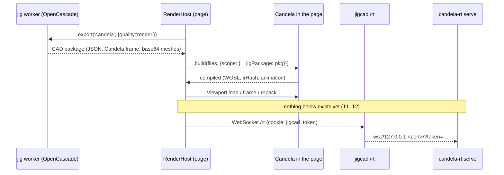

# Handoff: candela-rt for jig, what to build on the Spark and how

## 1. Where things stand

Candela, which was `wesen/2026-11-21--pbr-spark`, now lives in jig at `import/candela`, with its full history. The
old repository is archived. Two pull requests carry the work so far, stacked:

- **#5, JIG-016** (`jig-016-render`): jig renders its CAD models with Candela in the browser. The worker exports a
  **CAD package**, a bridge module turns it into a Candela scene, and a Render tab path-traces it with WebGPU or
  WebGL2. The same PR adds `jigcad serve`'s candela-rt **sidecar**: jigcad starts `candela-rt serve` on a localhost
  port, restarts it, and proxies its WebSocket at `/rt`.
- **#6, JIG-017** (`jig-017-candela`): the move. jig builds Candela's bundles from `import/candela`, Candela's tests
  run in jig's CI, `make candela-rt` builds the native renderer, and a GPU CI workflow waits for a runner.

What does not exist yet is the subject of this ticket. **jig's Render view never talks to candela-rt.** The sidecar
is supervised and proxied, but nothing in jig opens `/rt`, and candela-rt cannot receive a jig model in the form jig
has it. The work below closes that gap, then adds GPU render jobs, rendering on a remote GPU, and a release
package.

None of the native work in JIG-017 was compiled or run: the machine it was done on has no NVIDIA GPU. So the first
task (T0) is to check it on the Spark.

Background reading, in order of usefulness:

- `ttmp/2026/11/22/JIG-017-CANDELA…/design-doc/01-candela-inside-jig…`: Parts 2, 3 and 6 for jig, and Part 8 for the
  first design of what follows;
- `ttmp/2026/11/22/JIG-017-CANDELA…/reference/01-candela-rt-technical-map…`: candela-rt as it is, with line numbers;
- the vault report "jigcad: Rendering CAD with Candela …" for JIG-016 in depth.

Start from `jig-017-candela`, or from `main` once #5 and #6 are merged. Use this ticket (`docmgr`, `ttmp/…/JIG-018-RT…`)
for the diary and tasks.

## 2. How jig renders today, from candela-rt's point of view

You know candela-rt; this is the jig side it will meet.



The scene jig builds is not a preset. `RenderHost.build` (`import/jigcad/src/render/host.js:203`) makes this file
map and builds it with a **scope**:

```js
const files = {
  'jig-candela.js': LIB['jig-candela.js'],                 // the bridge: jigScene(pkg) → a Candela group
  'jig-program.js': 'export const program = __jigPackage;', // the package, injected, not serialized
  'scene.js': look,                                          // the project's look.js, or a default look
  /* …every other *.look.js file of the project, e.g. compur-poses.look.js */
};
const r = await this.C.build(files, { scope: { __jigPackage: this.pkg } });
```

`scope` is a `build()` option (Candela's `runFiles` makes each key an extra parameter of every module's function). A
package is megabytes of JSON for a large assembly. Without a scope it would have to become JavaScript source
(`export const program = {…}`) and be parsed again on every look edit. **candela-rt's `serve` has no scope today.**
Its `files` message passes `files` and `params` to `Candela.openRender`, and `openRender` calls `s.build(files)`
with no options (`import/candela/src/engine/headless.ts:89`).

Other RenderHost facts you will need:

| What | Where | Notes |
|---|---|---|
| Backend choice | `attach(canvas, { prefer })`, `host.js:132` | `'auto' \| 'webgpu' \| 'webgl2'`, stored in `localStorage['jig.render.backend']` |
| Frame loop | `loop()`, `host.js:159` | `requestAnimationFrame`; skips while loading or rendering a job |
| Rebuild triggers | `refresh()`, `host.js:178` | new package when the model changed, rebuild when the look changed |
| Clock | `setTime(t)`, `play()`, `host.js:282` | `repack(t)` on every change |
| Camera | `camera()`, `orbit()`, `freeCam` | `{ at, target }`, set with `vp.setView` |
| Live drag | `livePose(p)`, `host.js:262` | world matrices by component id, `vp.setPoses(map)` |
| Motion blur | `setMotion('look' \| 'off' \| '180')`, `host.js:275` | the 180° shutter at 24 fps overrides the look's |
| Render jobs | `renderJob(o)`, `host.js:291` | Candela's `runRender` on the page's viewport |
| Picking | `pick(nx, ny)`, `host.js:333` | `rayMesh` on the local build; stays local in every mode |

The view is `import/jigcad/src/ui/views/render.jsx`. It has a backend pill (line 75), the PNG and video job buttons
(86–87) and the `<canvas>` (107). `GET /api/render/capabilities` answers `{ rt, state, reason, restarts }`, with
`state` one of `off`, `starting`, `up` and `down`.

On authentication: `jigcad serve` binds `127.0.0.1` by default. On any other address it needs `--token`. Opening
`/?token=…` once sets the `jigcad_token` cookie, which the browser also sends with the `/rt` WebSocket, so the page
needs no token of its own. The proxy adds candela-rt's own random token (`pkg/render/proxy.go`).

## 3. Tasks

Each task lists its goal, the files involved, a sketch, and how to know it is done. They are in dependency order. T1
is needed by T2; T3, T4 and T5 can follow in any order. All code below is a sketch to adapt, not tested code.

### T0. candela-rt built from jig, and the GPU runner

The goal is to prove that JIG-017's untested native parts work on the Spark.

```sh
make web candela-rt                                    # OPTIX_DIR=… if the SDK is not under ~/opt
cd import/candela && ./build/rt/candela-rt digest --json build/rt-digest.json \
  && ESBUILD=../../.bin/esbuild/node_modules/esbuild/lib/main.js \
     node scripts/node-tests.mjs --run scripts/core-digest.ts -- --compare build/rt-digest.json
cd ../.. && make serve RENDER=import/candela/build/rt/candela-rt
curl -s http://127.0.0.1:8787/api/render/capabilities  # expect "state":"up"
```

Optionally, register the Spark as a self-hosted runner with the labels `self-hosted`, `linux` and `nvidia`. Then
set the repository variables `NVIDIA_RUNNER=true` and, if needed, `OPTIX_DIR`. `.github/workflows/candela-rt.yml`
then runs on every change to Candela, the build, `pkg/render` or the Makefile.

**Done when:** `make candela-rt` builds, the digest comparison prints `105/105 identical`, capabilities say `up`,
and (if registered) the workflow is green. Any fix to the CMake setup or the workflow belongs in this ticket.

### T1. candela-rt takes a scope

The goal is that `serve` can build exactly the scene jig builds.

**Engine** (`import/candela/src/engine/headless.ts`):

```ts
export interface HeadlessOptions { /* … */ scope?: Record<string, any>; }
export async function openRender(files: Record<string, string>, o: HeadlessOptions) {
  const s = new SceneSession({ seed: 0 });
  /* params as today */
  const r = await s.build(files, o.scope ? { scope: o.scope } : {});   // today: s.build(files)
  /* … */
}
```

`SceneSession.build(files, o)` (`session.ts:109`) already passes its options on to `build()`.

**serve** (`import/candela/native/rt/src/serve.cpp`):

- In the `files` handler (around line 141), also keep `msg.scope` as a persistent handle, next to `files_` and
  `params_`.
- In `rebuild()` (around line 197), set `opts.scope` from it before `Candela.openRender(files_, opts)`.
- Add a message `scope { scope }` that replaces the scope and rebuilds, so that a look edit can resend only `files`
  and a model change only `scope`.
- Update the protocol comment at the head of `serve.cpp`.

**Tests:**

- A Node test, e.g. `tests/headless-scope.test.ts` added to `scripts/node-tests.mjs`'s default list. It should call
  `openRender({ 'scene.js': "import { program } from 'p'; …", 'p.js': 'export const program = __x;' }, { width: 64,
  height: 64, scope: { __x: … } })`, check `ok` and the `irHash`, and check that a missing scope fails with an error
  rather than a crash.
- On the Spark, with a real jig package: export one from the workbench (the Render view's package is
  `renderHostOf(host).pkg`; `JSON.stringify` it from the console), send it as `scope`, and compare `built.irHash`
  with the browser's `digestString(result.compiled.shared)`.

**Done when:** a jig model (try `M-11-synchro-compur` and one assembly with a study) builds in candela-rt with the
same `irHash` as in the page.

### T2. The Render view's OptiX mode

The goal is that, when the sidecar is up, the Render view can show candela-rt's frames instead of the browser's.

**Client.** Add `import/jigcad/src/render/rt.js`, a port of Candela's `src/app/remote.ts` without React or
`localStorage`. The URL is the page's own origin:

```js
const rtUrl = () => `${location.protocol === 'https:' ? 'wss' : 'ws'}://${location.host}/rt`;
// RtClient: connect / hello / sendScene(files, scope, {time, seed}) / sendView / sendClock / close;
// state 'connecting' | 'building' | 'compiling' | 'live' | 'taken' | 'error'; frame header + JPEG object URL;
// reconnect every 2 s, like remote.ts
```

**RenderHost.** A third backend, `'optix'`, chosen in the backend control only when capabilities say `up`. In that
mode RenderHost:

- still builds locally on every refresh, because picking, the timeline, diagnostics and the hash check need the
  local `compiled`. It can skip `vp.load`, or keep a WebGL2 viewport for a fallback;
- sends `files` with `scope: { __jigPackage: pkg }` after each build, and records the local `irHash` for the
  mismatch check;
- sends `view` from `camera()` on every orbit, pan and zoom, at the view's size;
- sends `clock` from `setTime` and `play`;
- shows the newest frame in an `` over the canvas, and reports `spp`, fps and the GPU name in the toolbar.

```js
// sketch, inside RenderHost
async build(seq, look) {
  /* … as today, up to r = await this.C.build(files, { scope }) … */
  if (this.backend === 'optix') {
    this.rt.sendScene(files, { __jigPackage: this.pkg }, { time: this.time, seed: 0 });
    this.localHash = this.C.digestString(r.compiled.shared);
    this.status = 'ready'; this.emit(); return;           // no vp.load in this mode
  }
  /* … vp.load … */
}
```

`digestString` reaches the page already: jig's `src/render/candela.js` re-exports everything from `core.ts`.

**Live drag and motion blur** need two messages candela-rt does not have yet. Add them here, or fall back to a
rebuild on drag end:

- `poses { poses }` → `H.session.setPoses(map)` (or the HeadlessRender equivalent), then `epoch(true)`. Send it
  from `livePose(p)`, throttled.
- `motion { mode }` → the motion-blur override that `setMotion('180')` sets in the page.

**Tests:**

- Extend `import/jigcad/test/ui/render.cjs`. It drives Chromium on the GPU through Playwright; its header says how to
  run it, and on Linux Chromium needs `--enable-unsafe-webgpu --enable-features=Vulkan --use-angle=vulkan` for a GPU
  adapter. With `jigcad serve --render …candela-rt` running, it should switch to
  OptiX and wait for a frame. It should then check `built.ok`, a matching `irHash`, a non-blank image, a changing
  frame after an orbit, and that a timeline seek moves a part.
- A unit test of `rt.js` against a fake `WebSocket` class (no GPU), in `test/render/`.

**Done when:** the Render view on the Spark shows OptiX frames for M-11, orbit and play work, and the irHash check
agrees.

### T3. GPU render jobs

The goal is that the Render view's "PNG" and "video" buttons render on the GPU when the sidecar is up: NVENC MP4,
the AI denoiser, and full sample counts.

Recommended shape:

- In `serve`, a `job { id, kind: 'still' | 'sequence', width, height, spp, start?, end?, fps?, format, denoise? }`
  message. It renders with the current scene (files, scope, params, view) into
  `<jobs dir>/<id>/`, and reports `job { id, state: 'running', progress }`, then `job { id, state: 'done',
  files: [names] }` or `job { id, state: 'error', message }`. Add `cancel { id }`. The existing job loop in
  `main.cpp`'s `cmdRender` (line 318; `render <id> --sequence …`) is the code to reuse.
- jigcad passes `--jobs-dir <dir>` when it starts the child, and serves that directory read-only at
  `GET /api/render/jobs/<id>/<file>`, behind the same token. The page downloads from there. The WebSocket carries
  only progress.
- In RenderHost, `renderJob(o)` sends a `job` in OptiX mode and resolves with the downloaded files, so `render.jsx`
  stays as it is.

**Done when:** a 1920×1080 still at 256 spp and a 24 fps MP4 of M-11's timeline come back to the browser as
downloads.

### T4. A GPU on another machine

The goal is that `jigcad serve` on a laptop renders with the Spark's candela-rt.

- `--render ws://spark:8790` (any `ws://` or `wss://` URL) plus `--render-token T` (or `$JIGCAD_RENDER_TOKEN`).
- `pkg/render/find.go`: `Find` returns a URL mode.
- `pkg/render/render.go`: in that mode, `Sidecar.Run` starts no child. It probes the URL instead (a WebSocket
  `hello`), with the same states (`starting`, `up`, `down`) and backoff.
- `pkg/render/proxy.go`: the proxy targets the URL with `?token=T`.
- On the Spark: `candela-rt serve --bind 0.0.0.0 --port 8790 --token T`.

candela-rt has no TLS, and its token check is a substring test of the request URI. Before this mode is used beyond
a private network or an SSH tunnel (`ssh -L 8790:127.0.0.1:8790 spark`), make the token check exact. A V8 watchdog
(`isolate->TerminateExecution()` after a time budget) is also worth adding, because scene code is user code.

**Tests:** Go tests in `pkg/render` with an `httptest` WebSocket server for the probe and the proxy, plus a manual
run from a laptop.

### T5. A release package

The goal is that a user downloads `jigcad` and `candela-rt` and puts them side by side; `--render auto` already
looks next to `jigcad` (JIG-017).

- **No absolute build paths at run time.** candela-rt compiles in the kernels directory and the CUDA and OptiX
  include directories (`native/rt/CMakeLists.txt`), because NVRTC needs them for every new scene. Look next to the
  executable first instead:
  - `<exe dir>/kernels`;
  - `<exe dir>/candela-core.js` as the `--bundle` default;
  - `$OPTIX_INCLUDE_DIR` or the SDK default for OptiX headers.
- **Package it.** On version tags, `candela-rt.yml` packs `candela-rt`, `kernels/`, `candela-core.js` and a README
  into `candela-rt-linux-arm64.tar.gz` and attaches it to the GitHub release. That needs `contents: write` for that
  job.
- **Document the runtime requirements** the archive cannot carry: driver 580 or newer, CUDA 13 runtime libraries,
  `libnode` (Node 18), ffmpeg with NVENC, and the OptiX SDK 9.0 headers.

**Done when:** the tarball from a tag, unpacked next to a release `jigcad` on a clean Spark user account, gives
`state: up` and renders M-11.

## 4. Conventions

- **Diary.** Keep a diary in this ticket (`diary/01-diary.md`), one step per milestone, with the exact commands and
  any failure output. Check off tasks in `tasks.md` and add a changelog entry per merged piece.
- **Tests and commits.** `make test` must stay green on x86-64 CI. Candela's tests run in `make test-js`, and the
  golden baseline is per architecture: an intended output change needs `--update` on the Spark and on an x86-64
  machine.
- **Pull requests.** One PR per task, or one for T1+T2, against `main` once #5 and #6 have merged.
