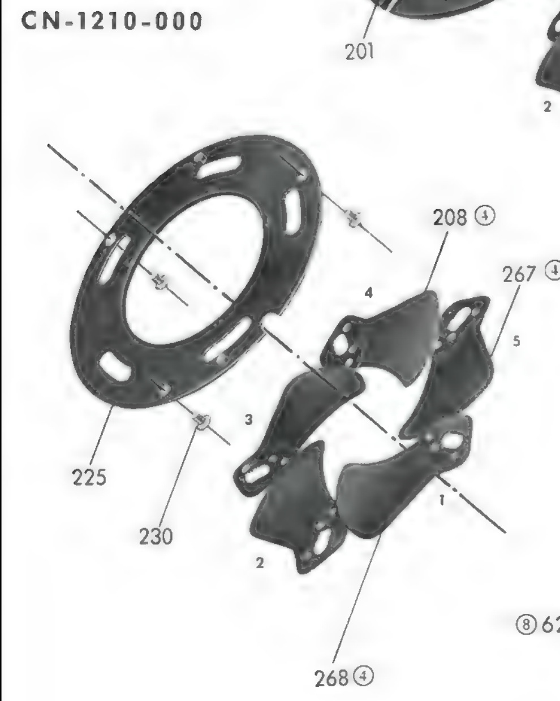
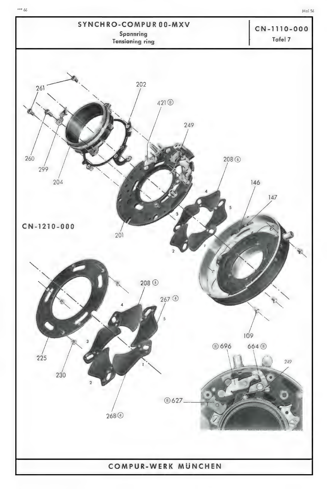
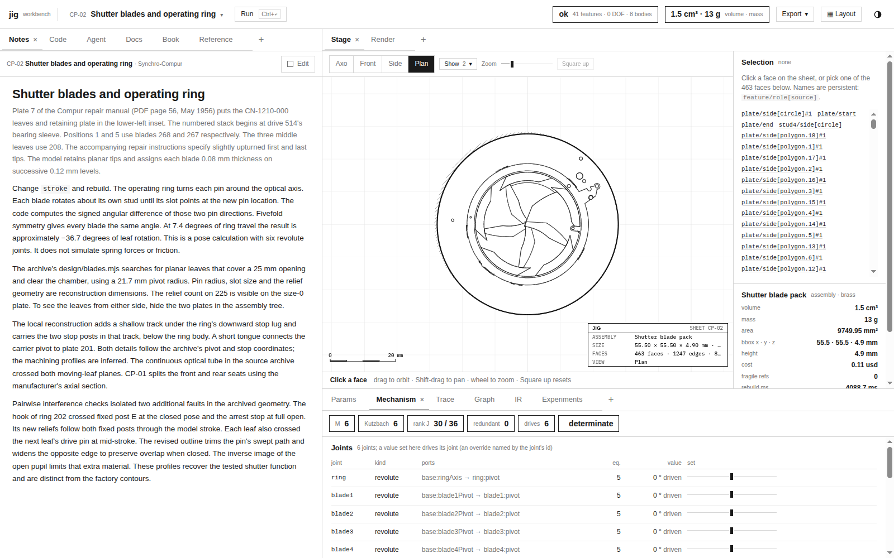
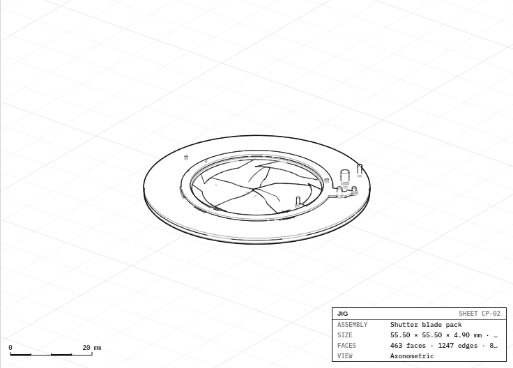

# Plate 7 catalog reconciliation

**CN-1210-000 blade inset: four of five distinct service identifiers have named CAD occurrences. Six of nine depicted physical pieces are represented.** This is a coverage count for the labeled size-0 inset on PDF p56, May 1956. It says nothing about dimensional interchangeability or the percentage complete for the whole shutter.

| Illustration number | Identity | Depicted quantity | CP-02 / M-11 occurrence | Result and limitation |
|---|---|---:|---|---|
| 225 | Blade mounting plate | 1 | bladePlate | Modeled with five arcuate openings and five stud holes. The screw seating geometry has not been established. |
| 230 | Fastening screw for 225 | 3 | none | Three screw symbols on three projection lines. The repair text instructs securing these screws with varnish. Head, thread, seat and length remain undimensioned here. |
| 268 | First blade | 1 | blade1 | Correct stack identity. Factory tip turns upward; modeled tip is flat. |
| 208 | Middle blades | 3 | blade2, blade3, blade4 | Positions 2–4 on the plate. Contours and axial spacing are reconstruction dimensions. |
| 267 | Last blade | 1 | blade5 | Correct stack identity. Factory tip turns upward; modeled tip is flat. |

To reproduce the CAD side, run `node <ticket>/scripts/05-count-plate-7.mjs` from the Jig repository root. It evaluates both entries using the part library packaged with each, reads the resulting occurrence names, and checks the blade order and counts. CP-02's other two occurrences are the base and the operating ring. M-11 reuses these same builders. Adding the two results would count the same design twice.

## Read the complete sheet

The full image contains 19 distinct three-digit leader identifiers. The table above accounts for five, including 208 which also appears in the upper illustration. The table below accounts for the other 14. The main heading reads **CN-1110-000**, size 00. The bottom-right mounted view revisits the base; its second 249 label depicts the same spring. In this table the quantity is a count or description of what is illustrated on this sheet. A shaft, screw or lever of similar function in a CAD study has been credited only when the identity can be traced. A standard-shutter order number includes additional digits and a change index.

| No. | Identification on sheet | Quantity evidence | CAD correspondence |
|---|---|---|---|
| 109 | Casing screws | Three symbols at the right-hand casing | No separate screws. The mounting thread on housing 101 is a different interface. |
| 146 | M/X click-stop spring | One strip | Absent. The flash contact blades in CP-06 perform different functions. |
| 147 | Rivet for the click-stop spring | One indicated | Absent. Shown in the size-00 area; independent size-0 stock applicability needs confirmation. |
| 201 | Mechanism base plate | One, with a mounted detail below | base in CP-02 and M-11. Its posts and stops are integrated features. |
| 202 | Blade operating ring | One | ring in CP-02 and M-11. Carries five modeled drive pins. |
| 204 | Front mounting tube | One | tube in CP-01 and M-11. External rear flange belongs to the housing in the reconstruction. |
| 249 | Ring closing spring | One spring, labeled twice | No named mechanical spring occurrence in M-11. A return force in the planar simulation supplies no CAD spring geometry. |
| 260 | Long stop screw | One indicated | Absent. Fastens stop 299 at 204. |
| 261 | Mounting-tube screws | Two indicated | Absent. Distinguish the third attachment, 260. |
| 299 | Stop against tube 204 | One | No identified 299 occurrence. CAD features stop1–3 on the base have other named roles. |
| 421 | V-detent lever riveted to base | One | No numbered member. CP-07 represents the local timer and describes the external latch. |
| 627 | M-anchor plate | One in mounted detail | No identified occurrence. A support called bridge in M-11 is 621. |
| 664 | M-detent lock | One in mounted detail | No identified occurrence. |
| 696 | M-cam check lever | One in mounted detail | No identified occurrence. A contact-closing lever alone cannot establish a match. |

The ordering instructions explain the notation: circled numbers refer to numbered supplement items; italic identifiers on assembled views repeat the exploded-view parts. The uncircled small numerals 1–5 at the blades indicate the fitting sequence. The repair instructions on PDF pp134–135 are particularly valuable for the end-blade difference, the purpose of the stop against 204, and the four levers/plates riveted to base 201. The earlier factory sheet supplies geometric identity; Honeywell's March 1967 tables 8-2 and 8-3 provide a separate check on terminology and type. The quantity column in the online OCR is unreliable. [Honeywell service instructions](https://www.scribd.com/document/586798459/Synchro-Compur-Service)

The factory September 1973 supplement sheet 10 lists 24 mm and 20 mm alternatives for CS-1210-275 and -276. A stock string containing 000 in that comparison table alone cannot certify its change index for a particular CN-1210-000. Consult the dated standard list and any substitution note before ordering. Use the broader catalog reconciliation for revision-specific evidence.

## CAD inspection

CP-02 at the home pose. The closed outlines establish that the correct assembly was open for the screenshot. The five named occurrences and blade identities were checked separately by script; a face count cannot establish the service sequence.

The exploded drawing establishes that three screws should exist. It does not establish thread diameter, pitch or the three bearing surfaces in machining coordinates. Adding three nominal screws without matching holes could increase the coverage count while introducing three collisions. The next supported modeling operation requires a fastener specification or specimen measurements of head diameter and profile, thread, length, seating side, and three center positions relative to the optical axis and the drive sleeve.
