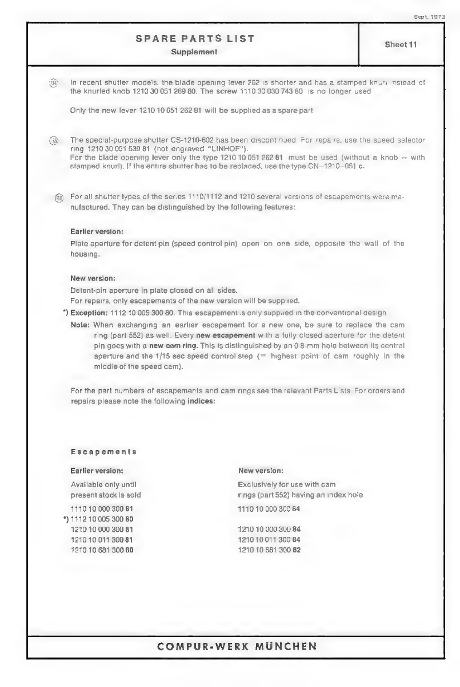
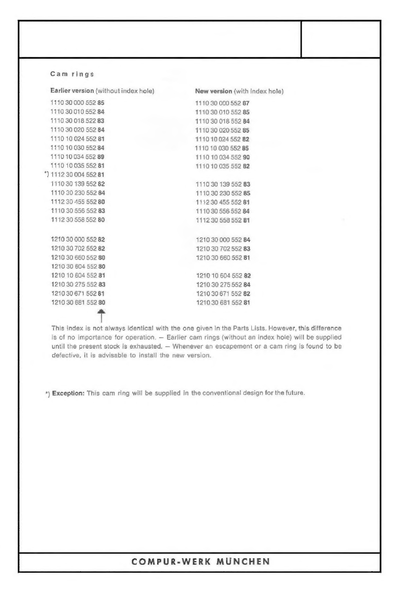

# The size-0 standard spare-parts list and the CAD assembly

## What the 75 rows count

Honeywell's March 1967 *Service Instructions for Synchro-Compur Shutter*, section 8-7, Table 8-3, provides a dated inventory headed 1210-000. The [inventory](../sources/catalog-standard-1210-000.tsv) records one row per listed stock entry, in printed sequence across both pages. It contains 75 rows and 74 distinct three-digit stock-number stems. Two different rivets share stem 623. The detent spring rivet's illustration number is indistinct in the transcription. Joining records by three-digit stock stem alone collapses these two objects. Section 8-6, Table 8-2, describes the smaller 1110-000. Section 8-8, Table 8-4, gives exceptions for individual cameras. [Honeywell service booklet, section 8](https://www.scribd.com/document/586798459/Synchro-Compur-Service)

The local factory manual supplies the size specification, numbered illustrations, repair instructions and stock substitutions. Its contents on PDF page 7 refer readers to a separate spare-parts binder. Honeywell's standard list establishes the row denominator here. The publicly readable copy exposes its text through OCR. Sixty-six historical stock numbers had legible numeric groups and are recorded as candidates. Nine have a question mark. The OCR also loses columns, particularly quantities on the first sheet. Twenty-three quantity fields have support from a legible count or the size-0 blade instructions. A question mark means unresolved. The quantities cannot yet support a total number of loose physical objects in a shutter.

The workbench has 19 standard rows with a counterpart in M-11. This includes the governor assembly, two integral features, and the two explicitly provisional assignments for the release and exposure control. Seven further rows have functional counterparts in the isolated diaphragm, flash or delay studies. For 49 rows the evidence examined here gives no CAD assignment. A family resemblance to a post, spring or generic screw is insufficient to identify one. The five physical exposure leaves account for three catalog rows. Conversely, the entire governor is one catalog row with several moving bodies in M-11. Dividing a workbench occurrence count by 75 would therefore give an invalid coverage measure.

## Interpreting the inventory

The last two fields record the 1967 stock candidate and quantity. A historical number whose prefix begins with 1110 can be genuine in a size-0 shutter. Honeywell lists shared parts under their existing numbers. Nine suspect readings have been withheld, including the ambiguous last digits of 208, 230 and 621. Even a clean OCR digit can be wrong. Use a legible original table before ordering.

The CAD column identifies the strongest traceable correspondence. M11 refers to the factories in `import/jigcad/content/presets/M-11-synchro-compur/compur.parts.js`. CP06–CP08 refer to the flash, delay and diaphragm part modules and the evidence notes beside them. The preset factories locate modeled solids. Their coordinates do not establish measured values for a particular specimen.

|Illustrated system|Available relationship and inspection point|
|---|---|
|Front controls, factory plate 1, PDF p. 50|539, 540, 547 and 552 correspond to the setting ring, front cover, modeled integral retainer and speed cam. Factory p. 132 describes adjustment of 547 followed by securing it with 538. The separate retaining screw has no assigned occurrence.|
|Cocking and release, plates 2–3, pp. 51–52|514, 517 and 528 appear as the drive, pinion and cocking ring. Page 133 specifies how to index the first tooth and identifies different timing adjustments. A shared center distance alone cannot identify the correct version or angular setting.|
|Mode selection and flash, plate 4, p. 53|The CP-06 strips and levers permit functional comparisons with 604, 612 and 615. The external conductors and M delay system need their own registration. Page 135 places 696, 627, 664 and 421 on 201 with riveted attachments and gives a cocked contact gap of at least 0.5 mm.|
|Speed governor, plate 5, p. 54|300 is a service assembly. M-11 represents its train with multiple bodies. The factory mentions 301, 319 and 341 in adjustment procedures. These are examples of physical details outside the 75-row count. Page 133 specifies engagement of one-third to one-half of tooth height and a speed adjustment about screw 304. Neither rule determines all arbor heights.|
|Delayed action, plate 6, p. 55|CP-07 isolates the functional cartridge corresponding to 400. Factory p. 134 gives a run-down interval of 8–10 s. The preset is static and its internal hardware does not establish the canister attachment 416, the external detent 421 or adjustable eccentric 298.|
|Blade mechanism, plate 7, p. 56|The size-0 detail shows 225 and the five fitting positions. Factory p. 134 identifies first leaf 268 and last leaf 267 with their bent tips. The three intermediate leaves are 208. The modeled tip bends are flat approximations.|
|Housing and diaphragm, plate 8, p. 57|105, 106 and 116 have CP-08 study geometry. The parent housing is 101. The iris operating ring 108, its guidance and its setting linkage still require identification and placement.|

Pages 50–57 carry CN-1110-000 headings. The repair instructions on PDF pp. 132–135 explicitly cover both CN-1110-000 and CN-1210-000. Plate 7 includes a separate size-0 blade inset. Treat the remaining illustrations as guides to mechanism identity and assembly order. A length taken from the 00 illustration requires independent size-0 evidence.

The size-0 inset depicts one support plate 225 and three screws 230. Those are depicted instance counts. The 1967 quantity cells for both remain unresolved in the OCR. See the [plate 7 evidence](02-plate-7-catalog-reconciliation.md) and the [governor fit and cartridge registration analysis](03-fit-wheel-and-cartridge-registration.md).

## How a later stock number changes the model

The replacement supplements add compatibility requirements. PDF page numbers below count from the first file page. The archive member `synchro-compur-sources/uploads/compur_shutter_repair_manual_text.pdf` and the Downloads copy with spaces in its name both have SHA-256 `db1d863563785d14278b7a668ff3c538b276bfe81f8a2ff1c831931b02eadb81`.

|PDF pages|Stock selection and physical consequence|
|---|---|
|234–235|421 (1210 20 000 421 80) requires bush 1110 40 000 670 83. Lock 664 (1210 20 000 664 81) requires pivot 1210 40 000 699 80. Size-0 spring 521 has indices 80 and 81, distinguished by the location of the ring's spring anchorage relative to the teeth.|
|242|A base with bearing bushes takes 1210 10 000 514 86 and 1210 10 000 517 81. The shaft-mounted alternative uses 514 index 87 and 517 index 82. The alternative drive has a groove in the upper face of the bushing. The same table includes 011-family options; their presence does not establish an idler gear in the standard 000 inventory.|
|248–249|The material of lever 696 determines the compatible setting ring. Standard ring 1210 10 000 148 82 goes with metal, index 83 with plastic. A top-view tracing of ring diameter cannot identify this pair.|
|251|The supplements distinguish 24 mm and 20 mm versions in specific CS-1210-275/276 shutters. They assign different stock numbers to 106, 116, 208, 225, 267 and 268. The 24 mm group includes 1210 10 000 225 80. The 20 mm group includes 1210 10 275 225 80. PDF p. 42 links these camera-specific shutters to the 1210-000 standard.|
|253–254|The earlier 1210 10 000 300 81 has a detent-pin opening open on one side. Replacement 1210 10 000 300 84 encloses the opening. Its mating speed cam has a 0.8 mm index hole close to the 1/15 step. The supplement pairs the 000-series 552 indices 82 and 84 with the earlier and later configurations respectively. Honeywell's earlier booklet prints index 81 for 552. Record the edition with the stock number.|
|256–257|Plain and enameled 105 leaves carry indices 86 and 88 respectively in the 1210 10 000 family. A replacement 101 housing of index 88 has extra diaphragm space. The instruction specifies five enameled leaves when replacing a housing fitted with plain leaves. The named 277/278 housings have a separate exception.|

## Reproducing and extending the reconciliation

1. Use the camera and lens identification on factory p. 42, or the relevant manufacturer's table, to record the CS code, serial range and base CN family. If the physical shutter has no traceable identity, keep its revision field open.
2. Look up a callout in the applicable CS list before using a CN default. Inspect the supplement reference and retain the full stock number, quantity, publication and page. For the historical distributor entry, keep the OCR candidate until an image of the table resolves the digits.
3. Find supplement passages with `python3 scripts/catalog-locate.py '/path/to/manual.pdf'` from the ticket directory. The script preserves page boundaries. Render the governor and cam evidence with `bash scripts/catalog-render-evidence.sh '/path/to/manual.pdf'`.
4. Inspect the factory and add the CAD association at the appropriate level. A separately mounted retainer needs its own occurrence to test installation and end play. A retainer fused into a cover can document its envelope. Store a measured transform, tolerances and observable version features for the intended specimen before promoting a correspondence to a dimensional match.
