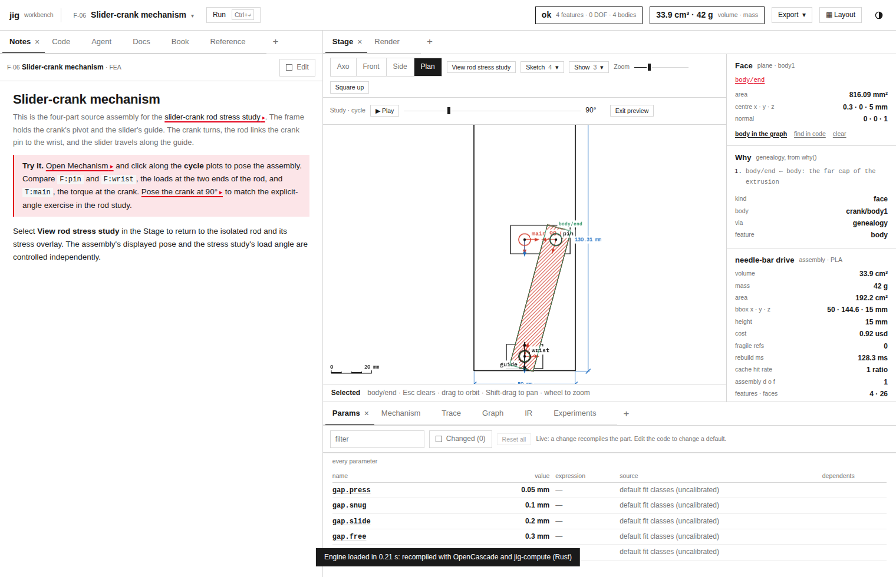
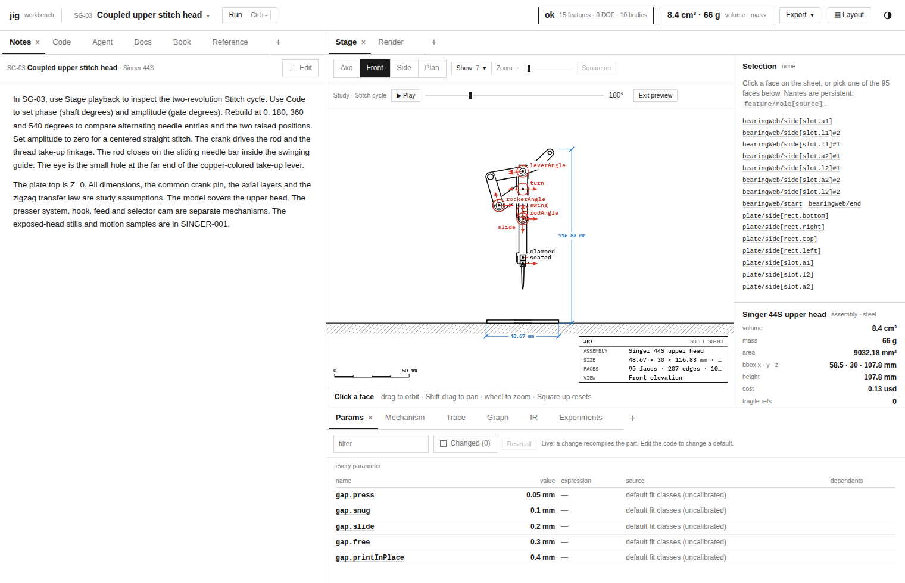
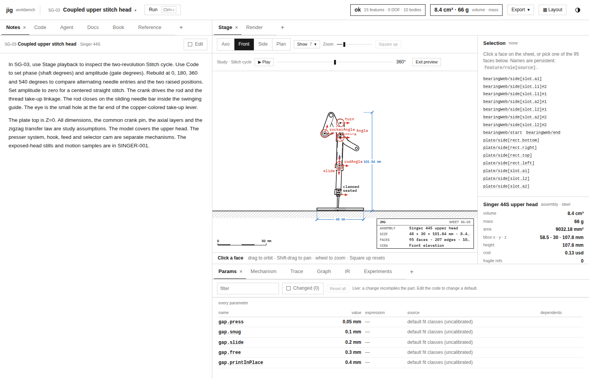

# Play motion studies in the CAD Stage

The [design proposal](design-doc/01-cad-stage-playback-for-motion-studies-and-phase-driven-mechanisms.md) specifies read-only playback of solved mechanism poses in the drafting Stage. F-06 is the native-study acceptance fixture. SINGER-001 supplies a second fixture for coordinated, phase-driven motion. Implementation and verification are recorded in the [diary](diary/02-stage-playback-implementation-diary.md).

## Verified Stage views

Open F-06 or SG-03, select Stage and press **Play**. Pause to orbit the mechanism. The study slider and arrow keys select solved samples. Exit preview restores the compiled pose. The screenshots below were captured in the browser while the study was paused.

| F-06 crank at 90° | Singer at 0° | Singer at 180° | Singer at 360° |
|---|---|---|---|
|  |  |  |  |

The ticket scripts independently check worker-buffer ownership, Singer trajectory agreement and interactive behavior. The browser check verifies picking, replay without worker calls, a descending study, a limit gap, failed compilation and a delayed response after switching presets.
