# Source frames and upper head geometry

## Goal

<!-- What is the purpose of this reference document? -->

## Context

<!-- Provide background context needed to use this reference -->

## Quick Reference

<!-- Provide copy/paste-ready content, API contracts, or quick-look tables -->

## Usage Examples

<!-- Show how to use this reference in practice -->

## Related

<!-- Link to related documents or resources -->

# Evidence for the upper stitch head

These images retain the original framing. The extraction script records each archive member and seek time. The photographs contain no calibrated scale in the linkage plane. They establish the order of the links, the needle guide and the shape of the eye. Hidden pin centers, shaft phase and lengths in the model are hypotheses.

| Original view | Feature used |
|---|---|
| 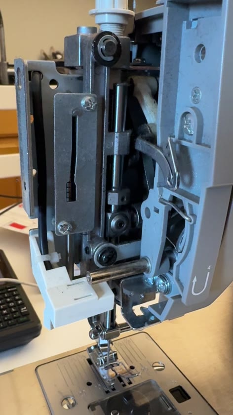 | Short clip, 3 s. The needle and upper lever share one head above the plate. |
| 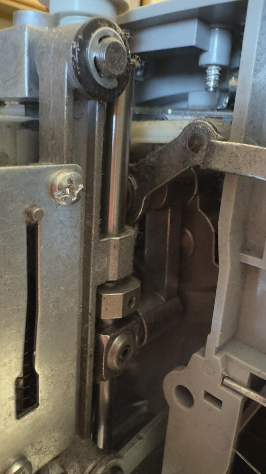 | Photo at 1:24:39. The thread eye extends beyond the articulated end of the lever. |
| 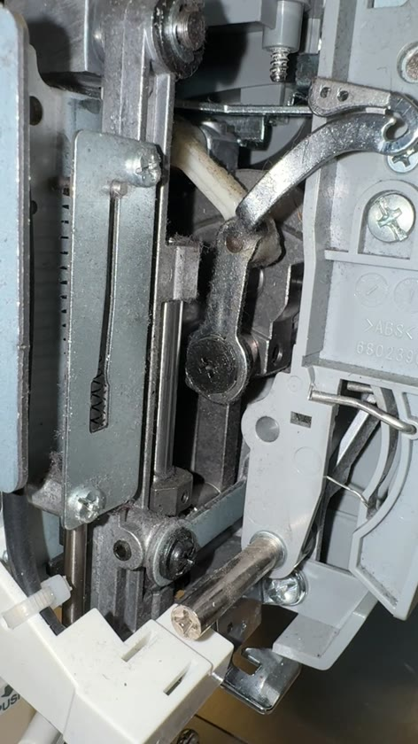 | Long clip, 2 s. Use the visible joints to identify the moving link. |
| 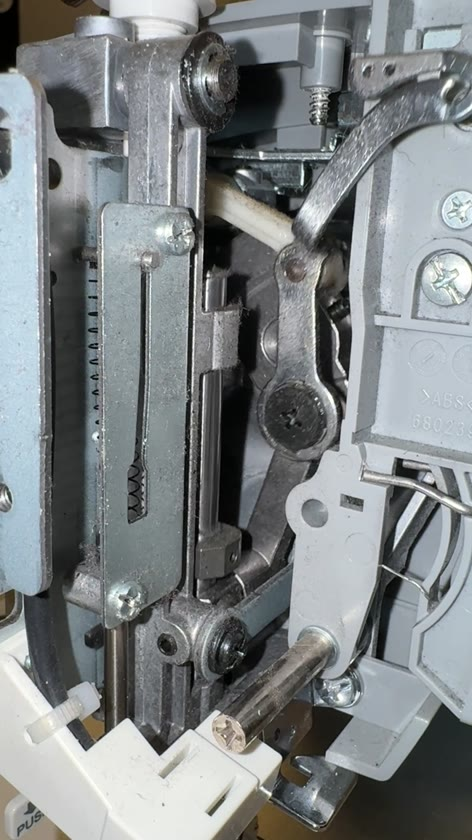 | Long clip, 8 s. Compare the lever orientation with the earlier pose. Camera position can change between frames. |
| 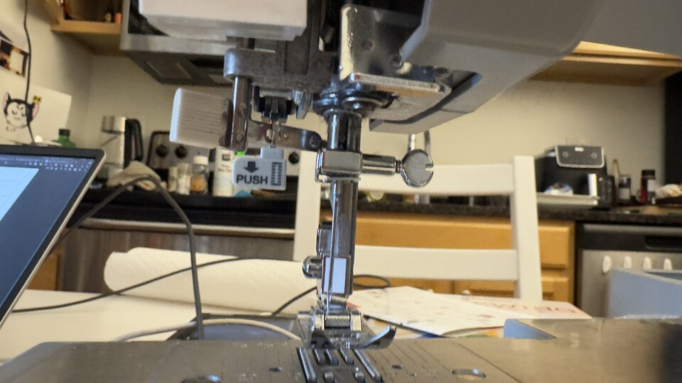 | Photo at 1:23:39. The plate surface and centered needle define the height and lateral references. |
| 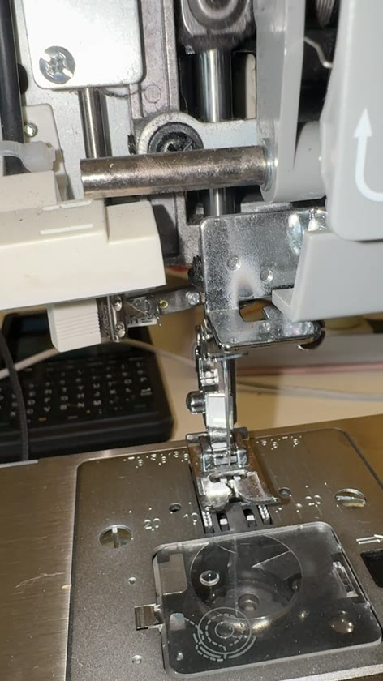 | Long clip, 25 s. The foot and needle project below the exposed head. |

Singer lists the take-up lever as 416543101 and its supporter as 416147701. The family drawing establishes separate components. Its exploded spacing supplies no assembled depth measurement. [Singer parts list](https://site.singeronline.com/ssl/instructions/Sgr_4411_4423_4432_4452_44S_5511_5523_5532.pdf)

## Compare the source with the CAD

| Needle drive | Swinging guide | Combined head |
|---|---|---|
| 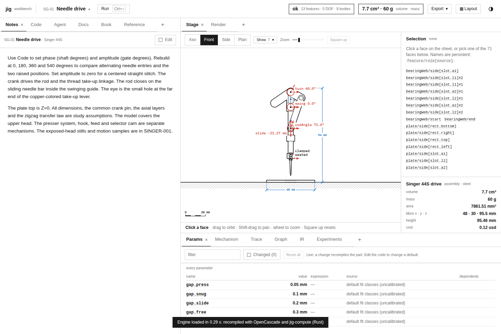 | 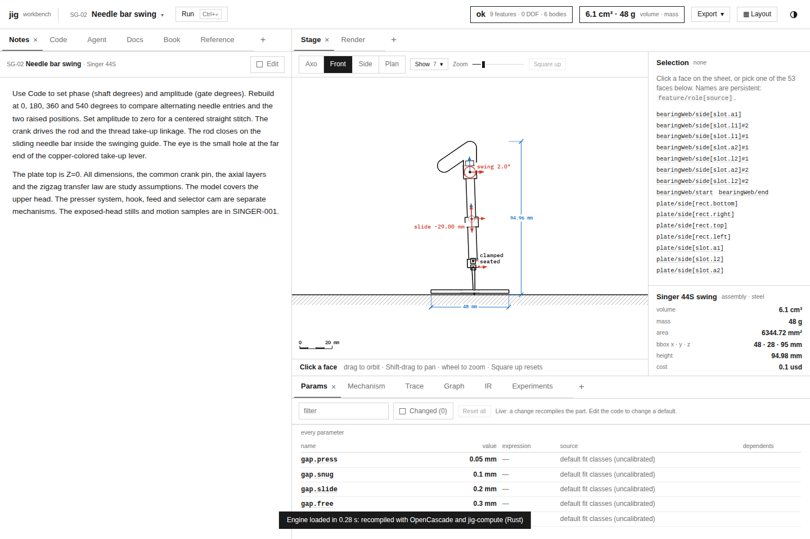 | 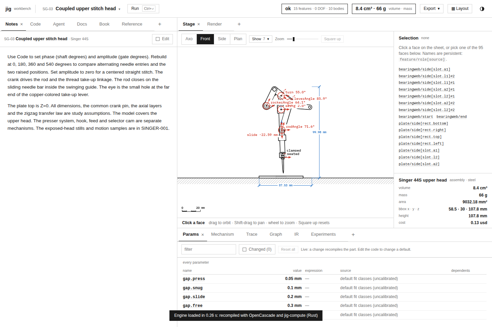 |

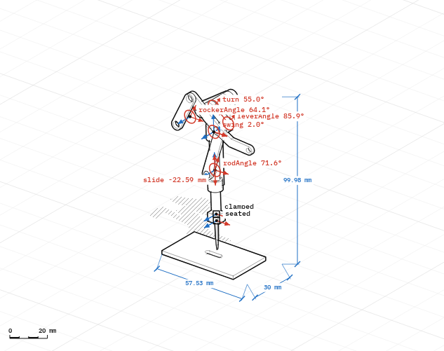

A single shaft angle sets the crank position. The connecting rod has a fixed 32 mm center distance. Its intersection with the tilted gate axis sets the bar height. The study assumes a shared crank pin for the take-up linkage, a 22 mm lever pin spacing and a 20 mm supporter. The resulting eye trajectory is sensitive to the fixed supporter position and eye offset. All of these dimensions require specimen verification.

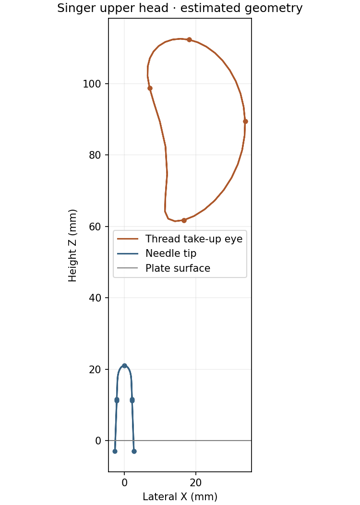

The [world-coordinate samples](../sources/upper-head-cycle.tsv) cover 0–720 degrees at 10-degree intervals. At 0 and 360 degrees the tip is approximately 2.96 mm below the plate with lateral positions of +2.65 and −2.65 mm. At 180 degrees it is centered and 21 mm above the plate. For the sampled submerged tip positions the checker verifies the lateral coordinate against the opening. Full solid interference, thread loop capture, thread tension and fabric transport remain outside this check.

To reproduce, build with make web, run the ticket scripts 02 and 04 from the repository root, then run script 03 against the local Jig server. Script 01 independently regenerates the source stills from the archive.
