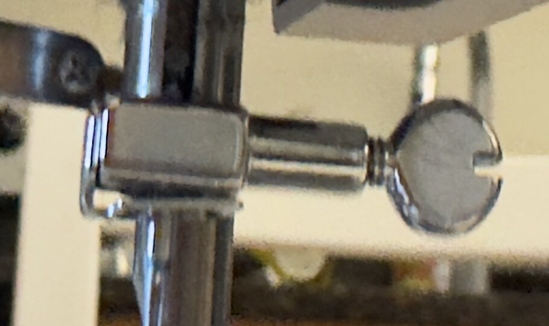
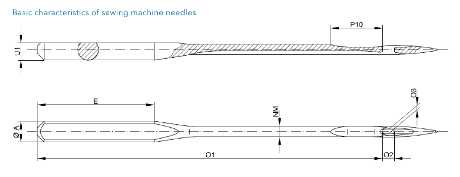
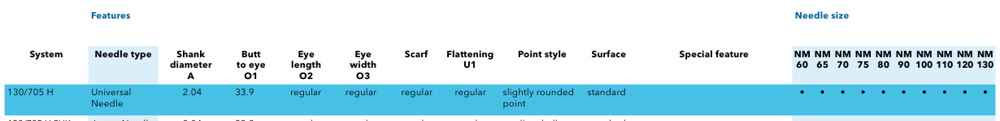

# Needle holder and swinging guide reconstruction

## Identifying the installed components

The front cap is off in the source photographs. The right-hand screw on the lower needle bar has a narrow cylindrical neck and a flat thumb paddle. A notch opens from the outer rim. The collar wraps the lower end of the needle bar. The sewing needle below it and the presser shank behind it occupy different depths. The crop comes from the original photograph at 1:23:39, using the optical orientation stored in the file.

| Workbench occurrence | Singer family plate E position | Basis and limits |
|---|---|---|
| gate | 1 | The catalog shows alternate supporters with and without the automatic threader. The study models the shared guide and pivot arrangement. The casting ribs, line-bored sleeves and front opening are estimated. |
| gatePin | 7 | The catalog separates the support pin from the casting. The pin sits behind the needle bar in the reconstruction. Journal diameter, shoulders and depth require measurement. |
| bar | 18 | Polished sliding bar with a reduced collar seat and an axial socket for the needle. The service manual identifies the bar height as an adjustment. The preset retains the previously studied clamp datum. |
| clamp, clampScrew | 19, 20 | The parts list assigns both positions the same order string. The drawing and the picture identify separate pieces. Both are selectable. Thread geometry and actual locking contact have yet to be measured. |
| driveBracket | 50 | The bracket complete carries the connection to the drive rod. The study combines its collar, arm and drive journal. The ring, bracket halves and locking screw remain below this assembly boundary. |
| needle | 35 | The family position identifies the needle. The actual make, gauge and point of the pictured needle are undetermined. SG-04 uses a representative universal NM90. |

The applicable family catalog explicitly includes 44S. Its exploded plate describes part identities and arrangement. The 44S owner instructions specify inserting the needle with the shank flat facing the rear. The manual's operational fit check to the hook needs the hook installed and timed. [Singer family parts list, plate E, PDF pp. 10–11](https://site.singeronline.com/ssl/instructions/Sgr_4411_4423_4432_4452_44S_5511_5523_5532.pdf)

## Needle dimensions and orientation

Schmetz identifies the diameter of its 130/705 H shank as 2.04 mm and its butt-to-eye dimension O1 as 33.9 mm. The dimension terminates at the upper edge of the eye. The selected size NM90 gives a 0.90 mm blade. The coordinates in the part place the tip at local Z = −17 mm to preserve the existing CAD needle path, the eye's upper edge at −12 mm, and the butt at +21.9 mm. The assumed 0.30 mm wide slotted eye traverses the blade front to back. A front groove approaches it along the blade. The rear scarf removes material above the eye on the hook side. The actual eye size, profile, insertion height and scarf have yet to be measured. [Schmetz dimensional drawing and universal needle table](https://www.schmetz.com/mm/media/web/7_tochtergesellschaften/bilder_18/schmetz/pdfs_4/datenblaetter/gegenueberstellung/Schmetz_DB_Gegenueberstellung_EN.pdf) · [Schmetz needle size and anatomy](https://www.schmetzneedles.com/pages/needle-guide)

## Inspecting the interfaces

SG-04 uses the same bar, drive bracket, clamp, screw and needle as SG-03. Change spread to zero to fit the components. SG-05 isolates the support, headed pin, bar and drive bracket. Its exploded view draws the pin out along its own journal axis and the shaft aside for inspecting the two guides.

Run scripts/08-check-needle-hardware.mjs with Node from the repository root. The script verifies a through aperture and both walls in the exact needle solid, probes the rear shank flat, and measures common volume for ten selected fitted pairs. Each fitted pair must stay below 0.00001 mm³. It also checks the gate against the bar, bracket, clamp and support pin every 30° through the full SG-03 cycle. This tests 100 moving pairs. It leaves the operator's screw torque, plate-to-hook clearance and axial retention for specimen inspection.

Two exact-solid results changed the casting. Initially the rib intruded 4.476805 mm³ into the guide bore at the SG-05 fitted pose. A continuous line bore relieved that intrusion. A subsequent motion test found 0.971255 mm³ of overlap with the drive bracket at shaft angle 180°. Moving the rib shoulder up the casting cleared the bracket at the inspected phases.
