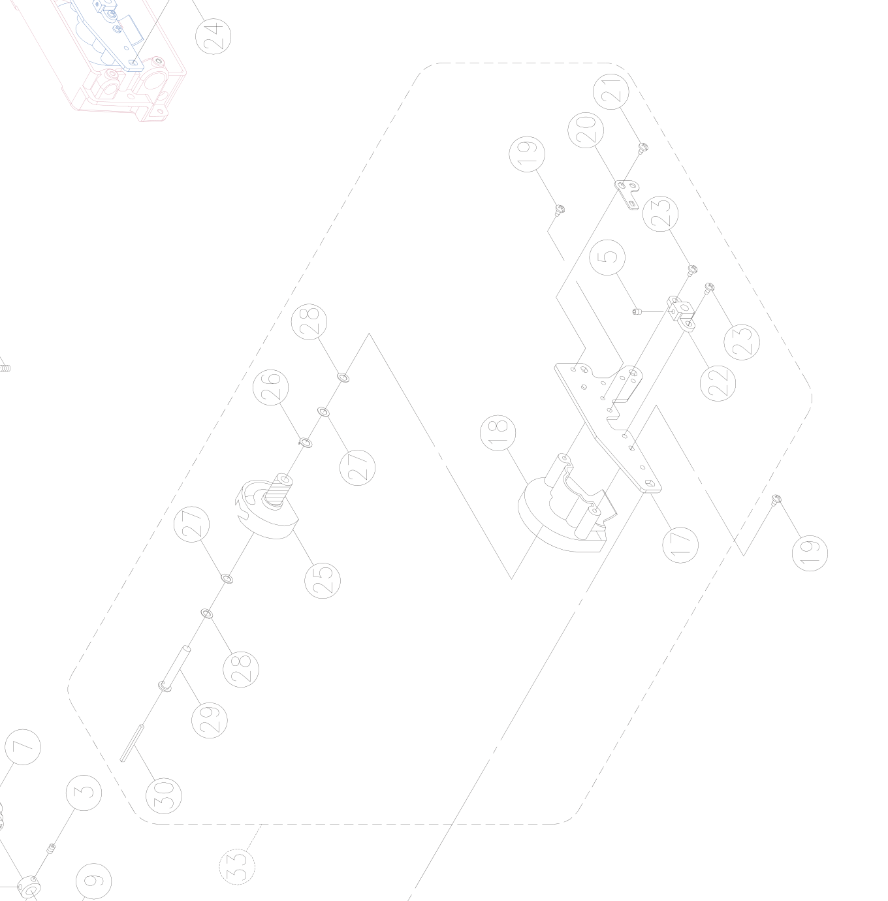
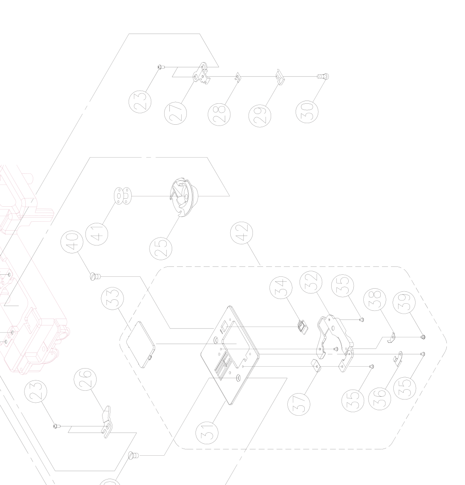
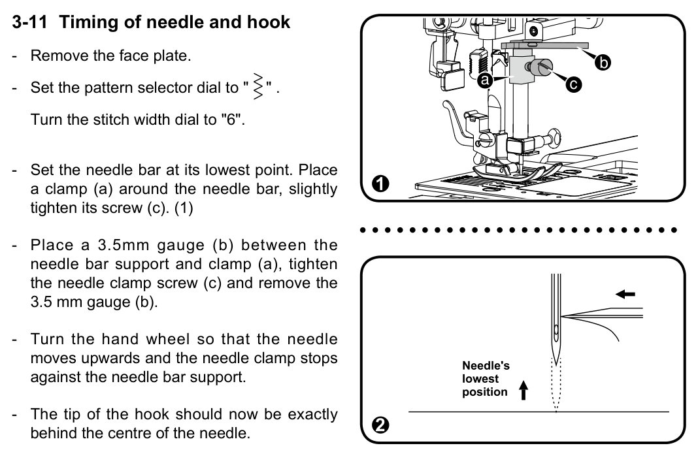
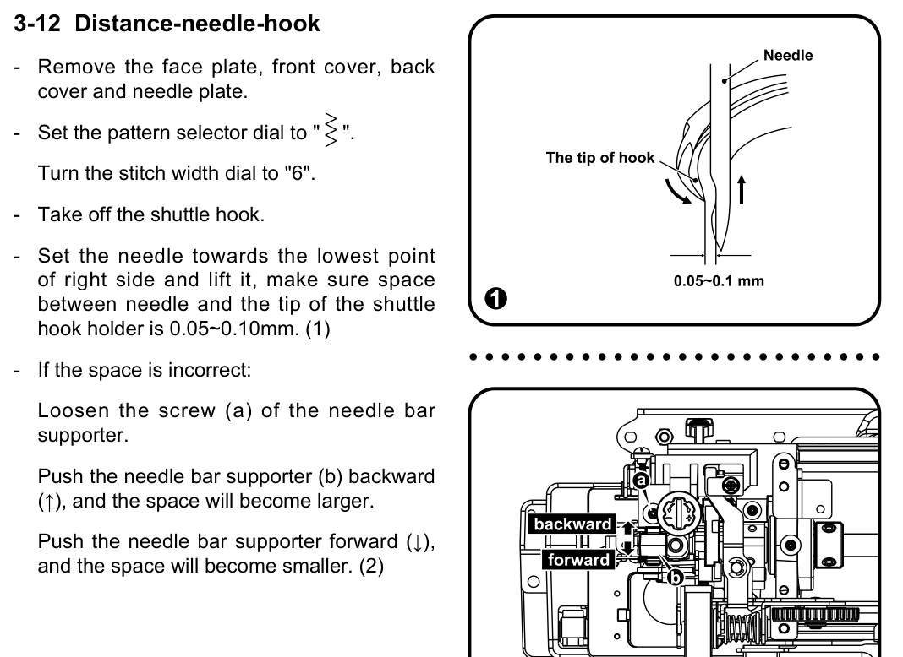

# Hook assembly identification and service timing

Singer identifies the 44S in the family parts book 104 23 62-96 of 18 August 2014 and service manual 104 73 14-26 of 8 November 2022. The parts book identifies the pieces on the lower shaft and in the bed. The service manual relates the hook point to the needle at particular settings. The 44S owner's instructions resolve the bobbin variant. The three documents supply different kinds of evidence. [Family parts book](https://site.singeronline.com/ssl/instructions/Sgr_4411_4423_4432_4452_44S_5511_5523_5532.pdf) · [Local source-page index and input checksums](../sources/figure-index.tsv)

## Lower assembly identification

The catalog's plate G (pp. 14–15) shows the lower shaft, its drive gear and the vertically mounted hook group. The outline numbered 33 contains the holder and its mounting parts. Plate M (pp. 26–27) shows the removable case, bobbin and retaining plates above the drive. Positions repeat between plates, so both the letter and the number belong in each part reference.

| Plate and position | Singer catalog identifier | Interpretation |
|---|---|---|
| G1, G4 | 416731301, 416197201 | Lower shaft and lower shaft gear. The service procedure adjusts relative hook timing at the gear. |
| G17, G22 | 270 H1A0383006, 416143401 | Rotary hook holder and supporter, the mounting group around the driven part. |
| G25 | 416479801 | Shuttle hook holder. The hook point examined in the clearance test remains in the machine when the removable case is taken out. |
| G29 | 416145401 | Bobbin shaft. The drawing separately calls out washers and seals. |
| G33 | 416467101 | Complete rotary hook holder, a group designation in plate G. |
| M25 | 270 Q6A0764000 | Shuttle hook complete, the removable bobbin-case assembly in plate M. |
| M26, M27 | 416144001, 416143901 | Two retaining plates around the removable assembly. Springs are also listed separately by position. |
| M31 | 416735301 | Needle plate. M42 denotes the larger plate assembly. |
| M41 | 270 006084009 | Plastic bobbin. The book gives another M41 number, 416735501. The 44S-specific instructions select the transparent Class 15 bobbin. |





Compare the [G list](../sources/G-holder-table.png) and [M list](../sources/M-bobbin-table.png) with the [44S bobbin specification](../sources/44S-bobbin-class.png). Singer's consumer identification guide gives approximately 21 mm diameter and 12 mm axial height for the transparent Class 15 bobbin, with flat flanges. Those rounded nominal dimensions apply to the bobbin envelope. Flange thickness, hub bore, case wall, gear ratio and tooth form need independent evidence. [Singer bobbin identification guide](https://ukhelp.singer.com/en-US/how-do-i-choose-the-right-singer-bobbin-590473)

## Three distinct service checks

| Service check | Setup and datum | Specified observation |
|---|---|---|
| 3-10, printed p. 15, PDF p. 16 | Width 0, needle bar bottomed. Plate and removable shuttle out. | 28.5 mm between the upper end of the needle and hook-ring surface d. This locates a ring-height reference. |
| 3-11, printed p. 16, PDF p. 17 | Zigzag, width 6. Clamp the bottomed bar with a 3.5 mm gauge, remove gauge, turn forward until the clamp reaches the support. | At 3.5 mm of bar rise the point is directly behind the needle center. Figure 2 shows the point approaching from the reader's right, above the eye. Neither the text nor the figure assigns a lateral penetration side or a numerical eye-to-point height. |
| 3-12, printed p. 17, PDF p. 18 | Zigzag, width 6. Remove the shuttle, approach the bottom of the **right** penetration and raise the needle. | Needle-to-holder-point separation 0.05–0.10 mm. It is adjusted in the front/back direction. This procedure names the side and does not independently specify 3.5 mm rise. |





A model can choose the right penetration for its inspection frame and impose the specified rise from its local bottom position. The corresponding shaft angle is derived from its own linkage dimensions. The midpoint gap 0.075 mm is a design choice within the specified interval. The signed height of the point relative to the eye belongs to the estimated geometry until an independent measurement supplies it. If a display combines these three quantities, each needs its own evidence label. Use the [factory ring-height figure](../sources/3-10-ring-height.png) to check that an axial placement uses the intended datum.

## Regenerating the figures

Run the ticket's extraction script with Python and PyMuPDF. It verifies the three source hashes before cropping the specified page rectangles. The figure index uses one-based PDF pages and crop coordinates in points from the page's upper left. The captured figures preserve the source text, linework and callouts. No dimension is inferred from their display scale.

```sh
python3 scripts/01-extract-hook-evidence.py \
  --catalog /path/to/Sgr_4411_4423_4432_4452_44S_5511_5523_5532.pdf \
  --service ~/Downloads/singer-ServicemanualHD.pdf \
  --owner ~/Downloads/44S_EN-instruction.pdf
```
